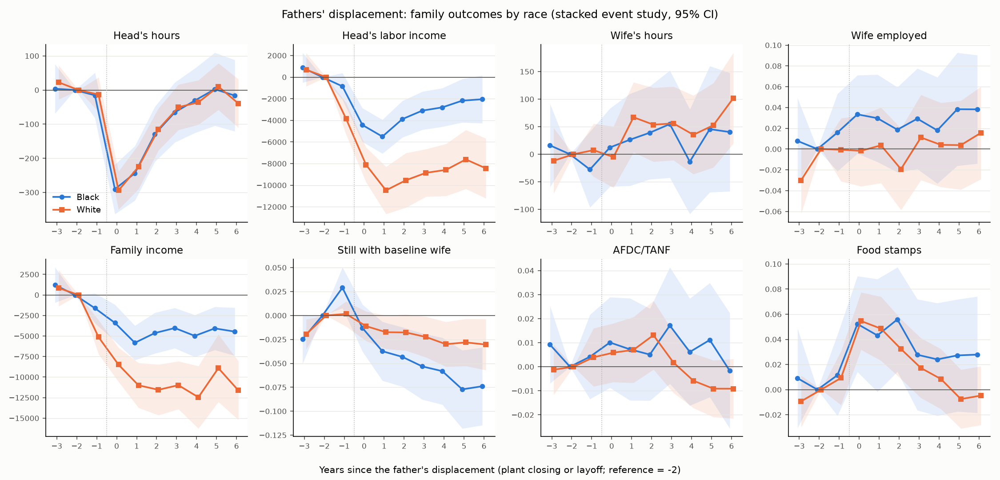

# Fathers' displacement in the PSID: the family's response and children's outcomes

Built by `19.FatherDisplacement.py` (2026-10-17); variable list per wave in its docstring. Unweighted PSID SRC + SEO, Black and White (head's race). S.e. clustered by 1968 family (fam68); *** p<0.01, ** p<0.05, * p<0.1. **Displacement (main)** = the head reports that his job ended because the company folded / moved / went out of business (closure) or he was laid off / fired; closures only = strict; quits = placebo. The event study compares displaced fathers with not-yet-displaced and never-displaced fathers; the child regressions are selection-on-observables comparisons. Neither identifies a causal effect without the usual assumptions (no selection into layoffs on trends or on unobserved family traits); the mediation section is descriptive.

## 1. The displacement measure

Annual rate: share of male heads aged 20-60 with positive hours in the previous observed year who report a job end of each kind dated to that (observed) calendar year.

| | Main (closure or layoff) | Closure | Layoff / fired | Quit | Zero hours | Head-years |
|---|---|---|---|---|---|---|
| 1967-79, Black | 0.0703 | 0.0210 | 0.0547 | 0.0703 | 0.0245 | 10,370 |
| 1967-79, White | 0.0394 | 0.0142 | 0.0277 | 0.0749 | 0.0095 | 23,851 |
| 1980-89, Black | 0.1020 | 0.0236 | 0.0818 | 0.0936 | 0.0375 | 10,754 |
| 1980-89, White | 0.0599 | 0.0190 | 0.0433 | 0.1021 | 0.0122 | 25,291 |
| 1990-99, Black | 0.0704 | 0.0179 | 0.0541 | 0.1015 | 0.0378 | 8,341 |
| 1990-99, White | 0.0468 | 0.0131 | 0.0346 | 0.1026 | 0.0137 | 21,440 |
| 2000-09, Black | 0.0716 | 0.0160 | 0.0565 | 0.1072 | 0.0556 | 4,498 |
| 2000-09, White | 0.0468 | 0.0128 | 0.0341 | 0.1129 | 0.0207 | 12,391 |
| 2010-22, Black | 0.0776 | 0.0179 | 0.0613 | 0.1246 | 0.0739 | 7,672 |
| 2010-22, White | 0.0455 | 0.0115 | 0.0345 | 0.1070 | 0.0307 | 15,133 |
| All years, Black | 0.0800 | 0.0199 | 0.0630 | 0.0966 | 0.0430 | 41,635 |
| All years, White | 0.0482 | 0.0146 | 0.0351 | 0.0977 | 0.0158 | 98,106 |

Main displacements (male heads, all years): 12,447 man-years (3,269 closures, 9,487 layoffs/firings; quits 22,563). Main reports by branch: E 5,816, J1 1,413, J2 2,456, J3 587, J4 132, R 118, U 3,297, U2 214. Share dated by a reported end year: 0.753. The head's annual hours are zero in the displacement year for 0.011 and in the next year for 0.060 of main displacements; 0.117 of main displacements have a zero-hours year within -1..+2 years, and 0.136 of zero-hours events have a main displacement within +-1 year. Coverage gaps: calendar 1997 and 1999 after the spring interview are reached only through the U-branch end years of the 1999 / 2001 waves (no 1998 / 2000 interview), so displacements then are undercounted; 1968-1983 E-branch reports have no end year and are dated to the year before the interview.

## 2. Family event study

Stacked event study (Cengiz et al. 2019): for each calendar year, fathers first displaced that year (main definition) vs clean controls (no displacement up to the event year + 6); all are male heads with a child 0-17 in the family unit and positive hours at baseline (the latest of event year -2, -1). Outcomes refer to calendar years (PSID income year = interview year - 1), event time -3..+6, reference e = -2; regressors = displaced x event-time dummies, with father x stack and calendar year x stack fixed effects. Hours and income (2000 dollars) in levels; wife's outcomes for the wife present at baseline while she is still in the family unit; 'Still with baseline wife' = 1 while she is his wife (its fall = separation, divorce or her death). AFDC/TANF = head or wife received; food stamps = family received (last year). After 1996 outcomes are observed every other year. A pre-displacement dip at e = -1 in the head's earnings is the usual Jacobson-LaLonde-Sullivan pattern (and partly dating error: undated reports are put in the year before the interview).

### 2a. Pooled and by race

| | Head's hours | Head's labor income | Wife's hours | Wife employed | Family income | Still with baseline wife | AFDC/TANF | Food stamps |
|---|---|---|---|---|---|---|---|---|
| **All fathers** | | | | | | | | |
| e=-3 | 15 (21; p=0.480) | 907 (571; p=0.112) | -6 (24; p=0.806) | -0.017 (0.013; p=0.193) | 1,101 (833; p=0.186) | -0.024*** (0.007; p=<0.001) | 0.002 (0.005; p=0.602) | -0.003 (0.010; p=0.769) |
| e=-1 | -15 (21; p=0.477) | -2,821*** (521; p=<0.001) | -6 (20; p=0.760) | 0.005 (0.012; p=0.658) | -3,924*** (746; p=<0.001) | 0.012** (0.006; p=0.039) | 0.004 (0.005; p=0.442) | 0.010 (0.009; p=0.306) |
| e=+0 | -298*** (23; p=<0.001) | -6,938*** (599; p=<0.001) | 4 (22; p=0.864) | 0.012 (0.013; p=0.361) | -6,783*** (797; p=<0.001) | -0.013* (0.007; p=0.052) | 0.007 (0.005; p=0.166) | 0.053*** (0.010; p=<0.001) |
| e=+1 | -238*** (26; p=<0.001) | -8,966*** (767; p=<0.001) | 54** (26; p=0.036) | 0.013 (0.014; p=0.355) | -9,447*** (969; p=<0.001) | -0.027*** (0.008; p=<0.001) | 0.007 (0.006; p=0.247) | 0.046*** (0.012; p=<0.001) |
| e=+2 | -130*** (25; p=<0.001) | -7,868*** (884; p=<0.001) | 47* (27; p=0.080) | -0.007 (0.015; p=0.654) | -9,491*** (1,110; p=<0.001) | -0.030*** (0.008; p=<0.001) | 0.010* (0.006; p=0.092) | 0.041*** (0.011; p=<0.001) |
| e=+3 | -66** (27; p=0.015) | -7,276*** (811; p=<0.001) | 53* (28; p=0.058) | 0.016 (0.016; p=0.312) | -9,097*** (1,075; p=<0.001) | -0.037*** (0.009; p=<0.001) | 0.007 (0.006; p=0.228) | 0.021* (0.011; p=0.063) |
| e=+4 | -46* (27; p=0.095) | -7,044*** (876; p=<0.001) | 13 (29; p=0.661) | 0.006 (0.016; p=0.701) | -10,530*** (1,345; p=<0.001) | -0.044*** (0.010; p=<0.001) | -0.002 (0.006; p=0.753) | 0.013 (0.011; p=0.247) |
| e=+5 | -5 (30; p=0.865) | -6,340*** (996; p=<0.001) | 43 (32; p=0.185) | 0.012 (0.017; p=0.483) | -8,109*** (1,460; p=<0.001) | -0.049*** (0.011; p=<0.001) | -0.002 (0.006; p=0.695) | 0.005 (0.011; p=0.690) |
| e=+6 | -45 (30; p=0.134) | -6,830*** (1,027; p=<0.001) | 71** (33; p=0.033) | 0.019 (0.017; p=0.279) | -10,042*** (1,321; p=<0.001) | -0.050*** (0.012; p=<0.001) | -0.007 (0.006; p=0.256) | 0.006 (0.011; p=0.593) |
| mean +1..+3 | -145*** (22; p=<0.001) | -8,037*** (748; p=<0.001) | 51** (23; p=0.029) | 0.008 (0.013; p=0.565) | -9,345*** (960; p=<0.001) | -0.031*** (0.008; p=<0.001) | 0.008 (0.005; p=0.102) | 0.036*** (0.010; p=<0.001) |
| Treated mean at e = -2, -1 | 2,111 | 34,097 | 973 | 0.699 | 49,740 | 0.989 | 0.031 | 0.133 |
| N (man-years, stacked) | 413,933 | 413,935 | 386,254 | 386,254 | 413,935 | 404,234 | 395,716 | 403,923 |
| Displaced fathers / control father-stacks | 2,417 / 63,669 | 2,417 / 63,669 | 2,295 / 61,958 | 2,295 / 61,958 | 2,417 / 63,669 | 2,295 / 61,958 | 2,413 / 63,126 | 2,416 / 63,641 |
| Clusters (fam68) | 2,714 | 2,714 | 2,696 | 2,696 | 2,714 | 2,696 | 2,713 | 2,710 |
| **Black fathers** | | | | | | | | |
| e=-3 | 4 (37; p=0.919) | 877 (706; p=0.214) | 16 (39; p=0.677) | 0.008 (0.021; p=0.710) | 1,220 (1,098; p=0.266) | -0.025* (0.013; p=0.058) | 0.009 (0.008; p=0.263) | 0.009 (0.020; p=0.651) |
| e=-1 | -16 (34; p=0.646) | -853 (630; p=0.176) | -28 (35; p=0.429) | 0.016 (0.019; p=0.403) | -1,616* (932; p=0.083) | 0.029*** (0.011; p=0.008) | 0.004 (0.009; p=0.644) | 0.012 (0.016; p=0.485) |
| e=+0 | -291*** (37; p=<0.001) | -4,426*** (796; p=<0.001) | 12 (36; p=0.734) | 0.033* (0.019; p=0.082) | -3,398*** (1,135; p=0.003) | -0.013 (0.013; p=0.300) | 0.010 (0.010; p=0.293) | 0.052*** (0.019; p=0.007) |
| e=+1 | -244*** (41; p=<0.001) | -5,500*** (799; p=<0.001) | 26 (43; p=0.537) | 0.030 (0.021; p=0.166) | -5,827*** (1,069; p=<0.001) | -0.037** (0.016; p=0.017) | 0.007 (0.011; p=0.504) | 0.043* (0.023; p=0.060) |
| e=+2 | -129*** (41; p=0.002) | -3,882*** (863; p=<0.001) | 39 (43; p=0.364) | 0.019 (0.021; p=0.371) | -4,640*** (1,264; p=<0.001) | -0.043*** (0.016; p=0.006) | 0.005 (0.010; p=0.604) | 0.056*** (0.021; p=0.008) |
| e=+3 | -65 (45; p=0.145) | -3,099*** (900; p=<0.001) | 55 (50; p=0.271) | 0.029 (0.025; p=0.236) | -4,031*** (1,252; p=0.001) | -0.053*** (0.018; p=0.003) | 0.017 (0.012; p=0.165) | 0.028 (0.023; p=0.218) |
| e=+4 | -31 (48; p=0.521) | -2,797*** (911; p=0.002) | -13 (48; p=0.782) | 0.018 (0.026; p=0.490) | -4,984*** (1,302; p=<0.001) | -0.058*** (0.018; p=0.001) | 0.006 (0.011; p=0.589) | 0.024 (0.023; p=0.292) |
| e=+5 | 2 (55; p=0.965) | -2,177** (1,027; p=0.034) | 46 (58; p=0.435) | 0.038 (0.028; p=0.167) | -4,071*** (1,340; p=0.002) | -0.077*** (0.021; p=<0.001) | 0.011 (0.012; p=0.358) | 0.027 (0.023; p=0.231) |
| e=+6 | -16 (53; p=0.760) | -2,047* (1,130; p=0.070) | 40 (55; p=0.463) | 0.038 (0.027; p=0.151) | -4,464*** (1,491; p=0.003) | -0.074*** (0.021; p=<0.001) | -0.002 (0.012; p=0.891) | 0.028 (0.024; p=0.238) |
| mean +1..+3 | -146*** (35; p=<0.001) | -4,160*** (757; p=<0.001) | 40 (38; p=0.298) | 0.026 (0.019; p=0.168) | -4,832*** (1,082; p=<0.001) | -0.045*** (0.015; p=0.003) | 0.010 (0.009; p=0.259) | 0.042** (0.019; p=0.023) |
| Treated mean at e = -2, -1 | 1,987 | 24,934 | 1,082 | 0.720 | 38,685 | 0.983 | 0.042 | 0.195 |
| N (man-years, stacked) | 111,752 | 111,752 | 100,925 | 100,925 | 111,752 | 107,047 | 107,449 | 108,781 |
| Displaced fathers / control father-stacks | 989 / 17,746 | 989 / 17,746 | 909 / 16,927 | 909 / 16,927 | 989 / 17,746 | 909 / 16,927 | 988 / 17,591 | 989 / 17,726 |
| Clusters (fam68) | 1,009 | 1,009 | 995 | 995 | 1,009 | 995 | 1,006 | 1,005 |
| **White fathers** | | | | | | | | |
| e=-3 | 23 (25; p=0.377) | 688 (787; p=0.382) | -12 (30; p=0.697) | -0.030* (0.017; p=0.069) | 843 (1,128; p=0.455) | -0.020** (0.008; p=0.013) | -0.001 (0.005; p=0.817) | -0.009 (0.010; p=0.375) |
| e=-1 | -13 (26; p=0.607) | -3,834*** (750; p=<0.001) | 7 (25; p=0.763) | -0.001 (0.015; p=0.966) | -5,131*** (1,062; p=<0.001) | 0.002 (0.007; p=0.805) | 0.004 (0.006; p=0.524) | 0.009 (0.011; p=0.397) |
| e=+0 | -294*** (28; p=<0.001) | -8,104*** (822; p=<0.001) | -5 (28; p=0.856) | -0.002 (0.017; p=0.923) | -8,490*** (1,058; p=<0.001) | -0.011 (0.008; p=0.159) | 0.006 (0.006; p=0.347) | 0.055*** (0.012; p=<0.001) |
| e=+1 | -225*** (33; p=<0.001) | -10,474*** (1,114; p=<0.001) | 67** (32; p=0.038) | 0.004 (0.019; p=0.845) | -11,001*** (1,395; p=<0.001) | -0.017* (0.009; p=0.050) | 0.007 (0.007; p=0.315) | 0.049*** (0.013; p=<0.001) |
| e=+2 | -115*** (31; p=<0.001) | -9,540*** (1,288; p=<0.001) | 54 (34; p=0.117) | -0.019 (0.020; p=0.335) | -11,551*** (1,574; p=<0.001) | -0.018* (0.010; p=0.066) | 0.013* (0.007; p=0.072) | 0.032*** (0.012; p=0.008) |
| e=+3 | -50 (34; p=0.139) | -8,854*** (1,124; p=<0.001) | 56 (34; p=0.100) | 0.011 (0.021; p=0.595) | -10,986*** (1,489; p=<0.001) | -0.022** (0.011; p=0.038) | 0.002 (0.006; p=0.782) | 0.017 (0.012; p=0.156) |
| e=+4 | -36 (33; p=0.274) | -8,583*** (1,229; p=<0.001) | 35 (36; p=0.333) | 0.004 (0.021; p=0.845) | -12,458*** (1,941; p=<0.001) | -0.030** (0.012; p=0.012) | -0.006 (0.006; p=0.315) | 0.008 (0.012; p=0.485) |
| e=+5 | 10 (35; p=0.770) | -7,613*** (1,392; p=<0.001) | 53 (39; p=0.177) | 0.004 (0.022; p=0.862) | -8,910*** (2,097; p=<0.001) | -0.028** (0.013; p=0.025) | -0.009 (0.006; p=0.130) | -0.008 (0.012; p=0.530) |
| e=+6 | -39 (36; p=0.279) | -8,436*** (1,413; p=<0.001) | 102** (42; p=0.015) | 0.016 (0.023; p=0.493) | -11,625*** (1,821; p=<0.001) | -0.030** (0.014; p=0.026) | -0.009 (0.006; p=0.148) | -0.005 (0.012; p=0.693) |
| mean +1..+3 | -130*** (28; p=<0.001) | -9,622*** (1,071; p=<0.001) | 59** (30; p=0.048) | -0.002 (0.018; p=0.931) | -11,179*** (1,353; p=<0.001) | -0.019** (0.009; p=0.035) | 0.007 (0.006; p=0.216) | 0.033*** (0.010; p=0.002) |
| Treated mean at e = -2, -1 | 2,194 | 40,186 | 904 | 0.686 | 57,085 | 0.992 | 0.024 | 0.091 |
| N (man-years, stacked) | 302,181 | 302,183 | 285,329 | 285,329 | 302,183 | 297,187 | 288,267 | 295,142 |
| Displaced fathers / control father-stacks | 1,428 / 45,923 | 1,428 / 45,923 | 1,386 / 45,031 | 1,386 / 45,031 | 1,428 / 45,923 | 1,386 / 45,031 | 1,425 / 45,535 | 1,427 / 45,915 |
| Clusters (fam68) | 1,817 | 1,817 | 1,807 | 1,807 | 1,817 | 1,807 | 1,811 | 1,817 |
| Fixed effects | father x stack, calendar year x stack | father x stack, calendar year x stack | father x stack, calendar year x stack | father x stack, calendar year x stack | father x stack, calendar year x stack | father x stack, calendar year x stack | father x stack, calendar year x stack | father x stack, calendar year x stack |

### 2b. By the youngest child's age and the wife's work at baseline

| | Head's hours | Head's labor income | Wife's hours | Wife employed | Family income | Still with baseline wife | AFDC/TANF | Food stamps |
|---|---|---|---|---|---|---|---|---|
| **All: youngest child 0-5** | | | | | | | | |
| e=-1 | -47* (27; p=0.085) | -2,379*** (639; p=<0.001) | 23 (27; p=0.404) | 0.032* (0.017; p=0.062) | -3,146*** (842; p=<0.001) | 0.020** (0.008; p=0.013) | 0.004 (0.007; p=0.580) | 0.014 (0.013; p=0.303) |
| e=+1 | -251*** (34; p=<0.001) | -8,683*** (1,000; p=<0.001) | 114*** (34; p=<0.001) | 0.049** (0.020; p=0.015) | -8,753*** (1,141; p=<0.001) | -0.023** (0.011; p=0.031) | 0.011 (0.008; p=0.158) | 0.051*** (0.016; p=0.002) |
| e=+2 | -134*** (33; p=<0.001) | -7,256*** (1,202; p=<0.001) | 114*** (35; p=0.001) | 0.029 (0.021; p=0.162) | -7,983*** (1,338; p=<0.001) | -0.028** (0.011; p=0.012) | 0.010 (0.008; p=0.178) | 0.042*** (0.015; p=0.007) |
| e=+3 | -90** (36; p=0.012) | -7,262*** (999; p=<0.001) | 108*** (38; p=0.004) | 0.046** (0.022; p=0.040) | -7,419*** (1,269; p=<0.001) | -0.039*** (0.012; p=0.002) | 0.016* (0.009; p=0.072) | 0.023 (0.016; p=0.149) |
| mean +1..+3 | -158*** (29; p=<0.001) | -7,733*** (976; p=<0.001) | 112*** (31; p=<0.001) | 0.041** (0.018; p=0.025) | -8,052*** (1,127; p=<0.001) | -0.030*** (0.010; p=0.004) | 0.012* (0.007; p=0.056) | 0.039*** (0.013; p=0.003) |
| Treated mean at e = -2, -1 | 2,082 | 30,168 | 859 | 0.664 | 42,723 | 0.987 | 0.036 | 0.161 |
| N (man-years, stacked) | 206,378 | 206,378 | 193,277 | 193,277 | 206,378 | 203,488 | 197,202 | 201,532 |
| Displaced fathers / control father-stacks | 1,481 / 31,782 | 1,481 / 31,782 | 1,415 / 31,252 | 1,415 / 31,252 | 1,481 / 31,782 | 1,415 / 31,252 | 1,477 / 31,521 | 1,480 / 31,760 |
| Clusters (fam68) | 2,354 | 2,354 | 2,344 | 2,344 | 2,354 | 2,344 | 2,351 | 2,352 |
| **All: youngest child 6-17** | | | | | | | | |
| e=-1 | 32 (29; p=0.268) | -3,761*** (889; p=<0.001) | -32 (31; p=0.302) | -0.028* (0.016; p=0.086) | -5,029*** (1,374; p=<0.001) | -0.001 (0.009; p=0.888) | 0.004 (0.007; p=0.524) | 0.004 (0.013; p=0.767) |
| e=+1 | -237*** (39; p=<0.001) | -10,306*** (1,188; p=<0.001) | -20 (39; p=0.610) | -0.032* (0.019; p=0.097) | -10,796*** (1,643; p=<0.001) | -0.032*** (0.012; p=0.008) | 0.001 (0.009; p=0.918) | 0.038** (0.016; p=0.017) |
| e=+2 | -149*** (39; p=<0.001) | -10,029*** (1,293; p=<0.001) | -41 (41; p=0.316) | -0.055*** (0.021; p=0.008) | -12,262*** (1,859; p=<0.001) | -0.030** (0.013; p=0.019) | 0.009 (0.009; p=0.298) | 0.040*** (0.015; p=0.010) |
| e=+3 | -59 (42; p=0.159) | -8,722*** (1,260; p=<0.001) | -16 (42; p=0.694) | -0.026 (0.022; p=0.235) | -12,245*** (1,778; p=<0.001) | -0.029** (0.014; p=0.038) | -0.006 (0.008; p=0.481) | 0.018 (0.016; p=0.248) |
| mean +1..+3 | -149*** (34; p=<0.001) | -9,686*** (1,118; p=<0.001) | -26 (36; p=0.474) | -0.038** (0.018; p=0.036) | -11,768*** (1,600; p=<0.001) | -0.030** (0.012; p=0.013) | 0.002 (0.008; p=0.841) | 0.032** (0.014; p=0.018) |
| Treated mean at e = -2, -1 | 2,158 | 40,214 | 1,153 | 0.755 | 60,663 | 0.991 | 0.024 | 0.089 |
| N (man-years, stacked) | 207,555 | 207,557 | 192,977 | 192,977 | 207,557 | 200,746 | 198,514 | 202,391 |
| Displaced fathers / control father-stacks | 936 / 31,887 | 936 / 31,887 | 880 / 30,706 | 880 / 30,706 | 936 / 31,887 | 880 / 30,706 | 936 / 31,605 | 936 / 31,881 |
| Clusters (fam68) | 2,300 | 2,300 | 2,269 | 2,269 | 2,300 | 2,269 | 2,299 | 2,298 |
| **All: wife employed at baseline** | | | | | | | | |
| e=-1 | -20 (24; p=0.403) | -2,527*** (638; p=<0.001) | -2 (26; p=0.947) | 0.022* (0.011; p=0.057) | -3,722*** (845; p=<0.001) | 0.004 (0.007; p=0.554) | -0.001 (0.006; p=0.895) | 0.008 (0.011; p=0.473) |
| e=+1 | -223*** (30; p=<0.001) | -8,440*** (950; p=<0.001) | 34 (32; p=0.287) | 0.002 (0.014; p=0.900) | -9,336*** (1,130; p=<0.001) | -0.033*** (0.010; p=<0.001) | -0.001 (0.006; p=0.899) | 0.033** (0.013; p=0.013) |
| e=+2 | -140*** (29; p=<0.001) | -7,441*** (1,113; p=<0.001) | 17 (33; p=0.600) | -0.021 (0.015; p=0.170) | -9,226*** (1,345; p=<0.001) | -0.036*** (0.010; p=<0.001) | 0.004 (0.006; p=0.514) | 0.040*** (0.013; p=0.002) |
| e=+3 | -65** (32; p=0.041) | -7,064*** (951; p=<0.001) | 32 (35; p=0.356) | 0.002 (0.017; p=0.913) | -8,965*** (1,221; p=<0.001) | -0.039*** (0.011; p=<0.001) | 0.002 (0.007; p=0.741) | 0.025* (0.013; p=0.056) |
| mean +1..+3 | -143*** (25; p=<0.001) | -7,648*** (914; p=<0.001) | 28 (29; p=0.338) | -0.006 (0.013; p=0.657) | -9,176*** (1,108; p=<0.001) | -0.036*** (0.010; p=<0.001) | 0.002 (0.005; p=0.722) | 0.033*** (0.011; p=0.003) |
| Treated mean at e = -2, -1 | 2,113 | 33,979 | 1,353 | 0.950 | 54,075 | 0.990 | 0.022 | 0.110 |
| N (man-years, stacked) | 283,098 | 283,100 | 269,961 | 269,961 | 283,100 | 283,100 | 267,347 | 278,017 |
| Displaced fathers / control father-stacks | 1,638 / 45,159 | 1,638 / 45,159 | 1,638 / 45,159 | 1,638 / 45,159 | 1,638 / 45,159 | 1,638 / 45,159 | 1,635 / 44,683 | 1,638 / 45,146 |
| Clusters (fam68) | 2,414 | 2,414 | 2,414 | 2,414 | 2,414 | 2,414 | 2,413 | 2,412 |
| **All: wife present, not employed at baseline** | | | | | | | | |
| e=-1 | -43 (38; p=0.259) | -4,128*** (1,059; p=<0.001) | -23 (27; p=0.389) | -0.049** (0.024; p=0.039) | -4,675*** (1,665; p=0.005) | 0.031*** (0.011; p=0.005) | 0.020* (0.011; p=0.066) | 0.018 (0.018; p=0.319) |
| e=+1 | -305*** (50; p=<0.001) | -11,031*** (1,400; p=<0.001) | 97** (40; p=0.014) | 0.037 (0.031; p=0.242) | -10,343*** (1,902; p=<0.001) | -0.013 (0.014; p=0.363) | 0.023* (0.014; p=0.090) | 0.076*** (0.024; p=0.001) |
| e=+2 | -151*** (51; p=0.003) | -9,865*** (1,550; p=<0.001) | 117*** (43; p=0.006) | 0.029 (0.031; p=0.347) | -10,797*** (2,098; p=<0.001) | -0.015 (0.014; p=0.306) | 0.020* (0.012; p=0.090) | 0.051** (0.022; p=0.022) |
| e=+3 | -110** (53; p=0.039) | -8,737*** (1,596; p=<0.001) | 103** (45; p=0.024) | 0.052 (0.033; p=0.120) | -9,967*** (2,198; p=<0.001) | -0.029* (0.016; p=0.068) | 0.018 (0.013; p=0.168) | 0.016 (0.023; p=0.498) |
| mean +1..+3 | -189*** (44; p=<0.001) | -9,878*** (1,380; p=<0.001) | 105*** (37; p=0.004) | 0.039 (0.028; p=0.162) | -10,369*** (1,903; p=<0.001) | -0.019 (0.014; p=0.164) | 0.020* (0.011; p=0.064) | 0.048** (0.019; p=0.013) |
| Treated mean at e = -2, -1 | 2,150 | 35,796 | 79 | 0.111 | 42,259 | 0.986 | 0.054 | 0.176 |
| N (man-years, stacked) | 121,124 | 121,124 | 116,284 | 116,284 | 121,124 | 121,124 | 119,585 | 116,394 |
| Displaced fathers / control father-stacks | 657 / 16,798 | 657 / 16,798 | 657 / 16,798 | 657 / 16,798 | 657 / 16,798 | 657 / 16,798 | 656 / 16,765 | 656 / 16,783 |
| Clusters (fam68) | 2,076 | 2,076 | 2,076 | 2,076 | 2,076 | 2,076 | 2,076 | 2,073 |
| **Black: youngest child 0-5** | | | | | | | | |
| e=-1 | -62 (43; p=0.149) | -1,406* (795; p=0.077) | 3 (46; p=0.944) | 0.047* (0.027; p=0.081) | -1,731* (1,011; p=0.087) | 0.046*** (0.015; p=0.002) | 0.008 (0.011; p=0.477) | 0.022 (0.022; p=0.310) |
| e=+1 | -295*** (51; p=<0.001) | -6,680*** (991; p=<0.001) | 68 (56; p=0.222) | 0.056* (0.031; p=0.074) | -6,646*** (1,185; p=<0.001) | -0.029 (0.021; p=0.177) | 0.020 (0.014; p=0.154) | 0.070** (0.029; p=0.018) |
| e=+2 | -139*** (53; p=0.009) | -4,095*** (1,099; p=<0.001) | 82 (57; p=0.155) | 0.054* (0.030; p=0.069) | -3,601** (1,473; p=0.014) | -0.040* (0.022; p=0.064) | 0.012 (0.013; p=0.334) | 0.061** (0.026; p=0.022) |
| e=+3 | -114* (58; p=0.052) | -4,069*** (1,127; p=<0.001) | 55 (65; p=0.395) | 0.035 (0.036; p=0.328) | -3,897*** (1,456; p=0.007) | -0.051** (0.024; p=0.031) | 0.039** (0.017; p=0.022) | 0.051* (0.030; p=0.085) |
| mean +1..+3 | -182*** (45; p=<0.001) | -4,948*** (966; p=<0.001) | 68 (50; p=0.176) | 0.048* (0.028; p=0.079) | -4,715*** (1,244; p=<0.001) | -0.040** (0.020; p=0.050) | 0.024** (0.011; p=0.036) | 0.060*** (0.023; p=0.009) |
| Treated mean at e = -2, -1 | 1,969 | 23,901 | 972 | 0.691 | 35,401 | 0.977 | 0.044 | 0.216 |
| N (man-years, stacked) | 55,732 | 55,732 | 50,304 | 50,304 | 55,732 | 54,009 | 53,657 | 54,217 |
| Displaced fathers / control father-stacks | 631 / 8,811 | 631 / 8,811 | 578 / 8,502 | 578 / 8,502 | 631 / 8,811 | 578 / 8,502 | 630 / 8,719 | 631 / 8,796 |
| Clusters (fam68) | 869 | 869 | 860 | 860 | 869 | 860 | 865 | 867 |
| **Black: youngest child 6-17** | | | | | | | | |
| e=-1 | 60 (52; p=0.251) | -35 (987; p=0.971) | -75 (56; p=0.181) | -0.033 (0.026; p=0.210) | -1,288 (1,815; p=0.478) | -0.007 (0.016; p=0.650) | 0.001 (0.015; p=0.966) | 0.001 (0.028; p=0.980) |
| e=+1 | -181*** (67; p=0.007) | -4,286*** (1,281; p=<0.001) | -66 (67; p=0.322) | -0.017 (0.029; p=0.551) | -4,825** (1,989; p=0.015) | -0.048** (0.021; p=0.021) | -0.011 (0.016; p=0.492) | 0.005 (0.033; p=0.887) |
| e=+2 | -139** (67; p=0.039) | -4,439*** (1,365; p=0.001) | -49 (69; p=0.473) | -0.044 (0.030; p=0.139) | -6,748*** (2,140; p=0.002) | -0.044** (0.021; p=0.038) | -0.004 (0.015; p=0.779) | 0.054* (0.032; p=0.096) |
| e=+3 | -25 (75; p=0.739) | -2,780** (1,365; p=0.042) | 23 (77; p=0.769) | 0.009 (0.032; p=0.790) | -5,069** (2,193; p=0.021) | -0.048** (0.024; p=0.044) | -0.019 (0.017; p=0.255) | -0.004 (0.033; p=0.905) |
| mean +1..+3 | -115* (59; p=0.050) | -3,835*** (1,152; p=<0.001) | -31 (61; p=0.611) | -0.018 (0.025; p=0.490) | -5,547*** (1,905; p=0.004) | -0.047** (0.020; p=0.020) | -0.012 (0.014; p=0.401) | 0.018 (0.028; p=0.520) |
| Treated mean at e = -2, -1 | 2,019 | 26,718 | 1,268 | 0.769 | 44,362 | 0.994 | 0.038 | 0.159 |
| N (man-years, stacked) | 56,020 | 56,020 | 50,621 | 50,621 | 56,020 | 53,038 | 53,792 | 54,564 |
| Displaced fathers / control father-stacks | 358 / 8,935 | 358 / 8,935 | 331 / 8,425 | 331 / 8,425 | 358 / 8,935 | 331 / 8,425 | 358 / 8,872 | 358 / 8,930 |
| Clusters (fam68) | 793 | 793 | 776 | 776 | 793 | 776 | 793 | 791 |
| **Black: wife employed at baseline** | | | | | | | | |
| e=-1 | -16 (42; p=0.697) | -912 (813; p=0.262) | -22 (43; p=0.606) | 0.030 (0.019; p=0.105) | -2,233* (1,227; p=0.069) | 0.014 (0.013; p=0.283) | -0.000 (0.009; p=0.958) | 0.013 (0.019; p=0.483) |
| e=+1 | -239*** (48; p=<0.001) | -5,501*** (995; p=<0.001) | 31 (52; p=0.558) | 0.027 (0.022; p=0.221) | -6,434*** (1,373; p=<0.001) | -0.046** (0.018; p=0.013) | -0.002 (0.011; p=0.827) | 0.036 (0.025; p=0.154) |
| e=+2 | -167*** (48; p=<0.001) | -4,545*** (1,099; p=<0.001) | 68 (52; p=0.188) | 0.029 (0.021; p=0.179) | -5,604*** (1,630; p=<0.001) | -0.046** (0.019; p=0.015) | -0.004 (0.010; p=0.712) | 0.068*** (0.024; p=0.005) |
| e=+3 | -89* (52; p=0.084) | -3,641*** (1,087; p=<0.001) | 64 (60; p=0.285) | 0.033 (0.026; p=0.206) | -4,767*** (1,561; p=0.002) | -0.052** (0.021; p=0.012) | 0.006 (0.013; p=0.642) | 0.035 (0.026; p=0.173) |
| mean +1..+3 | -165*** (40; p=<0.001) | -4,562*** (939; p=<0.001) | 54 (46; p=0.240) | 0.030 (0.019; p=0.118) | -5,602*** (1,380; p=<0.001) | -0.048*** (0.018; p=0.007) | -0.000 (0.009; p=0.996) | 0.046** (0.021; p=0.025) |
| Treated mean at e = -2, -1 | 2,034 | 25,878 | 1,450 | 0.950 | 43,785 | 0.988 | 0.025 | 0.162 |
| N (man-years, stacked) | 76,853 | 76,853 | 72,392 | 72,392 | 76,853 | 76,853 | 73,299 | 75,258 |
| Displaced fathers / control father-stacks | 671 / 12,642 | 671 / 12,642 | 671 / 12,642 | 671 / 12,642 | 671 / 12,642 | 671 / 12,642 | 670 / 12,504 | 671 / 12,634 |
| Clusters (fam68) | 885 | 885 | 885 | 885 | 885 | 885 | 882 | 883 |
| **Black: wife present, not employed at baseline** | | | | | | | | |
| e=-1 | -114* (60; p=0.059) | -1,392 (1,124; p=0.216) | -56 (57; p=0.330) | -0.042 (0.041; p=0.304) | 59 (1,480; p=0.968) | 0.066*** (0.024; p=0.005) | 0.026 (0.021; p=0.208) | 0.024 (0.036; p=0.501) |
| e=+1 | -303*** (81; p=<0.001) | -6,310*** (1,469; p=<0.001) | 20 (72; p=0.786) | 0.041 (0.049; p=0.405) | -4,693** (1,828; p=0.010) | -0.015 (0.031; p=0.624) | 0.038 (0.028; p=0.173) | 0.080 (0.049; p=0.101) |
| e=+2 | -119 (89; p=0.183) | -3,187** (1,546; p=0.039) | -9 (79; p=0.913) | 0.018 (0.052; p=0.722) | -2,598 (2,142; p=0.225) | -0.037 (0.032; p=0.254) | 0.035 (0.022; p=0.119) | 0.060 (0.045; p=0.186) |
| e=+3 | -72 (94; p=0.444) | -2,376 (1,846; p=0.198) | 45 (87; p=0.603) | 0.038 (0.053; p=0.476) | -1,705 (2,458; p=0.488) | -0.053 (0.035; p=0.124) | 0.055* (0.029; p=0.055) | 0.025 (0.053; p=0.641) |
| mean +1..+3 | -165** (74; p=0.027) | -3,958*** (1,457; p=0.007) | 19 (69; p=0.785) | 0.032 (0.044; p=0.461) | -2,999 (1,949; p=0.124) | -0.035 (0.030; p=0.246) | 0.043* (0.022; p=0.050) | 0.055 (0.041; p=0.178) |
| Treated mean at e = -2, -1 | 1,927 | 23,959 | 88 | 0.101 | 28,878 | 0.971 | 0.085 | 0.285 |
| N (man-years, stacked) | 30,184 | 30,184 | 28,524 | 28,524 | 30,184 | 30,184 | 29,847 | 28,923 |
| Displaced fathers / control father-stacks | 238 / 4,284 | 238 / 4,284 | 238 / 4,284 | 238 / 4,284 | 238 / 4,284 | 238 / 4,284 | 238 / 4,277 | 238 / 4,272 |
| Clusters (fam68) | 691 | 691 | 691 | 691 | 691 | 691 | 691 | 688 |
| **White: youngest child 0-5** | | | | | | | | |
| e=-1 | -38 (35; p=0.282) | -2,595*** (928; p=0.005) | 26 (33; p=0.444) | 0.019 (0.022; p=0.382) | -3,768*** (1,236; p=0.002) | -0.000 (0.009; p=0.966) | 0.002 (0.009; p=0.828) | 0.012 (0.016; p=0.472) |
| e=+1 | -213*** (45; p=<0.001) | -8,992*** (1,511; p=<0.001) | 116*** (44; p=0.009) | 0.037 (0.026; p=0.156) | -9,374*** (1,703; p=<0.001) | -0.015 (0.011; p=0.181) | 0.006 (0.009; p=0.482) | 0.043** (0.019; p=0.021) |
| e=+2 | -116*** (42; p=0.006) | -8,143*** (1,785; p=<0.001) | 115** (45; p=0.011) | 0.010 (0.027; p=0.723) | -9,686*** (1,916; p=<0.001) | -0.015 (0.012; p=0.204) | 0.010 (0.010; p=0.277) | 0.033* (0.019; p=0.073) |
| e=+3 | -59 (45; p=0.194) | -7,792*** (1,376; p=<0.001) | 120** (47; p=0.010) | 0.047 (0.029; p=0.101) | -8,128*** (1,756; p=<0.001) | -0.024* (0.014; p=0.070) | 0.002 (0.009; p=0.835) | 0.009 (0.018; p=0.634) |
| mean +1..+3 | -129*** (38; p=<0.001) | -8,309*** (1,425; p=<0.001) | 117*** (40; p=0.003) | 0.031 (0.024; p=0.194) | -9,063*** (1,603; p=<0.001) | -0.018 (0.011; p=0.102) | 0.006 (0.008; p=0.421) | 0.028* (0.015; p=0.068) |
| Treated mean at e = -2, -1 | 2,162 | 34,620 | 785 | 0.646 | 47,925 | 0.994 | 0.030 | 0.122 |
| N (man-years, stacked) | 150,646 | 150,646 | 142,973 | 142,973 | 150,646 | 149,479 | 143,545 | 147,315 |
| Displaced fathers / control father-stacks | 850 / 22,971 | 850 / 22,971 | 837 / 22,750 | 837 / 22,750 | 850 / 22,971 | 837 / 22,750 | 847 / 22,802 | 849 / 22,964 |
| Clusters (fam68) | 1,558 | 1,558 | 1,553 | 1,553 | 1,558 | 1,553 | 1,555 | 1,558 |
| **White: youngest child 6-17** | | | | | | | | |
| e=-1 | 18 (34; p=0.602) | -5,885*** (1,276; p=<0.001) | 1 (36; p=0.969) | -0.022 (0.020; p=0.288) | -6,980*** (1,882; p=<0.001) | 0.005 (0.010; p=0.642) | 0.007 (0.007; p=0.290) | 0.006 (0.012; p=0.625) |
| e=+1 | -257*** (48; p=<0.001) | -13,323*** (1,675; p=<0.001) | 24 (49; p=0.619) | -0.032 (0.026; p=0.210) | -13,470*** (2,274; p=<0.001) | -0.020 (0.015; p=0.179) | 0.008 (0.010; p=0.407) | 0.057*** (0.017; p=<0.001) |
| e=+2 | -138*** (47; p=0.003) | -12,785*** (1,857; p=<0.001) | -10 (51; p=0.849) | -0.052* (0.028; p=0.060) | -14,647*** (2,644; p=<0.001) | -0.019 (0.016; p=0.238) | 0.017 (0.011; p=0.117) | 0.031** (0.015; p=0.035) |
| e=+3 | -65 (51; p=0.204) | -11,622*** (1,761; p=<0.001) | -9 (50; p=0.852) | -0.034 (0.029; p=0.240) | -15,381*** (2,422; p=<0.001) | -0.016 (0.017; p=0.368) | 0.002 (0.008; p=0.843) | 0.029* (0.017; p=0.080) |
| mean +1..+3 | -153*** (42; p=<0.001) | -12,577*** (1,585; p=<0.001) | 2 (45; p=0.967) | -0.039 (0.024; p=0.104) | -14,500*** (2,221; p=<0.001) | -0.018 (0.015; p=0.236) | 0.009 (0.009; p=0.312) | 0.039*** (0.014; p=0.004) |
| Treated mean at e = -2, -1 | 2,240 | 48,279 | 1,086 | 0.747 | 70,404 | 0.990 | 0.016 | 0.047 |
| N (man-years, stacked) | 151,535 | 151,537 | 142,356 | 142,356 | 151,537 | 147,708 | 144,722 | 147,827 |
| Displaced fathers / control father-stacks | 578 / 22,952 | 578 / 22,952 | 549 / 22,281 | 549 / 22,281 | 578 / 22,952 | 549 / 22,281 | 578 / 22,733 | 578 / 22,951 |
| Clusters (fam68) | 1,573 | 1,573 | 1,555 | 1,555 | 1,573 | 1,555 | 1,567 | 1,573 |
| **White: wife employed at baseline** | | | | | | | | |
| e=-1 | -22 (30; p=0.451) | -3,420*** (908; p=<0.001) | 10 (33; p=0.753) | 0.018 (0.015; p=0.213) | -4,532*** (1,136; p=<0.001) | -0.001 (0.009; p=0.871) | -0.001 (0.007; p=0.892) | 0.005 (0.013; p=0.695) |
| e=+1 | -203*** (39; p=<0.001) | -9,798*** (1,401; p=<0.001) | 39 (42; p=0.346) | -0.014 (0.019; p=0.453) | -10,675*** (1,602; p=<0.001) | -0.022* (0.011; p=0.052) | 0.001 (0.008; p=0.938) | 0.032** (0.015; p=0.026) |
| e=+2 | -107*** (37; p=0.003) | -8,566*** (1,641; p=<0.001) | -4 (43; p=0.934) | -0.051** (0.021; p=0.014) | -10,779*** (1,900; p=<0.001) | -0.026** (0.012; p=0.040) | 0.009 (0.008; p=0.268) | 0.023 (0.014; p=0.103) |
| e=+3 | -35 (40; p=0.389) | -8,360*** (1,337; p=<0.001) | 23 (44; p=0.594) | -0.017 (0.022; p=0.426) | -10,663*** (1,673; p=<0.001) | -0.026** (0.013; p=0.049) | 0.000 (0.008; p=0.973) | 0.020 (0.015; p=0.175) |
| mean +1..+3 | -115*** (33; p=<0.001) | -8,908*** (1,331; p=<0.001) | 20 (38; p=0.605) | -0.027 (0.018; p=0.120) | -10,705*** (1,543; p=<0.001) | -0.025** (0.012; p=0.034) | 0.003 (0.007; p=0.617) | 0.025** (0.012; p=0.038) |
| Treated mean at e = -2, -1 | 2,166 | 39,436 | 1,288 | 0.950 | 61,006 | 0.991 | 0.019 | 0.075 |
| N (man-years, stacked) | 206,245 | 206,247 | 197,569 | 197,569 | 206,247 | 206,247 | 194,048 | 202,759 |
| Displaced fathers / control father-stacks | 967 / 32,517 | 967 / 32,517 | 967 / 32,517 | 967 / 32,517 | 967 / 32,517 | 967 / 32,517 | 965 / 32,179 | 967 / 32,512 |
| Clusters (fam68) | 1,621 | 1,621 | 1,621 | 1,621 | 1,621 | 1,621 | 1,615 | 1,621 |
| **White: wife present, not employed at baseline** | | | | | | | | |
| e=-1 | -2 (49; p=0.966) | -5,525*** (1,531; p=<0.001) | -1 (29; p=0.969) | -0.049* (0.029; p=0.091) | -7,035*** (2,451; p=0.004) | 0.009 (0.010; p=0.379) | 0.015 (0.012; p=0.192) | 0.013 (0.021; p=0.519) |
| e=+1 | -295*** (64; p=<0.001) | -12,885*** (1,953; p=<0.001) | 124*** (47; p=0.009) | 0.034 (0.040; p=0.395) | -12,529*** (2,699; p=<0.001) | -0.008 (0.014; p=0.593) | 0.014 (0.014; p=0.315) | 0.072*** (0.025; p=0.004) |
| e=+2 | -153** (63; p=0.014) | -12,769*** (2,161; p=<0.001) | 165*** (50; p=0.001) | 0.037 (0.039; p=0.347) | -14,279*** (2,929; p=<0.001) | -0.000 (0.014; p=0.973) | 0.014 (0.014; p=0.334) | 0.045* (0.025; p=0.070) |
| e=+3 | -110* (66; p=0.093) | -11,256*** (2,179; p=<0.001) | 122** (53; p=0.022) | 0.062 (0.042; p=0.143) | -13,125*** (3,025; p=<0.001) | -0.013 (0.017; p=0.430) | -0.001 (0.012; p=0.954) | 0.011 (0.023; p=0.636) |
| mean +1..+3 | -186*** (56; p=<0.001) | -12,303*** (1,907; p=<0.001) | 137*** (44; p=0.002) | 0.044 (0.036; p=0.218) | -13,311*** (2,654; p=<0.001) | -0.007 (0.014; p=0.606) | 0.009 (0.012; p=0.451) | 0.043** (0.020; p=0.036) |
| Treated mean at e = -2, -1 | 2,272 | 42,318 | 75 | 0.116 | 49,632 | 0.994 | 0.037 | 0.116 |
| N (man-years, stacked) | 90,940 | 90,940 | 87,760 | 87,760 | 90,940 | 90,940 | 89,738 | 87,471 |
| Displaced fathers / control father-stacks | 419 / 12,514 | 419 / 12,514 | 419 / 12,514 | 419 / 12,514 | 419 / 12,514 | 419 / 12,514 | 418 / 12,488 | 418 / 12,511 |
| Clusters (fam68) | 1,424 | 1,424 | 1,424 | 1,424 | 1,424 | 1,424 | 1,424 | 1,424 |
| Fixed effects | father x stack, calendar year x stack | father x stack, calendar year x stack | father x stack, calendar year x stack | father x stack, calendar year x stack | father x stack, calendar year x stack | father x stack, calendar year x stack | father x stack, calendar year x stack | father x stack, calendar year x stack |

### 2c. Closures only (Page-Stevens-Lindo's strict definition) and quits (placebo)

| | Head's hours | Head's labor income | Wife's hours | Wife employed | Family income | Still with baseline wife | AFDC/TANF | Food stamps |
|---|---|---|---|---|---|---|---|---|
| **Closures: All** | | | | | | | | |
| e=-1 | 30 (34; p=0.382) | -4,699*** (1,127; p=<0.001) | 51 (34; p=0.137) | 0.012 (0.020; p=0.561) | -6,000*** (1,720; p=<0.001) | 0.003 (0.009; p=0.717) | 0.005 (0.008; p=0.549) | 0.000 (0.014; p=0.994) |
| e=+1 | -197*** (45; p=<0.001) | -8,493*** (1,310; p=<0.001) | 103** (45; p=0.022) | 0.037 (0.024; p=0.121) | -9,301*** (1,697; p=<0.001) | -0.023* (0.013; p=0.084) | 0.002 (0.008; p=0.840) | 0.040** (0.018; p=0.022) |
| e=+2 | -134*** (44; p=0.002) | -8,054*** (1,418; p=<0.001) | 69 (45; p=0.120) | -0.009 (0.025; p=0.714) | -9,696*** (1,955; p=<0.001) | -0.028* (0.015; p=0.055) | 0.006 (0.008; p=0.445) | 0.025 (0.016; p=0.130) |
| e=+3 | -69 (46; p=0.130) | -6,755*** (1,411; p=<0.001) | 78 (48; p=0.102) | 0.011 (0.027; p=0.691) | -8,148*** (2,001; p=<0.001) | -0.030* (0.016; p=0.056) | 0.006 (0.009; p=0.484) | 0.010 (0.016; p=0.542) |
| mean +1..+3 | -133*** (38; p=<0.001) | -7,767*** (1,252; p=<0.001) | 83** (41; p=0.040) | 0.013 (0.022; p=0.559) | -9,048*** (1,712; p=<0.001) | -0.027** (0.014; p=0.045) | 0.005 (0.007; p=0.516) | 0.025* (0.014; p=0.076) |
| Treated mean at e = -2, -1 | 2,267 | 38,231 | 968 | 0.692 | 56,130 | 0.989 | 0.023 | 0.085 |
| N (man-years, stacked) | 403,106 | 403,108 | 376,839 | 376,839 | 403,108 | 393,936 | 385,183 | 393,407 |
| Displaced fathers / control father-stacks | 735 / 63,669 | 735 / 63,669 | 706 / 61,958 | 706 / 61,958 | 735 / 63,669 | 706 / 61,958 | 735 / 63,126 | 735 / 63,641 |
| Clusters (fam68) | 2,610 | 2,610 | 2,595 | 2,595 | 2,610 | 2,595 | 2,609 | 2,606 |
| **Closures: Black** | | | | | | | | |
| e=-1 | 65 (63; p=0.305) | -446 (1,289; p=0.729) | 77 (70; p=0.271) | 0.026 (0.033; p=0.425) | -453 (2,180; p=0.835) | 0.010 (0.018; p=0.576) | 0.008 (0.015; p=0.601) | 0.010 (0.031; p=0.745) |
| e=+1 | -201*** (71; p=0.005) | -3,992** (1,614; p=0.013) | 71 (80; p=0.378) | 0.032 (0.036; p=0.370) | -3,454 (2,312; p=0.135) | -0.033 (0.028; p=0.230) | 0.011 (0.019; p=0.555) | 0.062 (0.039; p=0.111) |
| e=+2 | -156** (78; p=0.045) | -3,323* (1,893; p=0.079) | 70 (80; p=0.382) | -0.003 (0.036; p=0.934) | -3,416 (2,908; p=0.240) | -0.047 (0.030; p=0.114) | 0.015 (0.016; p=0.364) | 0.063* (0.036; p=0.077) |
| e=+3 | -3 (80; p=0.966) | -2,345 (1,832; p=0.201) | 82 (85; p=0.335) | -0.003 (0.039; p=0.933) | -3,445 (2,561; p=0.178) | -0.052 (0.033; p=0.119) | 0.017 (0.020; p=0.375) | 0.017 (0.035; p=0.625) |
| mean +1..+3 | -120* (65; p=0.063) | -3,220** (1,625; p=0.047) | 74 (74; p=0.314) | 0.009 (0.031; p=0.783) | -3,438 (2,418; p=0.155) | -0.044 (0.027; p=0.108) | 0.014 (0.015; p=0.323) | 0.048 (0.030; p=0.115) |
| Treated mean at e = -2, -1 | 2,139 | 28,028 | 1,142 | 0.740 | 44,023 | 0.987 | 0.035 | 0.146 |
| N (man-years, stacked) | 107,370 | 107,370 | 97,327 | 97,327 | 107,370 | 102,978 | 103,190 | 104,526 |
| Displaced fathers / control father-stacks | 266 / 17,746 | 266 / 17,746 | 244 / 16,927 | 244 / 16,927 | 266 / 17,746 | 244 / 16,927 | 266 / 17,591 | 266 / 17,726 |
| Clusters (fam68) | 945 | 945 | 933 | 933 | 945 | 933 | 942 | 941 |
| **Closures: White** | | | | | | | | |
| e=-1 | 15 (39; p=0.701) | -6,719*** (1,567; p=<0.001) | 41 (37; p=0.270) | 0.005 (0.025; p=0.834) | -8,588*** (2,338; p=<0.001) | 0.002 (0.011; p=0.878) | 0.003 (0.009; p=0.703) | -0.004 (0.015; p=0.813) |
| e=+1 | -187*** (56; p=<0.001) | -10,367*** (1,784; p=<0.001) | 121** (55; p=0.027) | 0.040 (0.031; p=0.197) | -11,748*** (2,253; p=<0.001) | -0.015 (0.015; p=0.307) | -0.003 (0.008; p=0.742) | 0.031* (0.018; p=0.082) |
| e=+2 | -110** (53; p=0.037) | -9,906*** (1,906; p=<0.001) | 73 (54; p=0.174) | -0.012 (0.032; p=0.712) | -12,154*** (2,546; p=<0.001) | -0.015 (0.016; p=0.362) | 0.002 (0.009; p=0.785) | 0.006 (0.016; p=0.727) |
| e=+3 | -90 (56; p=0.106) | -8,482*** (1,876; p=<0.001) | 79 (57; p=0.167) | 0.017 (0.035; p=0.627) | -9,844*** (2,665; p=<0.001) | -0.016 (0.017; p=0.337) | 0.001 (0.009; p=0.906) | 0.004 (0.016; p=0.781) |
| mean +1..+3 | -129*** (48; p=0.007) | -9,585*** (1,682; p=<0.001) | 91* (49; p=0.062) | 0.015 (0.029; p=0.604) | -11,249*** (2,249; p=<0.001) | -0.015 (0.015; p=0.304) | 0.000 (0.008; p=0.971) | 0.014 (0.014; p=0.343) |
| Treated mean at e = -2, -1 | 2,335 | 43,679 | 880 | 0.668 | 62,595 | 0.991 | 0.016 | 0.052 |
| N (man-years, stacked) | 295,736 | 295,738 | 279,512 | 279,512 | 295,738 | 290,958 | 281,993 | 288,881 |
| Displaced fathers / control father-stacks | 469 / 45,923 | 469 / 45,923 | 462 / 45,031 | 462 / 45,031 | 469 / 45,923 | 462 / 45,031 | 469 / 45,535 | 469 / 45,915 |
| Clusters (fam68) | 1,762 | 1,762 | 1,756 | 1,756 | 1,762 | 1,756 | 1,756 | 1,762 |
| **Quits: All** | | | | | | | | |
| e=-1 | -17 (24; p=0.475) | -1,971** (808; p=0.015) | -20 (25; p=0.421) | -0.012 (0.016; p=0.436) | -1,721* (1,014; p=0.090) | 0.012* (0.007; p=0.075) | 0.006 (0.006; p=0.318) | -0.001 (0.010; p=0.884) |
| e=+1 | -73** (34; p=0.034) | -5,272*** (1,321; p=<0.001) | -82** (33; p=0.012) | -0.051*** (0.019; p=0.007) | -4,379*** (1,610; p=0.007) | -0.002 (0.009; p=0.837) | 0.001 (0.005; p=0.888) | -0.005 (0.011; p=0.636) |
| e=+2 | -67* (35; p=0.056) | -3,492*** (1,221; p=0.004) | -92*** (34; p=0.007) | -0.058*** (0.019; p=0.002) | -1,642 (1,497; p=0.273) | -0.019* (0.010; p=0.064) | -0.006 (0.005; p=0.233) | -0.011 (0.011; p=0.326) |
| e=+3 | -34 (37; p=0.358) | -3,179** (1,355; p=0.019) | -62* (36; p=0.088) | -0.045** (0.020; p=0.024) | -3,354** (1,511; p=0.026) | -0.022** (0.011; p=0.049) | -0.004 (0.005; p=0.431) | -0.009 (0.011; p=0.410) |
| mean +1..+3 | -58* (32; p=0.071) | -3,981*** (1,213; p=0.001) | -79** (31; p=0.012) | -0.051*** (0.017; p=0.002) | -3,125** (1,372; p=0.023) | -0.014 (0.009; p=0.123) | -0.003 (0.004; p=0.473) | -0.008 (0.009; p=0.377) |
| Treated mean at e = -2, -1 | 2,216 | 36,797 | 1,036 | 0.725 | 54,960 | 0.992 | 0.024 | 0.095 |
| N (man-years, stacked) | 191,611 | 191,613 | 180,936 | 180,936 | 191,613 | 187,742 | 184,644 | 185,367 |
| Displaced fathers / control father-stacks | 1,480 / 29,202 | 1,480 / 29,202 | 1,441 / 28,523 | 1,441 / 28,523 | 1,480 / 29,202 | 1,441 / 28,523 | 1,473 / 28,931 | 1,480 / 29,183 |
| Clusters (fam68) | 2,291 | 2,291 | 2,273 | 2,273 | 2,291 | 2,273 | 2,290 | 2,287 |
| **Quits: Black** | | | | | | | | |
| e=-1 | -14 (47; p=0.758) | -530 (895; p=0.554) | -19 (51; p=0.707) | 0.004 (0.028; p=0.879) | 124 (1,447; p=0.932) | 0.026 (0.016; p=0.107) | 0.023 (0.017; p=0.173) | 0.018 (0.024; p=0.442) |
| e=+1 | -127* (69; p=0.066) | -3,154** (1,429; p=0.027) | -60 (63; p=0.344) | -0.046 (0.038; p=0.227) | -2,687 (1,728; p=0.120) | 0.009 (0.020; p=0.665) | -0.013 (0.014; p=0.367) | 0.004 (0.025; p=0.874) |
| e=+2 | -147** (72; p=0.041) | -2,491 (1,534; p=0.104) | -15 (64; p=0.814) | -0.015 (0.034; p=0.646) | -1,170 (1,796; p=0.515) | -0.028 (0.022; p=0.213) | -0.027* (0.014; p=0.058) | -0.001 (0.025; p=0.970) |
| e=+3 | -174** (77; p=0.024) | -2,456 (1,655; p=0.138) | -19 (70; p=0.779) | -0.022 (0.036; p=0.548) | -1,379 (1,807; p=0.445) | -0.029 (0.024; p=0.224) | -0.012 (0.015; p=0.425) | 0.003 (0.028; p=0.908) |
| mean +1..+3 | -149** (65; p=0.022) | -2,700* (1,426; p=0.058) | -31 (58; p=0.586) | -0.028 (0.031; p=0.377) | -1,745 (1,578; p=0.269) | -0.016 (0.020; p=0.425) | -0.017 (0.012; p=0.162) | 0.002 (0.022; p=0.924) |
| Treated mean at e = -2, -1 | 2,065 | 27,066 | 1,113 | 0.736 | 43,627 | 0.989 | 0.056 | 0.165 |
| N (man-years, stacked) | 57,647 | 57,647 | 52,869 | 52,869 | 57,647 | 55,499 | 55,718 | 55,758 |
| Displaced fathers / control father-stacks | 474 / 9,384 | 474 / 9,384 | 448 / 9,006 | 448 / 9,006 | 474 / 9,384 | 448 / 9,006 | 471 / 9,311 | 474 / 9,369 |
| Clusters (fam68) | 813 | 813 | 803 | 803 | 813 | 803 | 812 | 809 |
| **Quits: White** | | | | | | | | |
| e=-1 | -20 (28; p=0.484) | -2,568** (1,076; p=0.017) | -21 (28; p=0.457) | -0.019 (0.019; p=0.320) | -2,521* (1,294; p=0.051) | 0.007 (0.007; p=0.318) | -0.002 (0.004; p=0.545) | -0.010 (0.010; p=0.311) |
| e=+1 | -50 (39; p=0.202) | -6,031*** (1,758; p=<0.001) | -92** (38; p=0.016) | -0.053** (0.021; p=0.013) | -4,926** (2,146; p=0.022) | -0.005 (0.009; p=0.553) | 0.007 (0.004; p=0.132) | -0.008 (0.011; p=0.428) |
| e=+2 | -33 (40; p=0.409) | -3,690** (1,574; p=0.019) | -122*** (40; p=0.002) | -0.075*** (0.023; p=0.001) | -1,607 (1,946; p=0.409) | -0.015 (0.011; p=0.184) | 0.002 (0.004; p=0.578) | -0.014 (0.011; p=0.183) |
| e=+3 | 22 (42; p=0.595) | -3,324* (1,742; p=0.056) | -79* (42; p=0.064) | -0.055** (0.024; p=0.020) | -4,063** (1,956; p=0.038) | -0.018 (0.012; p=0.136) | -0.001 (0.004; p=0.862) | -0.014 (0.010; p=0.179) |
| mean +1..+3 | -20 (37; p=0.580) | -4,349*** (1,582; p=0.006) | -97*** (37; p=0.008) | -0.061*** (0.020; p=0.002) | -3,532** (1,794; p=0.049) | -0.013 (0.010; p=0.201) | 0.003 (0.004; p=0.438) | -0.012 (0.009; p=0.187) |
| Treated mean at e = -2, -1 | 2,284 | 41,164 | 1,003 | 0.720 | 60,045 | 0.993 | 0.010 | 0.063 |
| N (man-years, stacked) | 133,964 | 133,966 | 128,067 | 128,067 | 133,966 | 132,243 | 128,926 | 129,609 |
| Displaced fathers / control father-stacks | 1,006 / 19,818 | 1,006 / 19,818 | 993 / 19,517 | 993 / 19,517 | 1,006 / 19,818 | 993 / 19,517 | 1,002 / 19,620 | 1,006 / 19,814 |
| Clusters (fam68) | 1,549 | 1,549 | 1,539 | 1,539 | 1,549 | 1,539 | 1,544 | 1,549 |
| Fixed effects | father x stack, calendar year x stack | father x stack, calendar year x stack | father x stack, calendar year x stack | father x stack, calendar year x stack | father x stack, calendar year x stack | father x stack, calendar year x stack | father x stack, calendar year x stack | father x stack, calendar year x stack |

## 3. Children's outcomes

Children of `psid_child_exposure.pkl` and `psid_kids.pkl`. Father figure = male head of the child's family unit at the interview in or just after the year (biological father, stepfather or partner). Treated = the father figure's first main displacement falls in the age band; controls = children never exposed at 0-17 (CDS: before the test), given a pseudo event year at the treated's median exposure age. Both need a father figure who worked in the year(s) before the (pseudo) event. Children first exposed in another band are dropped. Controls: log family income of the father figure's family unit averaged over the 3 years before the (pseudo) event (the child's own unit if missing), parental education (max of father and mother figure: <12, 12, 13-15, 16+, missing), female, birth-year FE (+ CDS-wave FE; + Black in pooled rows). Adult outcomes from `psid_kids.pkl` (mean over years as head/wife at 25-55, zeros kept, 3+ years); ranks = percentile within 5-year birth cohorts of that sample; schooling = highest completed grade (born <= 1995). CDS = WJ standard scores and BPI z, assessments at 3-17.

### 3a. CDS test scores and behaviour (displacement before the test)

| | WJ Letter-Word | WJ Applied Problems | WJ Passage Comp. | BPI (z, higher = worse) |
|---|---|---|---|---|
| **Black, displaced at ages 0-5 (controls' pseudo age 2)** | | | | |
| Father figure displaced | -1.734 (1.123; p=0.123) | -0.322 (1.253; p=0.797) | -0.997 (1.174; p=0.396) | 0.133** (0.064; p=0.038) |
| Log pre-event family income (mean of 3 yrs before) | 2.840*** (0.797; p=<0.001) | 2.699*** (0.872; p=0.002) | 1.904** (0.901; p=0.035) | -0.078** (0.039; p=0.045) |
| Female | 3.247*** (1.007; p=0.001) | 1.142 (0.948; p=0.228) | 3.133*** (0.937; p=<0.001) | -0.134*** (0.047; p=0.004) |
| Mean of outcome | 99.417 | 95.896 | 98.461 | -0.104 |
| N / displaced | 1,481 / 442 | 1,474 / 439 | 1,246 / 387 | 2,207 / 678 |
| Clusters (fam68) | 378 | 376 | 355 | 448 |
| **White, displaced at ages 0-5 (controls' pseudo age 2)** | | | | |
| Father figure displaced | -0.658 (0.999; p=0.510) | -0.207 (0.970; p=0.831) | -0.335 (0.904; p=0.711) | 0.131*** (0.050; p=0.009) |
| Log pre-event family income (mean of 3 yrs before) | 2.530*** (0.675; p=<0.001) | 3.703*** (0.661; p=<0.001) | 2.041*** (0.648; p=0.002) | -0.107*** (0.034; p=0.002) |
| Female | 2.198*** (0.678; p=0.001) | -2.232*** (0.657; p=<0.001) | 2.005*** (0.607; p=<0.001) | -0.005 (0.033; p=0.884) |
| Mean of outcome | 107.602 | 108.465 | 106.962 | 0.022 |
| N / displaced | 3,138 / 591 | 3,128 / 591 | 2,669 / 518 | 5,171 / 980 |
| Clusters (fam68) | 699 | 699 | 671 | 867 |
| **Pooled, displaced at ages 0-5 (controls' pseudo age 2)** | | | | |
| Father figure displaced | -0.893 (0.756; p=0.237) | -0.162 (0.765; p=0.833) | -0.413 (0.714; p=0.563) | 0.122*** (0.039; p=0.002) |
| Log pre-event family income (mean of 3 yrs before) | 2.548*** (0.502; p=<0.001) | 3.341*** (0.542; p=<0.001) | 1.983*** (0.521; p=<0.001) | -0.095*** (0.026; p=<0.001) |
| Female | 2.612*** (0.565; p=<0.001) | -1.161** (0.544; p=0.033) | 2.422*** (0.514; p=<0.001) | -0.044 (0.027; p=0.102) |
| Mean of outcome | 104.978 | 104.439 | 104.256 | -0.016 |
| N / displaced | 4,619 / 1,033 | 4,602 / 1,030 | 3,915 / 905 | 7,378 / 1,658 |
| Clusters (fam68) | 1,057 | 1,056 | 1,009 | 1,277 |
| **Black, displaced at ages 6-17 (controls' pseudo age 8)** | | | | |
| Father figure displaced | -1.016 (1.921; p=0.597) | -3.353** (1.648; p=0.042) | 0.182 (1.704; p=0.915) | -0.072 (0.084; p=0.393) |
| Log pre-event family income (mean of 3 yrs before) | 2.945** (1.270; p=0.020) | 3.631*** (1.052; p=<0.001) | 1.619* (0.969; p=0.095) | -0.159*** (0.059; p=0.007) |
| Female | 3.906** (1.523; p=0.010) | -1.280 (1.179; p=0.278) | 3.170*** (1.213; p=0.009) | -0.016 (0.072; p=0.825) |
| Mean of outcome | 99.087 | 96.216 | 97.271 | -0.152 |
| N / displaced | 756 / 164 | 753 / 163 | 753 / 163 | 1,091 / 263 |
| Clusters (fam68) | 290 | 289 | 289 | 349 |
| **White, displaced at ages 6-17 (controls' pseudo age 8)** | | | | |
| Father figure displaced | 0.646 (1.529; p=0.673) | -1.171 (1.307; p=0.370) | 0.268 (1.227; p=0.827) | 0.123* (0.065; p=0.059) |
| Log pre-event family income (mean of 3 yrs before) | 1.553* (0.867; p=0.073) | 3.883*** (0.840; p=<0.001) | 1.882*** (0.702; p=0.007) | -0.196*** (0.045; p=<0.001) |
| Female | 1.552* (0.855; p=0.070) | -3.602*** (0.753; p=<0.001) | 1.986*** (0.654; p=0.002) | -0.012 (0.042; p=0.766) |
| Mean of outcome | 108.799 | 110.053 | 106.334 | -0.016 |
| N / displaced | 1,764 / 232 | 1,757 / 232 | 1,760 / 232 | 2,713 / 347 |
| Clusters (fam68) | 559 | 557 | 557 | 713 |
| **Pooled, displaced at ages 6-17 (controls' pseudo age 8)** | | | | |
| Father figure displaced | 0.035 (1.194; p=0.977) | -2.080** (1.031; p=0.044) | 0.087 (1.002; p=0.931) | 0.031 (0.051; p=0.539) |
| Log pre-event family income (mean of 3 yrs before) | 2.060*** (0.712; p=0.004) | 4.015*** (0.638; p=<0.001) | 2.033*** (0.557; p=<0.001) | -0.171*** (0.035; p=<0.001) |
| Female | 2.314*** (0.749; p=0.002) | -2.771*** (0.635; p=<0.001) | 2.323*** (0.590; p=<0.001) | -0.012 (0.036; p=0.741) |
| Mean of outcome | 105.885 | 105.902 | 103.618 | -0.055 |
| N / displaced | 2,520 / 396 | 2,510 / 395 | 2,513 / 395 | 3,804 / 610 |
| Clusters (fam68) | 847 | 844 | 844 | 1,053 |
| Fixed effects | birth year, CDS wave | birth year, CDS wave | birth year, CDS wave | birth year, CDS wave |
| Other controls | parental education | parental education | parental education | parental education |

### 3b. Adult outcomes

| | Log lifetime earnings | Log lifetime family income | Earnings rank (0-100) | Family income rank (0-100) | Years of schooling |
|---|---|---|---|---|---|
| **Black, displaced at ages 0-5 (controls' pseudo age 2)** | | | | | |
| Father figure displaced | -0.001 (0.071; p=0.993) | -0.057 (0.056; p=0.315) | -1.775 (1.942; p=0.361) | -2.539 (1.872; p=0.175) | -0.117 (0.104; p=0.260) |
| Log pre-event family income (mean of 3 yrs before) | 0.320*** (0.068; p=<0.001) | 0.247*** (0.052; p=<0.001) | 9.584*** (1.727; p=<0.001) | 8.691*** (1.603; p=<0.001) | 0.483*** (0.091; p=<0.001) |
| Female | -0.201*** (0.063; p=0.002) | -0.015 (0.051; p=0.775) | -5.550*** (1.714; p=0.001) | -0.304 (1.676; p=0.856) | 0.939*** (0.091; p=<0.001) |
| Mean of outcome | 9.739 | 10.296 | 44.166 | 38.966 | 13.214 |
| N / displaced | 935 / 339 | 949 / 347 | 935 / 339 | 949 / 347 | 1,837 / 683 |
| Clusters (fam68) | 378 | 380 | 378 | 380 | 558 |
| **White, displaced at ages 0-5 (controls' pseudo age 2)** | | | | | |
| Father figure displaced | -0.084* (0.047; p=0.073) | -0.101*** (0.035; p=0.004) | -2.600* (1.451; p=0.073) | -4.478*** (1.443; p=0.002) | -0.364*** (0.095; p=<0.001) |
| Log pre-event family income (mean of 3 yrs before) | 0.311*** (0.063; p=<0.001) | 0.242*** (0.051; p=<0.001) | 10.286*** (2.016; p=<0.001) | 8.617*** (1.936; p=<0.001) | 0.372*** (0.076; p=<0.001) |
| Female | -0.563*** (0.038; p=<0.001) | 0.019 (0.027; p=0.474) | -18.173*** (1.084; p=<0.001) | 0.726 (1.078; p=0.501) | 0.513*** (0.070; p=<0.001) |
| Mean of outcome | 10.148 | 10.910 | 58.215 | 62.428 | 14.121 |
| N / displaced | 2,156 / 600 | 2,179 / 611 | 2,156 / 600 | 2,179 / 611 | 3,401 / 983 |
| Clusters (fam68) | 862 | 871 | 862 | 871 | 1,133 |
| **Pooled, displaced at ages 0-5 (controls' pseudo age 2)** | | | | | |
| Father figure displaced | -0.058 (0.040; p=0.143) | -0.086*** (0.030; p=0.004) | -2.476** (1.178; p=0.036) | -3.915*** (1.148; p=<0.001) | -0.279*** (0.072; p=<0.001) |
| Log pre-event family income (mean of 3 yrs before) | 0.309*** (0.048; p=<0.001) | 0.244*** (0.039; p=<0.001) | 9.939*** (1.474; p=<0.001) | 8.656*** (1.427; p=<0.001) | 0.409*** (0.060; p=<0.001) |
| Female | -0.456*** (0.033; p=<0.001) | 0.006 (0.024; p=0.805) | -14.439*** (0.938; p=<0.001) | 0.287 (0.896; p=0.749) | 0.661*** (0.056; p=<0.001) |
| Mean of outcome | 10.024 | 10.724 | 53.965 | 55.310 | 13.803 |
| N / displaced | 3,091 / 939 | 3,128 / 958 | 3,091 / 939 | 3,128 / 958 | 5,238 / 1,666 |
| Clusters (fam68) | 1,233 | 1,244 | 1,233 | 1,244 | 1,681 |
| **Black, displaced at ages 6-11 (controls' pseudo age 8)** | | | | | |
| Father figure displaced | -0.048 (0.087; p=0.580) | -0.003 (0.059; p=0.964) | -2.489 (2.286; p=0.276) | -2.069 (2.166; p=0.339) | -0.041 (0.124; p=0.743) |
| Log pre-event family income (mean of 3 yrs before) | 0.257*** (0.074; p=<0.001) | 0.217*** (0.065; p=<0.001) | 7.945*** (1.858; p=<0.001) | 7.530*** (2.195; p=<0.001) | 0.492*** (0.100; p=<0.001) |
| Female | -0.317*** (0.065; p=<0.001) | -0.107** (0.047; p=0.021) | -9.930*** (1.693; p=<0.001) | -3.614** (1.534; p=0.018) | 0.695*** (0.092; p=<0.001) |
| Mean of outcome | 9.712 | 10.316 | 46.441 | 41.035 | 13.284 |
| N / displaced | 984 / 217 | 997 / 222 | 984 / 217 | 997 / 222 | 1,895 / 450 |
| Clusters (fam68) | 406 | 409 | 406 | 409 | 587 |
| **White, displaced at ages 6-11 (controls' pseudo age 8)** | | | | | |
| Father figure displaced | -0.102* (0.054; p=0.058) | -0.089** (0.037; p=0.016) | -4.779*** (1.585; p=0.003) | -4.678*** (1.519; p=0.002) | -0.511*** (0.102; p=<0.001) |
| Log pre-event family income (mean of 3 yrs before) | 0.347*** (0.039; p=<0.001) | 0.306*** (0.030; p=<0.001) | 11.923*** (1.180; p=<0.001) | 11.484*** (1.082; p=<0.001) | 0.477*** (0.080; p=<0.001) |
| Female | -0.622*** (0.036; p=<0.001) | 0.006 (0.025; p=0.808) | -19.793*** (1.072; p=<0.001) | 0.439 (1.002; p=0.661) | 0.325*** (0.068; p=<0.001) |
| Mean of outcome | 10.186 | 10.957 | 60.306 | 64.957 | 14.071 |
| N / displaced | 2,334 / 385 | 2,355 / 390 | 2,334 / 385 | 2,355 / 390 | 3,557 / 640 |
| Clusters (fam68) | 923 | 928 | 923 | 928 | 1,152 |
| **Pooled, displaced at ages 6-11 (controls' pseudo age 8)** | | | | | |
| Father figure displaced | -0.075 (0.046; p=0.101) | -0.057* (0.031; p=0.070) | -3.639*** (1.298; p=0.005) | -3.629*** (1.237; p=0.003) | -0.312*** (0.079; p=<0.001) |
| Log pre-event family income (mean of 3 yrs before) | 0.321*** (0.037; p=<0.001) | 0.283*** (0.031; p=<0.001) | 10.644*** (1.051; p=<0.001) | 10.368*** (1.085; p=<0.001) | 0.480*** (0.062; p=<0.001) |
| Female | -0.531*** (0.032; p=<0.001) | -0.029 (0.022; p=0.195) | -16.875*** (0.920; p=<0.001) | -0.802 (0.839; p=0.339) | 0.462*** (0.055; p=<0.001) |
| Mean of outcome | 10.045 | 10.767 | 56.194 | 57.842 | 13.797 |
| N / displaced | 3,318 / 602 | 3,352 / 612 | 3,318 / 602 | 3,352 / 612 | 5,452 / 1,090 |
| Clusters (fam68) | 1,327 | 1,335 | 1,327 | 1,335 | 1,736 |
| **Black, displaced at ages 12-17 (controls' pseudo age 14)** | | | | | |
| Father figure displaced | -0.189* (0.101; p=0.062) | -0.090 (0.061; p=0.135) | -4.710** (2.079; p=0.023) | -3.346* (1.983; p=0.092) | -0.317*** (0.122; p=0.010) |
| Log pre-event family income (mean of 3 yrs before) | 0.396*** (0.066; p=<0.001) | 0.355*** (0.042; p=<0.001) | 11.227*** (1.408; p=<0.001) | 11.543*** (1.277; p=<0.001) | 0.521*** (0.084; p=<0.001) |
| Female | -0.409*** (0.059; p=<0.001) | -0.091** (0.040; p=0.025) | -11.902*** (1.418; p=<0.001) | -3.102** (1.370; p=0.024) | 0.578*** (0.086; p=<0.001) |
| Mean of outcome | 9.643 | 10.270 | 45.497 | 39.625 | 13.003 |
| N / displaced | 1,223 / 213 | 1,243 / 219 | 1,223 / 213 | 1,243 / 219 | 2,268 / 436 |
| Clusters (fam68) | 432 | 437 | 432 | 437 | 615 |
| **White, displaced at ages 12-17 (controls' pseudo age 14)** | | | | | |
| Father figure displaced | -0.137** (0.062; p=0.026) | -0.057* (0.030; p=0.059) | -2.541* (1.403; p=0.070) | -2.471** (1.220; p=0.043) | -0.324*** (0.098; p=<0.001) |
| Log pre-event family income (mean of 3 yrs before) | 0.333*** (0.039; p=<0.001) | 0.298*** (0.028; p=<0.001) | 10.043*** (1.029; p=<0.001) | 11.627*** (0.999; p=<0.001) | 0.661*** (0.072; p=<0.001) |
| Female | -0.682*** (0.036; p=<0.001) | 0.041* (0.022; p=0.059) | -21.426*** (0.985; p=<0.001) | 1.888** (0.893; p=0.035) | 0.359*** (0.062; p=<0.001) |
| Mean of outcome | 10.133 | 10.952 | 60.268 | 65.325 | 13.922 |
| N / displaced | 2,991 / 421 | 3,011 / 425 | 2,991 / 421 | 3,011 / 425 | 4,478 / 651 |
| Clusters (fam68) | 1,031 | 1,035 | 1,031 | 1,035 | 1,252 |
| **Pooled, displaced at ages 12-17 (controls' pseudo age 14)** | | | | | |
| Father figure displaced | -0.154*** (0.053; p=0.004) | -0.065** (0.028; p=0.020) | -3.194*** (1.170; p=0.006) | -2.515** (1.037; p=0.015) | -0.294*** (0.076; p=<0.001) |
| Log pre-event family income (mean of 3 yrs before) | 0.352*** (0.033; p=<0.001) | 0.320*** (0.023; p=<0.001) | 10.459*** (0.825; p=<0.001) | 11.742*** (0.789; p=<0.001) | 0.619*** (0.055; p=<0.001) |
| Female | -0.601*** (0.031; p=<0.001) | 0.001 (0.019; p=0.947) | -18.674*** (0.826; p=<0.001) | 0.364 (0.748; p=0.627) | 0.431*** (0.050; p=<0.001) |
| Mean of outcome | 9.991 | 10.752 | 55.981 | 57.815 | 13.613 |
| N / displaced | 4,214 / 634 | 4,254 / 644 | 4,214 / 634 | 4,254 / 644 | 6,746 / 1,087 |
| Clusters (fam68) | 1,460 | 1,469 | 1,460 | 1,469 | 1,858 |
| Fixed effects | birth year | birth year | birth year | birth year | birth year |
| Other controls | parental education | parental education | parental education | parental education | parental education |

## 4. Displacement definitions: Page-Stevens-Lindo check and the zero-hours measure

Exposure at any age 0-17 (CDS: before the test). Main = closures + layoffs/firings; closures only: controls exclude children exposed to a main displacement; quits: treated and controls exclude them; zero hours = the 9.ChildExposure.py-style measure rebuilt on the same father figures (controls: no zero-hours year at 0-17). PSL (2009) find about -9% for adult earnings with layoffs included and about zero with closures only.

### 4a. Adult outcomes

| | Log lifetime earnings | Log lifetime family income | Earnings rank (0-100) | Family income rank (0-100) | Years of schooling |
|---|---|---|---|---|---|
| **Main (closure or layoff): Black** | | | | | |
| Father figure displaced | -0.045 (0.066; p=0.492) | -0.054 (0.047; p=0.250) | -3.099* (1.710; p=0.070) | -3.127** (1.572; p=0.047) | -0.283*** (0.087; p=0.001) |
| Mean of outcome | 9.672 | 10.266 | 43.933 | 38.406 | 13.109 |
| N / displaced | 1,430 / 769 | 1,454 / 788 | 1,430 / 769 | 1,454 / 788 | 2,834 / 1,569 |
| Clusters (fam68) | 462 | 466 | 462 | 466 | 651 |
| **Main (closure or layoff): White** | | | | | |
| Father figure displaced | -0.117*** (0.038; p=0.002) | -0.091*** (0.026; p=<0.001) | -3.958*** (1.107; p=<0.001) | -4.094*** (1.064; p=<0.001) | -0.522*** (0.076; p=<0.001) |
| Mean of outcome | 10.104 | 10.894 | 57.649 | 62.094 | 13.920 |
| N / displaced | 3,136 / 1,406 | 3,170 / 1,426 | 3,136 / 1,406 | 3,170 / 1,426 | 4,895 / 2,274 |
| Clusters (fam68) | 1,047 | 1,054 | 1,047 | 1,054 | 1,303 |
| **Main (closure or layoff): Pooled** | | | | | |
| Father figure displaced | -0.092*** (0.033; p=0.005) | -0.079*** (0.023; p=<0.001) | -3.608*** (0.939; p=<0.001) | -3.817*** (0.885; p=<0.001) | -0.431*** (0.058; p=<0.001) |
| Mean of outcome | 9.969 | 10.697 | 53.353 | 54.645 | 13.622 |
| N / displaced | 4,566 / 2,175 | 4,624 / 2,214 | 4,566 / 2,175 | 4,624 / 2,214 | 7,729 / 3,843 |
| Clusters (fam68) | 1,501 | 1,512 | 1,501 | 1,512 | 1,940 |
| **Closures only: Black** | | | | | |
| Father figure displaced | -0.050 (0.086; p=0.556) | -0.032 (0.059; p=0.586) | -2.523 (2.054; p=0.219) | -2.661 (1.989; p=0.181) | -0.058 (0.118; p=0.622) |
| Mean of outcome | 9.695 | 10.302 | 45.596 | 40.330 | 13.261 |
| N / displaced | 1,057 / 316 | 1,069 / 321 | 1,057 / 316 | 1,069 / 321 | 1,970 / 590 |
| Clusters (fam68) | 404 | 406 | 404 | 406 | 561 |
| **Closures only: White** | | | | | |
| Father figure displaced | -0.100** (0.047; p=0.034) | -0.079** (0.034; p=0.020) | -3.890*** (1.444; p=0.007) | -3.815*** (1.373; p=0.005) | -0.408*** (0.098; p=<0.001) |
| Mean of outcome | 10.158 | 10.940 | 59.666 | 64.129 | 14.071 |
| N / displaced | 2,506 / 640 | 2,533 / 652 | 2,506 / 640 | 2,533 / 652 | 3,842 / 1,029 |
| Clusters (fam68) | 944 | 950 | 944 | 950 | 1,170 |
| **Closures only: Pooled** | | | | | |
| Father figure displaced | -0.080* (0.042; p=0.055) | -0.060** (0.030; p=0.045) | -3.345*** (1.200; p=0.005) | -3.302*** (1.136; p=0.004) | -0.273*** (0.077; p=<0.001) |
| Mean of outcome | 10.021 | 10.751 | 55.492 | 57.066 | 13.796 |
| N / displaced | 3,563 / 956 | 3,602 / 973 | 3,563 / 956 | 3,602 / 973 | 5,812 / 1,619 |
| Clusters (fam68) | 1,345 | 1,353 | 1,345 | 1,353 | 1,726 |
| **Quits: Black** | | | | | |
| Father figure displaced | -0.061 (0.086; p=0.473) | 0.033 (0.069; p=0.632) | 0.869 (2.276; p=0.702) | 3.308 (2.266; p=0.144) | -0.250** (0.123; p=0.042) |
| Mean of outcome | 9.680 | 10.289 | 45.457 | 40.167 | 13.223 |
| N / displaced | 785 / 417 | 794 / 423 | 785 / 417 | 794 / 423 | 1,569 / 845 |
| Clusters (fam68) | 339 | 343 | 339 | 343 | 518 |
| **Quits: White** | | | | | |
| Father figure displaced | -0.057 (0.043; p=0.185) | -0.043 (0.033; p=0.187) | -2.668** (1.294; p=0.039) | -2.074 (1.310; p=0.113) | -0.320*** (0.089; p=<0.001) |
| Mean of outcome | 10.180 | 10.963 | 60.248 | 65.190 | 14.155 |
| N / displaced | 1,895 / 1,081 | 1,907 / 1,088 | 1,895 / 1,081 | 1,907 / 1,088 | 2,969 / 1,696 |
| Clusters (fam68) | 792 | 793 | 792 | 793 | 1,023 |
| **Quits: Pooled** | | | | | |
| Father figure displaced | -0.065* (0.039; p=0.094) | -0.020 (0.030; p=0.520) | -1.883* (1.122; p=0.093) | -0.520 (1.134; p=0.647) | -0.296*** (0.071; p=<0.001) |
| Mean of outcome | 10.034 | 10.765 | 55.916 | 57.834 | 13.833 |
| N / displaced | 2,680 / 1,498 | 2,701 / 1,511 | 2,680 / 1,498 | 2,701 / 1,511 | 4,538 / 2,541 |
| Clusters (fam68) | 1,127 | 1,132 | 1,127 | 1,132 | 1,534 |
| **Zero hours: Black** | | | | | |
| Father figure displaced | -0.186** (0.078; p=0.017) | -0.150*** (0.055; p=0.007) | -4.720*** (1.765; p=0.007) | -4.933*** (1.671; p=0.003) | -0.343*** (0.094; p=<0.001) |
| Mean of outcome | 9.633 | 10.239 | 43.597 | 38.079 | 13.091 |
| N / displaced | 1,522 / 442 | 1,548 / 456 | 1,522 / 442 | 1,548 / 456 | 2,999 / 972 |
| Clusters (fam68) | 484 | 487 | 484 | 487 | 685 |
| **Zero hours: White** | | | | | |
| Father figure displaced | -0.158*** (0.056; p=0.005) | -0.164*** (0.038; p=<0.001) | -6.608*** (1.667; p=<0.001) | -7.579*** (1.621; p=<0.001) | -0.519*** (0.117; p=<0.001) |
| Mean of outcome | 10.124 | 10.902 | 58.177 | 62.612 | 13.904 |
| N / displaced | 3,259 / 320 | 3,297 / 327 | 3,259 / 320 | 3,297 / 327 | 5,015 / 592 |
| Clusters (fam68) | 1,082 | 1,087 | 1,082 | 1,087 | 1,314 |
| **Zero hours: Pooled** | | | | | |
| Father figure displaced | -0.154*** (0.047; p=0.001) | -0.150*** (0.034; p=<0.001) | -5.232*** (1.218; p=<0.001) | -5.843*** (1.178; p=<0.001) | -0.408*** (0.075; p=<0.001) |
| Mean of outcome | 9.968 | 10.690 | 53.536 | 54.774 | 13.600 |
| N / displaced | 4,781 / 762 | 4,845 / 783 | 4,781 / 762 | 4,845 / 783 | 8,014 / 1,564 |
| Clusters (fam68) | 1,562 | 1,570 | 1,562 | 1,570 | 1,993 |
| Controls | log pre-event income, parental education, female, birth-year FE | log pre-event income, parental education, female, birth-year FE | log pre-event income, parental education, female, birth-year FE | log pre-event income, parental education, female, birth-year FE | log pre-event income, parental education, female, birth-year FE |

### 4b. CDS

| | WJ Letter-Word | WJ Applied Problems | WJ Passage Comp. | BPI (z, higher = worse) |
|---|---|---|---|---|
| **Main (closure or layoff): Black** | | | | |
| Father figure displaced | -1.613 (1.091; p=0.139) | -1.229 (1.168; p=0.293) | -0.858 (1.060; p=0.418) | 0.088 (0.057; p=0.123) |
| Mean of outcome | 99.283 | 95.726 | 98.210 | -0.121 |
| N / displaced | 1,613 / 606 | 1,603 / 602 | 1,407 / 550 | 2,390 / 941 |
| Clusters (fam68) | 388 | 386 | 374 | 451 |
| **Main (closure or layoff): White** | | | | |
| Father figure displaced | -0.464 (0.902; p=0.607) | -0.585 (0.845; p=0.489) | -0.153 (0.807; p=0.850) | 0.132*** (0.045; p=0.003) |
| Mean of outcome | 107.696 | 108.446 | 106.855 | 0.021 |
| N / displaced | 3,265 / 823 | 3,255 / 823 | 2,862 / 750 | 5,298 / 1,327 |
| Clusters (fam68) | 704 | 705 | 684 | 873 |
| **Main (closure or layoff): Pooled** | | | | |
| Father figure displaced | -0.781 (0.693; p=0.259) | -0.832 (0.678; p=0.219) | -0.351 (0.638; p=0.582) | 0.108*** (0.035; p=0.002) |
| Mean of outcome | 104.914 | 104.248 | 104.006 | -0.023 |
| N / displaced | 4,878 / 1,429 | 4,858 / 1,425 | 4,269 / 1,300 | 7,688 / 2,268 |
| Clusters (fam68) | 1,075 | 1,075 | 1,044 | 1,290 |
| **Closures only: Black** | | | | |
| Father figure displaced | -1.002 (1.628; p=0.538) | -1.831 (1.699; p=0.281) | 0.483 (1.516; p=0.750) | 0.085 (0.093; p=0.359) |
| Mean of outcome | 99.860 | 96.272 | 98.911 | -0.182 |
| N / displaced | 1,062 / 176 | 1,057 / 173 | 977 / 168 | 1,540 / 281 |
| Clusters (fam68) | 319 | 319 | 313 | 384 |
| **Closures only: White** | | | | |
| Father figure displaced | -0.350 (1.336; p=0.793) | -0.291 (1.246; p=0.815) | 1.054 (1.142; p=0.356) | 0.025 (0.073; p=0.735) |
| Mean of outcome | 108.482 | 109.226 | 107.267 | -0.028 |
| N / displaced | 2,503 / 290 | 2,496 / 290 | 2,302 / 273 | 3,975 / 429 |
| Clusters (fam68) | 618 | 617 | 606 | 788 |
| **Closures only: Pooled** | | | | |
| Father figure displaced | -0.472 (1.020; p=0.644) | -0.691 (1.004; p=0.491) | 0.951 (0.891; p=0.286) | 0.040 (0.057; p=0.484) |
| Mean of outcome | 105.913 | 105.372 | 104.777 | -0.071 |
| N / displaced | 3,565 / 466 | 3,553 / 463 | 3,279 / 441 | 5,515 / 710 |
| Clusters (fam68) | 929 | 928 | 912 | 1,155 |
| **Quits: Black** | | | | |
| Father figure displaced | -1.159 (1.353; p=0.392) | 0.244 (1.211; p=0.840) | -0.282 (1.232; p=0.819) | 0.086 (0.065; p=0.185) |
| Mean of outcome | 99.598 | 96.227 | 98.720 | -0.121 |
| N / displaced | 1,102 / 438 | 1,096 / 433 | 931 / 384 | 1,597 / 643 |
| Clusters (fam68) | 323 | 320 | 302 | 393 |
| **Quits: White** | | | | |
| Father figure displaced | 0.587 (0.839; p=0.484) | -0.076 (0.781; p=0.923) | 0.533 (0.711; p=0.453) | 0.078* (0.040; p=0.051) |
| Mean of outcome | 107.943 | 108.809 | 107.161 | -0.008 |
| N / displaced | 2,480 / 1,032 | 2,470 / 1,029 | 2,121 / 923 | 4,114 / 1,648 |
| Clusters (fam68) | 609 | 608 | 580 | 786 |
| **Quits: Pooled** | | | | |
| Father figure displaced | 0.086 (0.708; p=0.903) | 0.099 (0.654; p=0.880) | 0.334 (0.609; p=0.583) | 0.077** (0.034; p=0.022) |
| Mean of outcome | 105.376 | 104.942 | 104.586 | -0.040 |
| N / displaced | 3,582 / 1,470 | 3,566 / 1,462 | 3,052 / 1,307 | 5,711 / 2,291 |
| Clusters (fam68) | 921 | 918 | 873 | 1,153 |
| **Zero hours: Black** | | | | |
| Father figure displaced | -0.954 (1.282; p=0.457) | -0.100 (1.199; p=0.934) | -0.913 (1.220; p=0.454) | 0.070 (0.071; p=0.325) |
| Mean of outcome | 99.006 | 95.559 | 97.924 | -0.125 |
| N / displaced | 1,530 / 280 | 1,523 / 280 | 1,402 / 260 | 2,254 / 461 |
| Clusters (fam68) | 388 | 388 | 382 | 448 |
| **Zero hours: White** | | | | |
| Father figure displaced | -4.225*** (1.299; p=0.001) | -2.187* (1.297; p=0.092) | -2.076* (1.206; p=0.085) | 0.139* (0.078; p=0.076) |
| Mean of outcome | 108.091 | 108.663 | 106.744 | 0.015 |
| N / displaced | 3,095 / 195 | 3,086 / 194 | 2,848 / 186 | 4,987 / 390 |
| Clusters (fam68) | 678 | 677 | 668 | 847 |
| **Zero hours: Pooled** | | | | |
| Father figure displaced | -2.779*** (0.914; p=0.002) | -1.100 (0.882; p=0.213) | -1.523* (0.844; p=0.071) | 0.096* (0.052; p=0.065) |
| Mean of outcome | 105.086 | 104.333 | 103.835 | -0.029 |
| N / displaced | 4,625 / 475 | 4,609 / 474 | 4,250 / 446 | 7,241 / 851 |
| Clusters (fam68) | 1,053 | 1,052 | 1,038 | 1,269 |
| Controls | log pre-event income, parental education, female, birth-year FE, CDS-wave FE | log pre-event income, parental education, female, birth-year FE, CDS-wave FE | log pre-event income, parental education, female, birth-year FE, CDS-wave FE | log pre-event income, parental education, female, birth-year FE, CDS-wave FE |

## 5. Does the association differ with the mother's work? (exposure at 0-17, main definition)

Mother figure = the father figure's wife/partner at baseline (children without one drop out of these rows). 'Employed year before' = her hours > 0 in the year before the (pseudo) event; change in hours = her mean annual hours over event years +1..+3 minus the baseline year, in 1000s (for controls at the pseudo event year). The change in hours is itself an outcome of the displacement, so its interaction is descriptive.

### 5a. Adult outcomes

| | Log lifetime earnings | Log lifetime family income | Earnings rank (0-100) | Family income rank (0-100) | Years of schooling |
|---|---|---|---|---|---|
| **Black: x mother employed before** | | | | | |
| Father figure displaced | 0.045 (0.124; p=0.715) | -0.063 (0.090; p=0.483) | -2.970 (3.129; p=0.342) | -2.982 (3.023; p=0.324) | -0.284* (0.158; p=0.071) |
| Displaced x mother employed year before | -0.125 (0.132; p=0.341) | 0.010 (0.100; p=0.922) | -0.330 (3.444; p=0.924) | -0.200 (3.453; p=0.954) | 0.019 (0.189; p=0.920) |
| Mother figure employed year before | 0.080 (0.096; p=0.404) | -0.018 (0.071; p=0.795) | -0.072 (2.333; p=0.975) | -0.662 (2.383; p=0.781) | 0.118 (0.141; p=0.404) |
| Mean of outcome | 9.698 | 10.281 | 44.319 | 38.798 | 13.162 |
| N / displaced | 1,376 / 730 | 1,398 / 747 | 1,376 / 730 | 1,398 / 747 | 2,658 / 1,435 |
| Clusters (fam68) | 452 | 454 | 452 | 454 | 633 |
| **Black: x change in mother's hours** | | | | | |
| Father figure displaced | -0.061 (0.066; p=0.358) | -0.072 (0.049; p=0.146) | -3.737** (1.781; p=0.036) | -3.760** (1.686; p=0.026) | -0.238** (0.094; p=0.012) |
| Displaced x change in mother's hours | 0.044 (0.072; p=0.539) | 0.019 (0.055; p=0.727) | 0.307 (1.892; p=0.871) | 1.395 (1.990; p=0.484) | -0.060 (0.099; p=0.545) |
| Change in mother's hours (1000s) | 0.013 (0.062; p=0.833) | 0.046 (0.040; p=0.256) | 1.008 (1.401; p=0.472) | 1.206 (1.391; p=0.386) | 0.168** (0.075; p=0.024) |
| Mean of outcome | 9.699 | 10.283 | 44.467 | 38.953 | 13.196 |
| N / displaced | 1,344 / 710 | 1,366 / 727 | 1,344 / 710 | 1,366 / 727 | 2,547 / 1,364 |
| Clusters (fam68) | 449 | 451 | 449 | 451 | 623 |
| **White: x mother employed before** | | | | | |
| Father figure displaced | -0.154** (0.066; p=0.020) | -0.105*** (0.041; p=0.010) | -3.708** (1.833; p=0.043) | -4.156** (1.632; p=0.011) | -0.456*** (0.123; p=<0.001) |
| Displaced x mother employed year before | 0.067 (0.076; p=0.378) | 0.026 (0.049; p=0.600) | -0.278 (2.100; p=0.895) | 0.184 (1.965; p=0.926) | -0.108 (0.138; p=0.433) |
| Mother figure employed year before | -0.041 (0.044; p=0.358) | -0.045 (0.032; p=0.162) | -0.238 (1.300; p=0.855) | -1.026 (1.282; p=0.424) | 0.011 (0.087; p=0.897) |
| Mean of outcome | 10.112 | 10.897 | 57.837 | 62.196 | 13.942 |
| N / displaced | 3,104 / 1,382 | 3,138 / 1,402 | 3,104 / 1,382 | 3,138 / 1,402 | 4,820 / 2,225 |
| Clusters (fam68) | 1,040 | 1,047 | 1,040 | 1,047 | 1,298 |
| **White: x change in mother's hours** | | | | | |
| Father figure displaced | -0.111*** (0.039; p=0.005) | -0.088*** (0.027; p=0.001) | -3.998*** (1.151; p=<0.001) | -4.044*** (1.106; p=<0.001) | -0.537*** (0.078; p=<0.001) |
| Displaced x change in mother's hours | 0.033 (0.047; p=0.480) | 0.025 (0.033; p=0.442) | 1.208 (1.350; p=0.371) | 1.253 (1.338; p=0.349) | 0.133 (0.093; p=0.153) |
| Change in mother's hours (1000s) | -0.004 (0.038; p=0.906) | -0.021 (0.026; p=0.415) | 0.081 (1.007; p=0.936) | -0.921 (1.010; p=0.362) | 0.031 (0.061; p=0.609) |
| Mean of outcome | 10.117 | 10.900 | 57.976 | 62.282 | 13.977 |
| N / displaced | 3,060 / 1,359 | 3,093 / 1,378 | 3,060 / 1,359 | 3,093 / 1,378 | 4,685 / 2,153 |
| Clusters (fam68) | 1,031 | 1,038 | 1,031 | 1,038 | 1,282 |
| **Pooled: x mother employed before** | | | | | |
| Father figure displaced | -0.102* (0.059; p=0.082) | -0.092** (0.039; p=0.019) | -3.417** (1.595; p=0.032) | -3.790*** (1.459; p=0.009) | -0.422*** (0.098; p=<0.001) |
| Displaced x mother employed year before | 0.023 (0.065; p=0.725) | 0.021 (0.045; p=0.644) | -0.264 (1.792; p=0.883) | 0.030 (1.702; p=0.986) | -0.015 (0.112; p=0.894) |
| Mother figure employed year before | -0.014 (0.041; p=0.728) | -0.036 (0.029; p=0.220) | -0.160 (1.132; p=0.887) | -0.903 (1.109; p=0.416) | 0.014 (0.074; p=0.850) |
| Mean of outcome | 9.985 | 10.707 | 53.685 | 54.985 | 13.664 |
| N / displaced | 4,480 / 2,112 | 4,536 / 2,149 | 4,480 / 2,112 | 4,536 / 2,149 | 7,478 / 3,660 |
| Clusters (fam68) | 1,484 | 1,493 | 1,484 | 1,493 | 1,917 |
| **Pooled: x change in mother's hours** | | | | | |
| Father figure displaced | -0.094*** (0.034; p=0.006) | -0.082*** (0.024; p=<0.001) | -3.844*** (0.978; p=<0.001) | -3.979*** (0.927; p=<0.001) | -0.429*** (0.061; p=<0.001) |
| Displaced x change in mother's hours | 0.044 (0.041; p=0.278) | 0.022 (0.028; p=0.429) | 1.133 (1.111; p=0.308) | 1.316 (1.105; p=0.233) | 0.071 (0.070; p=0.309) |
| Change in mother's hours (1000s) | 0.001 (0.033; p=0.965) | 0.002 (0.021; p=0.914) | 0.413 (0.824; p=0.616) | -0.179 (0.802; p=0.824) | 0.085* (0.047; p=0.073) |
| Mean of outcome | 9.989 | 10.711 | 53.853 | 55.136 | 13.702 |
| N / displaced | 4,404 / 2,069 | 4,459 / 2,105 | 4,404 / 2,069 | 4,459 / 2,105 | 7,232 / 3,517 |
| Clusters (fam68) | 1,473 | 1,482 | 1,473 | 1,482 | 1,891 |
| Controls | log pre-event income, parental education, female, birth-year FE | log pre-event income, parental education, female, birth-year FE | log pre-event income, parental education, female, birth-year FE | log pre-event income, parental education, female, birth-year FE | log pre-event income, parental education, female, birth-year FE |

### 5b. CDS

| | WJ Letter-Word | WJ Applied Problems | WJ Passage Comp. | BPI (z, higher = worse) |
|---|---|---|---|---|
| **Black: x mother employed before** | | | | |
| Father figure displaced | -1.401 (2.711; p=0.605) | -2.160 (3.107; p=0.487) | 0.431 (2.362; p=0.855) | 0.163 (0.144; p=0.257) |
| Displaced x mother employed year before | -0.223 (2.897; p=0.939) | 0.997 (3.207; p=0.756) | -1.820 (2.549; p=0.475) | -0.069 (0.154; p=0.654) |
| Mother figure employed year before | 1.934 (1.664; p=0.245) | -0.759 (1.522; p=0.618) | 1.292 (1.527; p=0.397) | -0.111 (0.080; p=0.167) |
| Mean of outcome | 99.423 | 95.853 | 98.432 | -0.142 |
| N / displaced | 1,495 / 540 | 1,486 / 537 | 1,305 / 492 | 2,179 / 810 |
| Clusters (fam68) | 382 | 380 | 368 | 438 |
| **Black: x change in mother's hours** | | | | |
| Father figure displaced | -1.536 (1.182; p=0.194) | -1.720 (1.240; p=0.165) | -1.177 (1.152; p=0.307) | 0.096 (0.060; p=0.107) |
| Displaced x change in mother's hours | -0.314 (1.269; p=0.805) | 0.871 (1.305; p=0.504) | 0.990 (1.160; p=0.393) | 0.047 (0.072; p=0.511) |
| Change in mother's hours (1000s) | 0.641 (0.795; p=0.420) | 0.530 (0.725; p=0.464) | 0.221 (0.702; p=0.753) | 0.017 (0.036; p=0.639) |
| Mean of outcome | 99.545 | 95.966 | 98.522 | -0.138 |
| N / displaced | 1,452 / 515 | 1,443 / 512 | 1,269 / 468 | 2,105 / 771 |
| Clusters (fam68) | 372 | 370 | 359 | 430 |
| **White: x mother employed before** | | | | |
| Father figure displaced | -0.575 (1.920; p=0.764) | -0.557 (1.883; p=0.767) | -0.770 (1.925; p=0.689) | 0.176* (0.091; p=0.054) |
| Displaced x mother employed year before | 0.058 (2.145; p=0.979) | -0.051 (2.062; p=0.980) | 0.697 (2.088; p=0.738) | -0.056 (0.105; p=0.594) |
| Mother figure employed year before | -0.609 (0.977; p=0.533) | 0.194 (0.843; p=0.818) | 0.173 (0.849; p=0.838) | 0.031 (0.043; p=0.473) |
| Mean of outcome | 107.745 | 108.490 | 106.914 | 0.017 |
| N / displaced | 3,228 / 804 | 3,218 / 804 | 2,828 / 732 | 5,220 / 1,289 |
| Clusters (fam68) | 701 | 702 | 682 | 867 |
| **White: x change in mother's hours** | | | | |
| Father figure displaced | -0.788 (0.901; p=0.382) | -0.742 (0.872; p=0.394) | -0.301 (0.817; p=0.712) | 0.124*** (0.047; p=0.008) |
| Displaced x change in mother's hours | 1.753* (1.046; p=0.094) | 0.734 (0.929; p=0.430) | 0.721 (1.007; p=0.474) | 0.023 (0.054; p=0.671) |
| Change in mother's hours (1000s) | -0.873 (0.540; p=0.106) | -0.770 (0.483; p=0.111) | -0.738 (0.481; p=0.126) | -0.012 (0.025; p=0.641) |
| Mean of outcome | 107.802 | 108.561 | 106.949 | 0.015 |
| N / displaced | 3,181 / 788 | 3,170 / 788 | 2,790 / 720 | 5,114 / 1,250 |
| Clusters (fam68) | 693 | 694 | 675 | 858 |
| **Pooled: x mother employed before** | | | | |
| Father figure displaced | -0.725 (1.563; p=0.643) | -1.039 (1.588; p=0.513) | -0.401 (1.507; p=0.790) | 0.170** (0.077; p=0.028) |
| Displaced x mother employed year before | -0.041 (1.725; p=0.981) | 0.215 (1.720; p=0.900) | -0.093 (1.638; p=0.955) | -0.076 (0.086; p=0.381) |
| Mother figure employed year before | 0.001 (0.848; p=0.999) | -0.168 (0.738; p=0.820) | 0.419 (0.742; p=0.573) | 0.003 (0.039; p=0.930) |
| Mean of outcome | 105.111 | 104.498 | 104.236 | -0.030 |
| N / displaced | 4,723 / 1,344 | 4,704 / 1,341 | 4,133 / 1,224 | 7,399 / 2,099 |
| Clusters (fam68) | 1,067 | 1,067 | 1,037 | 1,276 |
| **Pooled: x change in mother's hours** | | | | |
| Father figure displaced | -0.976 (0.710; p=0.169) | -1.130 (0.701; p=0.107) | -0.594 (0.659; p=0.367) | 0.104*** (0.037; p=0.004) |
| Displaced x change in mother's hours | 1.082 (0.789; p=0.170) | 0.994 (0.745; p=0.182) | 0.929 (0.751; p=0.216) | 0.031 (0.042; p=0.470) |
| Change in mother's hours (1000s) | -0.286 (0.447; p=0.522) | -0.314 (0.395; p=0.427) | -0.384 (0.395; p=0.331) | -0.002 (0.021; p=0.914) |
| Mean of outcome | 105.214 | 104.621 | 104.314 | -0.030 |
| N / displaced | 4,633 / 1,303 | 4,613 / 1,300 | 4,059 / 1,188 | 7,219 / 2,021 |
| Clusters (fam68) | 1,049 | 1,049 | 1,021 | 1,259 |
| Controls | log pre-event income, parental education, female, birth-year FE, CDS-wave FE | log pre-event income, parental education, female, birth-year FE, CDS-wave FE | log pre-event income, parental education, female, birth-year FE, CDS-wave FE | log pre-event income, parental education, female, birth-year FE, CDS-wave FE |

## 6. Mediation (descriptive)

Exposure at 0-17, main definition; the same sample in every row of a column (non-missing mediators). Total = coefficient on 'displaced' without mediators; then adding the mother figure's change in hours (+1..+3 vs baseline, 1000s), the log of the child's family income over +1..+3, and both. Share mediated = (total - direct) / total. S.e. from 500 bootstrap replications resampling 1968 families; p-values from the bootstrap s.e. (normal). The mediators are post-displacement outcomes chosen by the family, so the shares decompose an association; they are not causal mediation effects and are unstable when the total is near zero.

| | Log lifetime earnings | Log lifetime family income | Earnings rank (0-100) | Years of schooling | WJ Applied Problems (CDS) | WJ Letter-Word (CDS) |
|---|---|---|---|---|---|---|
| **Black** | | | | | | |
| Displaced: total | -0.050 (0.066; p=0.447) | -0.063 (0.049; p=0.191) | -3.572** (1.794; p=0.046) | -0.232** (0.094; p=0.014) | -1.723 (1.268; p=0.174) | -1.587 (1.206; p=0.188) |
| Displaced, given mother's change in hours | -0.052 (0.067; p=0.437) | -0.066 (0.048; p=0.172) | -3.619** (1.802; p=0.045) | -0.236** (0.094; p=0.012) | -1.639 (1.262; p=0.194) | -1.537 (1.215; p=0.206) |
| Displaced, given log family income after | -0.008 (0.066; p=0.900) | -0.036 (0.049; p=0.468) | -2.408 (1.768; p=0.173) | -0.179* (0.094; p=0.056) | -1.213 (1.266; p=0.338) | -1.144 (1.240; p=0.356) |
| Displaced, given both | -0.008 (0.067; p=0.902) | -0.039 (0.049; p=0.432) | -2.426 (1.776; p=0.172) | -0.187** (0.093; p=0.045) | -1.192 (1.265; p=0.346) | -1.137 (1.244; p=0.361) |
| Share mediated: mother's hours | -0.027 (0.362; p=0.940) | -0.039 (0.564; p=0.945) | -0.013 (0.102; p=0.896) | -0.020 (0.108; p=0.853) | 0.049 (6.403; p=0.994) | 0.031 (0.414; p=0.940) |
| Share mediated: family income | 0.836 (11.243; p=0.941) | 0.436 (5.848; p=0.941) | 0.326 (1.103; p=0.768) | 0.227 (0.510; p=0.656) | 0.296 (15.263; p=0.985) | 0.279 (4.398; p=0.949) |
| Share mediated: both | 0.837 (11.321; p=0.941) | 0.391 (5.574; p=0.944) | 0.321 (1.113; p=0.773) | 0.195 (0.437; p=0.656) | 0.308 (17.889; p=0.986) | 0.284 (4.421; p=0.949) |
| Total - direct (both) | -0.042*** (0.014; p=0.003) | -0.025** (0.011; p=0.019) | -1.146*** (0.352; p=0.001) | -0.045*** (0.016; p=0.005) | -0.531** (0.231; p=0.021) | -0.450* (0.236; p=0.056) |
| N / displaced | 1,335 / 703 | 1,357 / 720 | 1,335 / 703 | 2,518 / 1,343 | 1,440 / 511 | 1,449 / 514 |
| Clusters (fam68) | 448 | 450 | 448 | 623 | 368 | 370 |
| **White** | | | | | | |
| Displaced: total | -0.099*** (0.036; p=0.007) | -0.085*** (0.025; p=<0.001) | -3.661*** (1.099; p=<0.001) | -0.500*** (0.074; p=<0.001) | -0.663 (0.841; p=0.430) | -0.666 (0.889; p=0.454) |
| Displaced, given mother's change in hours | -0.100*** (0.037; p=0.006) | -0.084*** (0.025; p=<0.001) | -3.693*** (1.101; p=<0.001) | -0.499*** (0.074; p=<0.001) | -0.670 (0.843; p=0.426) | -0.671 (0.890; p=0.451) |
| Displaced, given log family income after | -0.067* (0.037; p=0.070) | -0.055** (0.025; p=0.029) | -2.534** (1.114; p=0.023) | -0.442*** (0.073; p=<0.001) | -0.451 (0.837; p=0.590) | -0.697 (0.890; p=0.433) |
| Displaced, given both | -0.067* (0.037; p=0.071) | -0.053** (0.025; p=0.033) | -2.559** (1.118; p=0.022) | -0.443*** (0.073; p=<0.001) | -0.439 (0.838; p=0.601) | -0.692 (0.890; p=0.437) |
| Share mediated: mother's hours | -0.006 (0.021; p=0.774) | 0.003 (0.015; p=0.823) | -0.009 (0.028; p=0.753) | 0.002 (0.006; p=0.806) | -0.011 (2.316; p=0.996) | -0.007 (0.918; p=0.994) |
| Share mediated: family income | 0.325 (0.482; p=0.499) | 0.354* (0.207; p=0.087) | 0.308 (0.278; p=0.268) | 0.116*** (0.034; p=<0.001) | 0.320 (35.857; p=0.993) | -0.047 (1.264; p=0.971) |
| Share mediated: both | 0.324 (0.479; p=0.498) | 0.370* (0.216; p=0.087) | 0.301 (0.260; p=0.246) | 0.113*** (0.034; p=<0.001) | 0.338 (34.945; p=0.992) | -0.039 (1.095; p=0.972) |
| Total - direct (both) | -0.032*** (0.009; p=<0.001) | -0.031*** (0.008; p=<0.001) | -1.102*** (0.287; p=<0.001) | -0.056*** (0.016; p=<0.001) | -0.224* (0.133; p=0.092) | 0.026 (0.114; p=0.820) |
| N / displaced | 3,040 / 1,339 | 3,073 / 1,358 | 3,040 / 1,339 | 4,635 / 2,103 | 3,167 / 786 | 3,178 / 786 |
| Clusters (fam68) | 1,027 | 1,034 | 1,027 | 1,276 | 693 | 692 |
| **Pooled** | | | | | | |
| Displaced: total | -0.081** (0.033; p=0.014) | -0.078*** (0.024; p=0.001) | -3.535*** (0.959; p=<0.001) | -0.401*** (0.063; p=<0.001) | -1.034 (0.750; p=0.168) | -0.872 (0.709; p=0.219) |
| Displaced, given mother's change in hours | -0.082** (0.033; p=0.014) | -0.078*** (0.024; p=0.001) | -3.579*** (0.961; p=<0.001) | -0.403*** (0.062; p=<0.001) | -1.033 (0.749; p=0.168) | -0.868 (0.710; p=0.222) |
| Displaced, given log family income after | -0.045 (0.034; p=0.190) | -0.048* (0.025; p=0.051) | -2.381** (0.975; p=0.015) | -0.345*** (0.062; p=<0.001) | -0.732 (0.737; p=0.320) | -0.744 (0.720; p=0.301) |
| Displaced, given both | -0.045 (0.034; p=0.188) | -0.048* (0.025; p=0.052) | -2.416** (0.980; p=0.014) | -0.350*** (0.062; p=<0.001) | -0.733 (0.738; p=0.320) | -0.744 (0.720; p=0.301) |
| Share mediated: mother's hours | -0.013 (0.051; p=0.800) | -0.008 (0.015; p=0.608) | -0.013 (0.015; p=0.418) | -0.003 (0.007; p=0.670) | 0.001 (0.134; p=0.993) | 0.004 (0.356; p=0.991) |
| Share mediated: family income | 0.452 (0.960; p=0.638) | 0.385 (0.255; p=0.131) | 0.327 (0.387; p=0.398) | 0.140*** (0.036; p=<0.001) | 0.292 (2.246; p=0.897) | 0.146 (11.528; p=0.990) |
| Share mediated: both | 0.446 (0.959; p=0.642) | 0.386 (0.258; p=0.135) | 0.317 (0.393; p=0.421) | 0.129*** (0.035; p=<0.001) | 0.291 (2.276; p=0.898) | 0.146 (11.380; p=0.990) |
| Total - direct (both) | -0.036*** (0.007; p=<0.001) | -0.030*** (0.006; p=<0.001) | -1.119*** (0.210; p=<0.001) | -0.052*** (0.012; p=<0.001) | -0.301*** (0.105; p=0.004) | -0.127 (0.096; p=0.186) |
| N / displaced | 4,375 / 2,042 | 4,430 / 2,078 | 4,375 / 2,042 | 7,153 / 3,446 | 4,607 / 1,297 | 4,627 / 1,300 |
| Clusters (fam68) | 1,468 | 1,477 | 1,468 | 1,885 | 1,046 | 1,046 |
| Controls | log pre-event income, parental education, female, birth-year FE (CDS: + wave) | log pre-event income, parental education, female, birth-year FE (CDS: + wave) | log pre-event income, parental education, female, birth-year FE (CDS: + wave) | log pre-event income, parental education, female, birth-year FE (CDS: + wave) | log pre-event income, parental education, female, birth-year FE (CDS: + wave) | log pre-event income, parental education, female, birth-year FE (CDS: + wave) |

## 7. Sample sizes

| | Displaced | Controls | Rows |
|---|---|---|---|
| Family event study, Black | 989 | 17,746 | 111,752 |
| Family event study, White | 1,428 | 45,923 | 302,181 |
| Children in adult-outcome design (0-17), Black | 3,152 | 2,503 | 5,655 |
| Children in adult-outcome design (0-17), White | 3,911 | 5,858 | 9,769 |
| CDS child-waves in design (0-17), Black | 951 | 1,468 | 2,419 |
| CDS child-waves in design (0-17), White | 1,341 | 4,006 | 5,347 |
