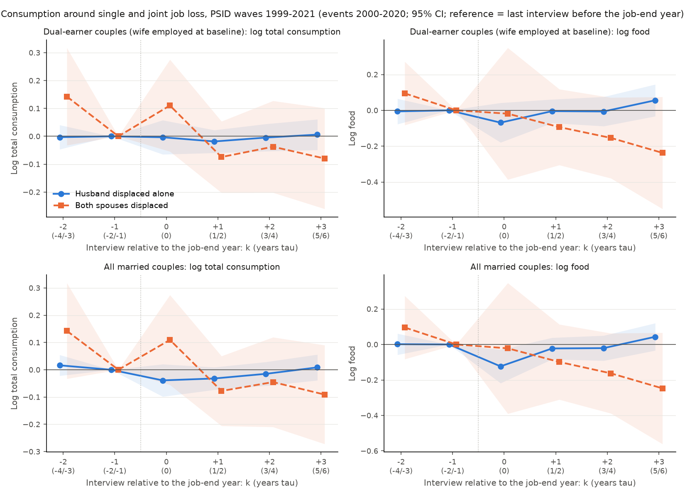

# Paper A's PSID consumption measure, 1999-2021, and consumption around single vs joint job loss

Built by `47.PSIDConsumptionEvent.py` (2026-10-18); definitions in its docstring. **Period: PSID interview waves 1999-2021** (consumption is asked from 1999; displacement events 2000-2020 so that the waves bracket them). Plan: `proposals/fable_bps2016_nextsteps.md` Sec. 2.3 (ii) and Sec. 3. Unweighted PSID SRC + SEO. S.e. clustered by 1968 family; *** p<0.01, ** p<0.05, * p<0.1. Every cell: coefficient*** (s.e.; p).

## 0. Data built: BPS's consumption measure ported to the PSID family files 1999-2021

102,607 family-interviews in 12 biennial waves 1999-2021 (1999 6,997, 2001 7,406, 2003 7,822, 2005 8,002, 2007 8,289, 2009 8,690, 2011 8,907, 2013 9,063, 2015 9,048, 2017 9,607, 2019 9,569, 2021 9,207). Each item is located in each wave by its PSID label; for 1999-2009 the names equal BPS's `psid_interview.do` (asserted in the code). Rows = items, columns = waves; '-' = not asked.

| Item | 1999 | 2001 | 2003 | 2005 | 2007 | 2009 | 2011 | 2013 | 2015 | 2017 | 2019 | 2021 |
|---|---|---|---|---|---|---|---|---|---|---|---|---|
| house | ER13041 | ER17044 | ER21043 | ER25029 | ER36029 | ER42030 | ER47330 | ER53030 | ER60031 | ER66031 | ER72031 | ER78032 |
| homeinsure | ER13043 | ER17048 | ER21047 | ER25038 | ER36038 | ER42039 | ER47344 | ER53044 | ER60045 | ER66047 | ER72047 | ER78048 |
| hins2y | ER15780 | ER19841 | ER23278 | ER27238 | ER40410 | ER46383 | ER51744 | - | - | - | - | - |
| hins | - | - | - | - | - | - | - | ER57485 | ER64607 | ER70683 | ER76691 | ER80955 |
| hins_per | - | - | - | - | - | - | - | ER57486 | ER64608 | ER70684 | ER76692 | ER80956 |
| nurse | ER15781 | ER19842 | ER23279 | ER27239 | ER40414 | ER46387 | ER51748 | ER57491 | ER64613 | ER70689 | ER76697 | ER80961 |
| doctor | ER15787 | ER19848 | ER23285 | ER27245 | ER40420 | ER46393 | ER51754 | ER57497 | ER64619 | ER70694 | ER76702 | ER80966 |
| prescription | ER15793 | ER19854 | ER23291 | ER27251 | ER40426 | ER46399 | ER51760 | ER57503 | ER64625 | ER70698 | ER76706 | ER80970 |
| electric | ER13086 | ER17097 | ER21086 | ER25082 | ER36085 | ER42114 | ER47417 | ER53117 | ER60112 | ER66113 | ER72113 | ER78115 |
| electric_per | ER13087 | ER17098 | ER21087 | ER25083 | ER36086 | ER42115 | ER47418 | ER53118 | ER60113 | ER66114 | ER72114 | ER78116 |
| heating | ER13088 | ER17099 | ER21088 | ER25080 | ER36083 | ER42112 | ER47415 | ER53115 | ER60110 | ER66111 | ER72111 | ER78113 |
| heating_per | ER13089 | ER17100 | ER21089 | ER25081 | ER36084 | ER42113 | ER47416 | ER53116 | ER60111 | ER66112 | ER72112 | ER78114 |
| gaselec | - | - | - | - | ER36087 | ER42116 | ER47419 | ER53119 | ER60114 | ER66115 | ER72115 | ER78117 |
| gaselec_per | - | - | - | - | ER36088 | ER42117 | ER47420 | ER53120 | ER60115 | ER66116 | ER72116 | ER78118 |
| water | ER13090 | ER17101 | ER21090 | ER25084 | ER36089 | ER42118 | ER47421 | ER53121 | ER60116 | ER66117 | ER72117 | ER78119 |
| water_per | ER13091 | ER17102 | ER21091 | ER25085 | ER36090 | ER42119 | ER47422 | ER53122 | ER60117 | ER66118 | ER72118 | ER78120 |
| miscutils | ER13097 | ER17108 | ER21097 | ER25090 | ER36095 | ER42124 | ER47427 | ER53127 | ER60122 | ER66123 | ER72123 | ER78125 |
| miscutils_per | ER13098 | ER17109 | ER21098 | ER25091 | ER36096 | ER42125 | ER47428 | ER53128 | ER60123 | ER66124 | ER72124 | ER78126 |
| telephone | - | - | - | ER25086 | ER36091 | ER42120 | ER47423 | ER53123 | ER60118 | ER66119 | ER72119 | ER78121 |
| telephone_per | - | - | - | ER25087 | ER36092 | ER42121 | ER47424 | ER53124 | ER60119 | ER66120 | ER72120 | ER78122 |
| carins | ER13191 | ER17202 | ER21838 | ER25794 | ER36812 | ER42803 | ER48125 | ER53819 | ER60878 | ER66926 | ER72930 | ER79007 |
| carins_per | ER13192 | ER17203 | ER21839 | ER25795 | ER36813 | ER42804 | ER48126 | ER53820 | ER60879 | ER66927 | ER72931 | ER79008 |
| carrepair | ER13195 | ER17206 | ER21842 | ER25798 | ER36816 | ER42807 | ER48129 | ER53823 | ER60881 | ER66929 | ER72933 | ER79010 |
| gasoline | ER13196 | ER17207 | ER21843 | ER25799 | ER36817 | ER42808 | ER48130 | ER53824 | ER60883 | ER66931 | ER72935 | ER79012 |
| parking | ER13197 | ER17208 | ER21844 | ER25800 | ER36818 | ER42809 | ER48131 | ER53825 | ER60884 | ER66932 | ER72936 | ER79013 |
| busfare | ER13198 | ER17209 | ER21845 | ER25801 | ER36819 | ER42810 | ER48132 | ER53826 | ER60885 | ER66933 | ER72937 | ER79014 |
| taxifare | ER13199 | ER17210 | ER21846 | ER25802 | ER36820 | ER42811 | ER48133 | ER53827 | ER60886 | ER66934 | ER72938 | ER79015 |
| othertrans | ER13200 | ER17211 | ER21847 | ER25803 | ER36821 | ER42812 | ER48134 | ER53828 | ER60887 | ER66935 | ER72939 | ER79016 |
| tuition | ER13202 | ER17213 | ER21849 | ER25805 | ER36823 | ER42814 | ER48136 | ER53830 | ER60889 | ER66937 | ER72941 | ER79018 |
| otherschool | ER13204 | ER17215 | ER21851 | ER25807 | ER36825 | ER42816 | ER48138 | ER53832 | ER60891 | ER66939 | ER72943 | ER79020 |
| childcare | ER14232 | ER18362 | ER21628 | ER25628 | ER36633 | ER42652 | ER47970 | ER53682 | ER60697 | ER66744 | ER72748 | ER78825 |
| childcare_per | - | - | - | - | ER36634 | ER42653 | ER47971 | ER53683 | ER60698 | ER66745 | ER72749 | ER78826 |
| fs | ER14256 | ER18387 | ER21653 | ER25655 | ER36673 | ER42692 | ER48008 | ER53705 | ER60720 | ER66767 | ER72771 | ER78848 |
| fs_per | ER14257 | ER18388 | ER21654 | ER25656 | ER36674 | ER42693 | ER48009 | ER53706 | ER60721 | ER66768 | ER72772 | ER78849 |
| fdhm1 | ER14288 | ER18421 | ER21686 | ER25688 | ER36706 | ER42712 | ER48028 | ER53725 | ER60740 | ER66787 | ER72791 | ER78868 |
| fdhmper1 | ER14289 | ER18422 | ER21687 | ER25689 | ER36707 | ER42713 | ER48029 | ER53726 | ER60741 | ER66788 | ER72792 | ER78869 |
| fddel1 | ER14291 | ER18425 | ER21690 | ER25692 | ER36710 | ER42716 | ER48032 | ER53729 | ER60744 | ER66791 | ER72795 | ER78872 |
| fddelper1 | ER14292 | ER18426 | ER21691 | ER25693 | ER36711 | ER42717 | ER48033 | ER53730 | ER60745 | ER66792 | ER72796 | ER78873 |
| fout1 | ER14293 | ER18428 | ER21693 | ER25695 | ER36713 | ER42719 | ER48035 | ER53732 | ER60747 | ER66794 | ER72798 | ER78875 |
| foutper1 | ER14294 | ER18429 | ER21694 | ER25696 | ER36714 | ER42720 | ER48036 | ER53733 | ER60748 | ER66795 | ER72799 | ER78876 |
| fdhm2 | ER14295 | ER18431 | ER21696 | ER25698 | ER36716 | ER42722 | ER48038 | ER53735 | ER60750 | ER66797 | ER72801 | ER78878 |
| fdhmper2 | ER14296 | ER18432 | ER21697 | ER25699 | ER36717 | ER42723 | ER48039 | ER53736 | ER60751 | ER66798 | ER72802 | ER78879 |
| fddel2 | ER14298 | ER18435 | ER21700 | ER25702 | ER36720 | ER42726 | ER48042 | ER53739 | ER60754 | ER66801 | ER72805 | ER78882 |
| fddelper2 | ER14299 | ER18436 | ER21701 | ER25703 | ER36721 | ER42727 | ER48043 | ER53740 | ER60755 | ER66802 | ER72806 | ER78883 |
| fout2 | ER14300 | ER18438 | ER21703 | ER25705 | ER36723 | ER42729 | ER48045 | ER53742 | ER60757 | ER66804 | ER72808 | ER78885 |
| foutper2 | ER14301 | ER18439 | ER21704 | ER25706 | ER36724 | ER42730 | ER48046 | ER53743 | ER60758 | ER66805 | ER72809 | ER78886 |
| rent | ER13065 | ER17074 | ER21072 | ER25063 | ER36065 | ER42080 | ER47387 | ER53087 | ER60088 | ER66090 | ER72090 | ER78091 |
| rent_per | ER13066 | ER17075 | ER21073 | ER25064 | ER36066 | ER42081 | ER47388 | ER53088 | ER60089 | ER66091 | ER72091 | ER78092 |
| x_hrep | - | - | - | ER28037D8 | ER41027D8 | ER46971D8 | ER52395D8 | ER58212D8 | ER65444 | ER71523 | ER77577 | ER81904 |
| x_furn | - | - | - | ER28037D9 | ER41027D9 | ER46971D9 | ER52395D9 | ER58212D9 | ER65445 | ER71524 | ER77579 | ER81906 |
| x_cloth | - | - | - | ER28037E1 | ER41027E1 | ER46971E1 | ER52395E1 | ER58212E1 | ER65446 | ER71525 | ER77581 | ER81908 |
| x_trips | - | - | - | ER28037E2 | ER41027E2 | ER46971E2 | ER52395E2 | ER58212E2 | ER65447 | ER71526 | ER77583 | ER81910 |
| x_rec | - | - | - | ER28037E3 | ER41027E3 | ER46971E3 | ER52395E3 | ER58212E3 | ER65448 | ER71527 | ER77585 | ER81912 |
| x_comp | - | - | - | - | - | - | - | - | - | ER71522 | ER77575 | ER81902 |

Questionnaire changes handled: heating 'A41 heating fuel' -> 'A42A fuel' (2011); combined gas/electric bill asked from 2007 (added to utilities, see docstring; not in BPS); telephone separate from 2005 (added to other utilities, as BPS); health insurance 'H63 paid last 2 years' (1999-2011, / 2) -> 'H61J premiums x time unit' (2013+); hospital / doctor / prescriptions 2-year totals (/ 2) to 2011, previous calendar year from 2013; car repairs 'F80A' monthly (x 12) to 2013 -> 'F80D repair/maintenance' annual from 2015; child care 'F6D' -> 'F7' (2019) and a time unit from 2007. The 2015 car-repair and 2013 health redesigns change levels in all families alike; the event study's wave x stack fixed effects absorb such common shifts.

## 1. Checks (BPS's own data, BPS Table 1, the PSID's generated variables)

### 1a. Household by household against BPS's shipped `psid_cons.dta` (waves 1999-2009, 47,206 families; all merged)

BPS-exact variant (no combined gas/electric bill, child care read as annual). Share of families with the same amount (within $0.5; missing = 0, as in BPS's sums).

| Item | Share equal | Mean, BPS | Mean, this script |
|---|---|---|---|
| house | 0.9995 | 111,807 | 111,772 |
| homeinsure | 0.9998 | 399 | 399 |
| hinsurance | 1.0000 | 1,134 | 1,134 |
| nurse | 1.0000 | 287 | 287 |
| doctor | 1.0000 | 420 | 420 |
| prescription | 1.0000 | 308 | 308 |
| electric | 0.9999 | 1,082 | 1,082 |
| heating | 0.9999 | 658 | 658 |
| water | 1.0000 | 322 | 322 |
| miscutils | 1.0000 | 1,110 | 1,110 |
| carins | 1.0000 | 1,369 | 1,369 |
| carrepair | 1.0000 | 1,371 | 1,371 |
| gasoline | 1.0000 | 1,664 | 1,664 |
| parking | 1.0000 | 41 | 41 |
| busfare | 1.0000 | 67 | 67 |
| taxifare | 1.0000 | 26 | 26 |
| othertrans | 1.0000 | 135 | 135 |
| tuition | 1.0000 | 1,182 | 1,182 |
| otherschool | 1.0000 | 37 | 37 |
| childcare_bps | 1.0000 | 389 | 389 |
| fstmp | 1.0000 | 244 | 244 |
| food | 1.0000 | 4,517 | 4,517 |
| fout | 1.0000 | 1,894 | 1,894 |
| rent | 0.9997 | 6,765 | 6,765 |
| renteq | 0.9995 | 6,708 | 6,566 |
| **Total (nondurables + services)** | 0.9991 (within 0.1%) | 27,035 | 27,032 |

The rent-equivalent row differs only where BPS leave it missing (house value missing) and this script writes 0; both count as zero in the totals. The few remaining differences are 2005-2007 edits in BPS's file.

### 1b. BPS Table 1, column 1 (baseline sample, mean, nominal dollars, waves 1999-2009)

Same 10,479 household-years as BPS's estimation file (`data4estimation.dta`); missing = 0 as in BPS's Table 1 code. Columns: published value; recomputed from BPS's shipped file; this script, BPS-exact items; this script, Paper A items (with the combined gas/electric bill and child care by its time unit).

| Category | BPS Table 1 (published) | BPS shipped file | This script, BPS-exact | This script, Paper A | Paper A / published |
|---|---|---|---|---|---|
| Total | 39,257 | 39,257 | 39,256 | 39,401 | 1.004 |
| Nondurable cons. | 8,552 | 8,552 | 8,552 | 8,552 | 1.000 |
| Food at home | 6,165 | 6,165 | 6,165 | 6,165 | 1.000 |
| Gasoline | 2,339 | 2,339 | 2,339 | 2,339 | 1.000 |
| Services | 30,705 | 30,705 | 30,704 | 30,849 | 1.005 |
| Food out | 2,816 | 2,816 | 2,816 | 2,816 | 1.000 |
| Health ins. | 1,572 | 1,572 | 1,572 | 1,572 | 1.000 |
| Health serv. | 1,317 | 1,317 | 1,317 | 1,317 | 1.000 |
| Utilities | 3,856 | 3,856 | 3,856 | 3,940 | 1.022 |
| Transportation | 3,896 | 3,896 | 3,896 | 3,896 | 1.000 |
| Education | 2,589 | 2,589 | 2,589 | 2,589 | 1.000 |
| Child care | 714 | 714 | 714 | 775 | 1.085 |
| Home ins. | 581 | 581 | 580 | 580 | 0.999 |
| Rent (or rent eq.) | 13,364 | 13,364 | 13,363 | 13,363 | 1.000 |
| Median total | 32,920 | 32,920 | 32,920 | 33,027 | 1.003 |

### 1c. Each category against the PSID's generated expenditure variable, wave by wave

Cell: share of families whose amount equals the PSID's generated amount within 1% / median ratio (this script / PSID), over families with both positive; the PSID imputes missing items and edits outliers, this script follows BPS (no imputation, no edits). A median ratio of 1 confirms the annualisation (units, 2-year health totals, monthly transport items). Utilities: the PSID's generated variables also leave out the combined gas/electric bill, so the comparison uses the items without it.

| Category | 1999 | 2001 | 2003 | 2005 | 2007 | 2009 | 2011 | 2013 | 2015 | 2017 | 2019 | 2021 |
|---|---|---|---|---|---|---|---|---|---|---|---|---|
| Food at home + delivered | 1.00 / 1.00 | 1.00 / 1.00 | 1.00 / 1.00 | 1.00 / 1.00 | 1.00 / 1.00 | 1.00 / 1.00 | 1.00 / 1.00 | 1.00 / 1.00 | 1.00 / 1.00 | 1.00 / 1.00 | 1.00 / 1.00 | 0.99 / 1.00 |
| Food away | 1.00 / 1.00 | 1.00 / 1.00 | 1.00 / 1.00 | 1.00 / 1.00 | 1.00 / 1.00 | 1.00 / 1.00 | 1.00 / 1.00 | 1.00 / 1.00 | 1.00 / 1.00 | 1.00 / 1.00 | 1.00 / 1.00 | 1.00 / 1.00 |
| Rent (renters) | 1.00 / 1.00 | 1.00 / 1.00 | 1.00 / 1.00 | 1.00 / 1.00 | 1.00 / 1.00 | 1.00 / 1.00 | 1.00 / 1.00 | 1.00 / 1.00 | 1.00 / 1.00 | 1.00 / 1.00 | 1.00 / 1.00 | 1.00 / 1.00 |
| Home insurance | 1.00 / 1.00 | 1.00 / 1.00 | 1.00 / 1.00 | 1.00 / 1.00 | 1.00 / 1.00 | 1.00 / 1.00 | 1.00 / 1.00 | 1.00 / 1.00 | 1.00 / 1.00 | 1.00 / 1.00 | 1.00 / 1.00 | 1.00 / 1.00 |
| Electricity + heating + water + other (+ phone) | 0.85 / 1.00 | 0.94 / 1.00 | 0.93 / 1.00 | 0.88 / 1.00 | 0.93 / 1.00 | 0.94 / 1.00 | 0.95 / 1.00 | 0.94 / 1.00 | 0.94 / 1.00 | 0.94 / 1.00 | 0.92 / 1.00 | 0.94 / 1.00 |
| Car insurance | 1.00 / 1.00 | 1.00 / 1.00 | 1.00 / 1.00 | 1.00 / 1.00 | 1.00 / 1.00 | 1.00 / 1.00 | 1.00 / 1.00 | 1.00 / 1.00 | 1.00 / 1.00 | 1.00 / 1.00 | 1.00 / 1.00 | 1.00 / 1.00 |
| Car repairs | 1.00 / 1.00 | 1.00 / 1.00 | 1.00 / 1.00 | 1.00 / 1.00 | 1.00 / 1.00 | 1.00 / 1.00 | 1.00 / 1.00 | 1.00 / 1.00 | 1.00 / 1.00 | 1.00 / 1.00 | 1.00 / 1.00 | 1.00 / 1.00 |
| Gasoline | 1.00 / 1.00 | 1.00 / 1.00 | 1.00 / 1.00 | 1.00 / 1.00 | 1.00 / 1.00 | 1.00 / 1.00 | 1.00 / 1.00 | 1.00 / 1.00 | 1.00 / 1.00 | 1.00 / 1.00 | 1.00 / 1.00 | 1.00 / 1.00 |
| Parking, bus, taxi, other | 0.99 / 1.00 | 1.00 / 1.00 | 0.99 / 1.00 | 0.99 / 1.00 | 0.99 / 1.00 | 1.00 / 1.00 | 0.99 / 1.00 | 0.99 / 1.00 | 0.99 / 1.00 | 0.99 / 1.00 | 0.99 / 1.00 | 0.86 / 1.00 |
| Education | 1.00 / 1.00 | 1.00 / 1.00 | 1.00 / 1.00 | 1.00 / 1.00 | 1.00 / 1.00 | 1.00 / 1.00 | 1.00 / 1.00 | 1.00 / 1.00 | 1.00 / 1.00 | 1.00 / 1.00 | 1.00 / 1.00 | 1.00 / 1.00 |
| Child care | 1.00 / 1.00 | 1.00 / 1.00 | 1.00 / 1.00 | 1.00 / 1.00 | 1.00 / 1.00 | 1.00 / 1.00 | 1.00 / 1.00 | 1.00 / 1.00 | 0.89 / 1.00 | 0.89 / 1.00 | 0.90 / 1.00 | 0.77 / 1.00 |
| Health services | 0.95 / 1.00 | 0.96 / 1.00 | 0.95 / 1.00 | 0.93 / 1.00 | 0.94 / 1.00 | 0.95 / 1.00 | 0.97 / 1.00 | 0.98 / 1.00 | 0.98 / 1.00 | 0.97 / 1.00 | 0.98 / 1.00 | 0.96 / 1.00 |
| Health insurance | 1.00 / 1.00 | 1.00 / 1.00 | 1.00 / 1.00 | 1.00 / 1.00 | 1.00 / 1.00 | 1.00 / 1.00 | 1.00 / 1.00 | 1.00 / 1.00 | 1.00 / 1.00 | 1.00 / 1.00 | 1.00 / 1.00 | 1.00 / 1.00 |

### 1d. Consumption by wave, 1999-2021 (real 2000 dollars, CPI-U of the interview year; all families and married couples)

| Wave | Families | Total, mean | Total, median | Nondurables | Services | Food (incl. stamps, away) | Housing (rent / rent eq.) | Couples: N | Couples: total, mean | Excluded 2005+ categories, mean (share of total) |
|---|---|---|---|---|---|---|---|---|---|---|
| 1999 | 6,997 | 20,831 | 17,799 | 5,185 | 15,645 | 5,734 | 6,575 | 3,642 | 25,522 | - |
| 2001 | 7,406 | 22,812 | 19,056 | 6,024 | 16,788 | 6,305 | 7,036 | 3,876 | 28,247 | - |
| 2003 | 7,822 | 22,974 | 19,219 | 5,290 | 17,684 | 5,671 | 7,654 | 3,931 | 28,529 | - |
| 2005 | 8,002 | 25,530 | 21,424 | 5,714 | 19,816 | 5,784 | 8,628 | 4,057 | 31,818 | 5,894 (0.23) |
| 2007 | 8,289 | 27,446 | 22,304 | 6,455 | 20,991 | 6,642 | 9,148 | 4,159 | 34,002 | 6,095 (0.22) |
| 2009 | 8,690 | 24,991 | 21,220 | 5,517 | 19,474 | 5,552 | 8,177 | 4,252 | 31,301 | 5,178 (0.21) |
| 2011 | 8,907 | 24,545 | 21,215 | 5,994 | 18,551 | 5,523 | 7,480 | 4,224 | 31,286 | 4,732 (0.19) |
| 2013 | 9,063 | 24,636 | 21,226 | 5,921 | 18,715 | 5,586 | 7,348 | 4,207 | 31,845 | 4,309 (0.17) |
| 2015 | 9,048 | 23,784 | 20,344 | 5,543 | 18,241 | 5,747 | 7,690 | 4,088 | 30,858 | 4,384 (0.18) |
| 2017 | 9,607 | 24,653 | 21,499 | 5,656 | 18,997 | 6,117 | 8,055 | 4,195 | 31,494 | 4,635 (0.19) |
| 2019 | 9,569 | 25,205 | 22,052 | 5,761 | 19,444 | 6,248 | 8,479 | 4,082 | 32,500 | 4,609 (0.18) |
| 2021 | 9,207 | 25,530 | 22,213 | 5,810 | 19,720 | 6,277 | 9,363 | 3,933 | 32,928 | 4,266 (0.17) |

Excluded categories (PSID generated, waves 2005-2021, real 2000 $ means; not in the consistent series): Household repairs 1,201; Furnishings 803; Clothing 1,062; Trips 1,122; Other recreation 578; Computing (2017+) 295. Also outside BPS's definition throughout: mortgage payments, property tax, vehicle loan / lease / down payments.

## 2. Consumption around single and joint job loss (stacked event study, waves 1999-2021)

19's stacks restricted to displacement events 2000-2020 (the consumption waves 1999-2021 bracket each event), married at baseline; J = the baseline wife's own displacement dated ev-1..ev+1 (38). Event time in interview waves relative to the job-end year: k=+1 is the first interview after it (tau = 1-2 years), k=-1 (tau = -2/-1) the reference. One regression per column (interaction model); rows are linear combinations of its coefficients: husband alone = displaced x k; both = displaced + J + displaced x J; both - alone = J + displaced x J; wife alone = J x k among control families. 'All displaced' is a separate plain event study on the same sample. Counts are units with at least two interviews in the regression. Rows 'minus k=-2' re-reference to k=-2 (same regression): J covers ev-1, so for joint couples the k=-1 interview (1-2 years before his job-end year) can already follow her displacement; these rows rest on the joint events observed at k=-2 (shown).

### 2a. Main design, pooled

| | Log total consumption | Log food | Log consumption excl. housing |
|---|---|---|---|
| **Dual-earner couples (wife employed at baseline): All** | | | |
| Husband displaced alone, k=+1 | -0.019 (0.021; p=0.375) | -0.005 (0.034; p=0.890) | -0.022 (0.026; p=0.403) |
| Both spouses displaced, k=+1 | -0.074 (0.065; p=0.255) | -0.094 (0.108; p=0.386) | -0.121 (0.078; p=0.120) |
| Both - husband alone, k=+1 | -0.056 (0.069; p=0.419) | -0.089 (0.115; p=0.437) | -0.099 (0.083; p=0.231) |
| Wife displaced alone (husband not displaced), k=+1 | -0.004 (0.023; p=0.852) | 0.011 (0.032; p=0.721) | 0.030 (0.024; p=0.222) |
| Husband displaced alone, mean k=+1..+3 | -0.006 (0.021; p=0.785) | 0.015 (0.034; p=0.658) | -0.002 (0.026; p=0.940) |
| Both spouses displaced, mean k=+1..+3 | -0.064 (0.070; p=0.360) | -0.162 (0.109; p=0.137) | -0.132 (0.083; p=0.114) |
| Both - husband alone, mean k=+1..+3 | -0.058 (0.073; p=0.428) | -0.177 (0.114; p=0.123) | -0.130 (0.088; p=0.140) |
| Wife displaced alone (husband not displaced), mean k=+1..+3 | -0.026 (0.024; p=0.285) | 0.005 (0.033; p=0.879) | 0.004 (0.027; p=0.869) |
| All displaced (plain event study), mean k=+1..+3 | -0.012 (0.020; p=0.545) | -0.008 (0.033; p=0.805) | -0.019 (0.025; p=0.435) |
| Husband displaced alone, mean k=+1..+3 minus k=-2 (reference k=-2) | -0.003 (0.025; p=0.917) | 0.021 (0.039; p=0.587) | 0.004 (0.029; p=0.892) |
| Both spouses displaced, mean k=+1..+3 minus k=-2 (reference k=-2) | -0.206** (0.095; p=0.030) | -0.257** (0.109; p=0.018) | -0.265** (0.112; p=0.018) |
| Both - husband alone, mean k=+1..+3 minus k=-2 (reference k=-2) | -0.204** (0.098; p=0.038) | -0.278** (0.115; p=0.016) | -0.269** (0.117; p=0.021) |
| Joint events observed at k=-2 | 26 | 26 | 26 |
| Trimmed (0.5 / 99.5 pct by wave): husband displaced alone, mean k=+1..+3 | -0.003 (0.021; p=0.871) | 0.011 (0.031; p=0.718) | 0.010 (0.025; p=0.699) |
| Trimmed (0.5 / 99.5 pct by wave): both spouses displaced, mean k=+1..+3 | -0.067 (0.071; p=0.342) | -0.117 (0.098; p=0.232) | -0.139 (0.085; p=0.100) |
| Trimmed (0.5 / 99.5 pct by wave): both - husband alone, mean k=+1..+3 | -0.064 (0.074; p=0.392) | -0.128 (0.103; p=0.213) | -0.149* (0.089; p=0.095) |
| Trimmed: displaced (joint events) / N | 412 (63) / 66,044 | 413 (63) / 65,961 | 411 (63) / 65,880 |
| Pre-event level at k=-1, 2000 $: husband alone / both | 29,121 / 27,357 | 6,798 / 7,139 | 20,822 / 20,035 |
| Displaced (joint events) / wife-alone events / control stacks / N / clusters | 413 (63) / 748 / 13,870 / 66,737 / 1,208 | 413 (63) / 745 / 13,853 / 66,556 / 1,206 | 413 (63) / 748 / 13,870 / 66,734 / 1,208 |
| Joint events observed at k=-1 / at k=+1..+3 | 49 / 63 | 48 / 63 | 49 / 63 |
| **All married couples: All** | | | |
| Husband displaced alone, k=+1 | -0.032 (0.021; p=0.129) | -0.023 (0.031; p=0.467) | -0.031 (0.025; p=0.221) |
| Both spouses displaced, k=+1 | -0.078 (0.065; p=0.234) | -0.099 (0.108; p=0.361) | -0.123 (0.078; p=0.113) |
| Both - husband alone, k=+1 | -0.046 (0.070; p=0.511) | -0.076 (0.113; p=0.501) | -0.092 (0.083; p=0.266) |
| Wife displaced alone (husband not displaced), k=+1 | -0.006 (0.023; p=0.794) | 0.007 (0.032; p=0.827) | 0.029 (0.024; p=0.238) |
| Husband displaced alone, mean k=+1..+3 | -0.013 (0.019; p=0.492) | 0.000 (0.029; p=1.000) | -0.011 (0.022; p=0.619) |
| Both spouses displaced, mean k=+1..+3 | -0.071 (0.070; p=0.306) | -0.170 (0.109; p=0.120) | -0.138* (0.083; p=0.096) |
| Both - husband alone, mean k=+1..+3 | -0.059 (0.073; p=0.422) | -0.170 (0.113; p=0.133) | -0.127 (0.087; p=0.141) |
| Wife displaced alone (husband not displaced), mean k=+1..+3 | -0.031 (0.024; p=0.200) | -0.002 (0.033; p=0.954) | -0.001 (0.027; p=0.982) |
| All displaced (plain event study), mean k=+1..+3 | -0.018 (0.018; p=0.317) | -0.017 (0.029; p=0.549) | -0.024 (0.022; p=0.262) |
| Husband displaced alone, mean k=+1..+3 minus k=-2 (reference k=-2) | -0.029 (0.022; p=0.192) | -0.001 (0.032; p=0.963) | -0.033 (0.026; p=0.212) |
| Both spouses displaced, mean k=+1..+3 minus k=-2 (reference k=-2) | -0.214** (0.095; p=0.025) | -0.265** (0.109; p=0.015) | -0.271** (0.112; p=0.015) |
| Both - husband alone, mean k=+1..+3 minus k=-2 (reference k=-2) | -0.185* (0.098; p=0.058) | -0.264** (0.113; p=0.019) | -0.238** (0.114; p=0.037) |
| Joint events observed at k=-2 | 26 | 26 | 26 |
| Trimmed (0.5 / 99.5 pct by wave): husband displaced alone, mean k=+1..+3 | -0.010 (0.019; p=0.576) | -0.001 (0.026; p=0.974) | 0.002 (0.022; p=0.935) |
| Trimmed (0.5 / 99.5 pct by wave): both spouses displaced, mean k=+1..+3 | -0.074 (0.071; p=0.294) | -0.124 (0.098; p=0.206) | -0.146* (0.085; p=0.085) |
| Trimmed (0.5 / 99.5 pct by wave): both - husband alone, mean k=+1..+3 | -0.064 (0.074; p=0.388) | -0.123 (0.101; p=0.224) | -0.147* (0.088; p=0.094) |
| Trimmed: displaced (joint events) / N | 546 (63) / 82,778 | 547 (63) / 82,735 | 546 (63) / 82,692 |
| Pre-event level at k=-1, 2000 $: husband alone / both | 27,977 / 27,357 | 6,786 / 7,139 | 19,837 / 20,035 |
| Displaced (joint events) / wife-alone events / control stacks / N / clusters | 548 (63) / 748 / 17,683 / 83,825 / 1,278 | 547 (63) / 745 / 17,662 / 83,579 / 1,277 | 548 (63) / 748 / 17,683 / 83,822 / 1,278 |
| Joint events observed at k=-1 / at k=+1..+3 | 49 / 63 | 48 / 63 | 49 / 63 |
| Fixed effects | father x stack, wave x stack | father x stack, wave x stack | father x stack, wave x stack |
| Period | waves 1999-2021, events 2000-2020 | waves 1999-2021, events 2000-2020 | waves 1999-2021, events 2000-2020 |

### 2b. By race (head's race)

| | Log total consumption | Log food | Log consumption excl. housing |
|---|---|---|---|
| **Dual-earner couples (wife employed at baseline): Black** | | | |
| Husband displaced alone, k=+1 | -0.031 (0.037; p=0.395) | -0.032 (0.060; p=0.595) | -0.025 (0.046; p=0.580) |
| Both spouses displaced, k=+1 | -0.100 (0.090; p=0.266) | -0.215* (0.126; p=0.087) | -0.132 (0.120; p=0.271) |
| Both - husband alone, k=+1 | -0.069 (0.097; p=0.479) | -0.183 (0.139; p=0.186) | -0.107 (0.128; p=0.404) |
| Wife displaced alone (husband not displaced), k=+1 | -0.052 (0.053; p=0.326) | 0.005 (0.056; p=0.925) | 0.003 (0.055; p=0.957) |
| Husband displaced alone, mean k=+1..+3 | 0.010 (0.032; p=0.767) | 0.016 (0.054; p=0.768) | 0.017 (0.042; p=0.676) |
| Both spouses displaced, mean k=+1..+3 | -0.060 (0.088; p=0.497) | -0.265** (0.133; p=0.045) | -0.129 (0.121; p=0.284) |
| Both - husband alone, mean k=+1..+3 | -0.070 (0.093; p=0.453) | -0.281** (0.141; p=0.046) | -0.147 (0.126; p=0.246) |
| Wife displaced alone (husband not displaced), mean k=+1..+3 | -0.045 (0.050; p=0.367) | -0.035 (0.062; p=0.567) | -0.011 (0.053; p=0.836) |
| All displaced (plain event study), mean k=+1..+3 | 0.002 (0.031; p=0.949) | -0.024 (0.052; p=0.646) | -0.004 (0.040; p=0.914) |
| Husband displaced alone, mean k=+1..+3 minus k=-2 (reference k=-2) | 0.043 (0.045; p=0.345) | 0.063 (0.073; p=0.389) | 0.048 (0.049; p=0.327) |
| Both spouses displaced, mean k=+1..+3 minus k=-2 (reference k=-2) | -0.296*** (0.107; p=0.006) | -0.343** (0.143; p=0.016) | -0.403*** (0.135; p=0.003) |
| Both - husband alone, mean k=+1..+3 minus k=-2 (reference k=-2) | -0.338*** (0.113; p=0.003) | -0.406*** (0.155; p=0.009) | -0.451*** (0.140; p=0.001) |
| Joint events observed at k=-2 | 13 | 13 | 13 |
| Pre-event level at k=-1, 2000 $: husband alone / both | 25,706 / 22,566 | 6,192 / 6,469 | 18,917 / 17,279 |
| Displaced (joint events) / wife-alone events / control stacks / N / clusters | 174 (29) / 243 / 3,250 / 15,340 / 410 | 174 (29) / 243 / 3,243 / 15,269 / 408 | 174 (29) / 243 / 3,250 / 15,337 / 410 |
| Joint events observed at k=-1 / at k=+1..+3 | 23 / 29 | 22 / 29 | 23 / 29 |
| **Dual-earner couples (wife employed at baseline): White** | | | |
| Husband displaced alone, k=+1 | -0.007 (0.025; p=0.779) | 0.020 (0.039; p=0.612) | -0.014 (0.031; p=0.660) |
| Both spouses displaced, k=+1 | -0.032 (0.094; p=0.731) | 0.027 (0.166; p=0.869) | -0.084 (0.102; p=0.411) |
| Both - husband alone, k=+1 | -0.025 (0.098; p=0.796) | 0.008 (0.173; p=0.964) | -0.070 (0.108; p=0.517) |
| Wife displaced alone (husband not displaced), k=+1 | 0.023 (0.022; p=0.311) | 0.015 (0.039; p=0.691) | 0.048* (0.026; p=0.061) |
| Husband displaced alone, mean k=+1..+3 | -0.005 (0.027; p=0.864) | 0.026 (0.044; p=0.546) | 0.000 (0.033; p=0.995) |
| Both spouses displaced, mean k=+1..+3 | -0.025 (0.107; p=0.818) | -0.034 (0.162; p=0.835) | -0.081 (0.117; p=0.487) |
| Both - husband alone, mean k=+1..+3 | -0.020 (0.112; p=0.859) | -0.060 (0.168; p=0.722) | -0.082 (0.123; p=0.508) |
| Wife displaced alone (husband not displaced), mean k=+1..+3 | -0.010 (0.026; p=0.710) | 0.026 (0.040; p=0.516) | 0.020 (0.031; p=0.519) |
| All displaced (plain event study), mean k=+1..+3 | -0.007 (0.027; p=0.787) | 0.018 (0.043; p=0.675) | -0.011 (0.031; p=0.727) |
| Husband displaced alone, mean k=+1..+3 minus k=-2 (reference k=-2) | -0.011 (0.030; p=0.712) | 0.018 (0.046; p=0.703) | 0.002 (0.037; p=0.958) |
| Both spouses displaced, mean k=+1..+3 minus k=-2 (reference k=-2) | -0.055 (0.142; p=0.699) | -0.110 (0.154; p=0.476) | -0.057 (0.152; p=0.705) |
| Both - husband alone, mean k=+1..+3 minus k=-2 (reference k=-2) | -0.044 (0.147; p=0.766) | -0.127 (0.160; p=0.426) | -0.059 (0.159; p=0.709) |
| Joint events observed at k=-2 | 13 | 13 | 13 |
| Pre-event level at k=-1, 2000 $: husband alone / both | 31,386 / 31,596 | 7,198 / 7,705 | 22,085 / 22,472 |
| Displaced (joint events) / wife-alone events / control stacks / N / clusters | 239 (34) / 505 / 10,620 / 51,397 / 836 | 239 (34) / 502 / 10,610 / 51,287 / 836 | 239 (34) / 505 / 10,620 / 51,397 / 836 |
| Joint events observed at k=-1 / at k=+1..+3 | 26 / 34 | 26 / 34 | 26 / 34 |
| **All married couples: Black** | | | |
| Husband displaced alone, k=+1 | -0.057 (0.040; p=0.153) | -0.055 (0.060; p=0.367) | -0.062 (0.048; p=0.195) |
| Both spouses displaced, k=+1 | -0.109 (0.090; p=0.222) | -0.222* (0.126; p=0.077) | -0.143 (0.120; p=0.236) |
| Both - husband alone, k=+1 | -0.053 (0.101; p=0.600) | -0.168 (0.139; p=0.226) | -0.081 (0.132; p=0.540) |
| Wife displaced alone (husband not displaced), k=+1 | -0.053 (0.054; p=0.324) | 0.006 (0.055; p=0.911) | -0.001 (0.055; p=0.979) |
| Husband displaced alone, mean k=+1..+3 | -0.005 (0.031; p=0.863) | -0.012 (0.052; p=0.820) | -0.003 (0.037; p=0.935) |
| Both spouses displaced, mean k=+1..+3 | -0.070 (0.088; p=0.430) | -0.270** (0.133; p=0.043) | -0.140 (0.121; p=0.248) |
| Both - husband alone, mean k=+1..+3 | -0.064 (0.094; p=0.496) | -0.258* (0.141; p=0.068) | -0.137 (0.126; p=0.277) |
| Wife displaced alone (husband not displaced), mean k=+1..+3 | -0.047 (0.051; p=0.357) | -0.029 (0.061; p=0.632) | -0.016 (0.053; p=0.769) |
| All displaced (plain event study), mean k=+1..+3 | -0.011 (0.029; p=0.694) | -0.042 (0.049; p=0.394) | -0.020 (0.036; p=0.583) |
| Husband displaced alone, mean k=+1..+3 minus k=-2 (reference k=-2) | -0.004 (0.041; p=0.918) | 0.024 (0.062; p=0.704) | -0.017 (0.046; p=0.705) |
| Both spouses displaced, mean k=+1..+3 minus k=-2 (reference k=-2) | -0.302*** (0.107; p=0.005) | -0.342** (0.144; p=0.018) | -0.407*** (0.135; p=0.003) |
| Both - husband alone, mean k=+1..+3 minus k=-2 (reference k=-2) | -0.298*** (0.110; p=0.007) | -0.366** (0.153; p=0.017) | -0.389*** (0.135; p=0.004) |
| Joint events observed at k=-2 | 13 | 13 | 13 |
| Pre-event level at k=-1, 2000 $: husband alone / both | 24,277 / 22,566 | 6,209 / 6,469 | 17,820 / 17,279 |
| Displaced (joint events) / wife-alone events / control stacks / N / clusters | 221 (29) / 243 / 4,006 / 18,494 / 438 | 221 (29) / 243 / 3,999 / 18,403 / 437 | 221 (29) / 243 / 4,006 / 18,491 / 438 |
| Joint events observed at k=-1 / at k=+1..+3 | 23 / 29 | 22 / 29 | 23 / 29 |
| **All married couples: White** | | | |
| Husband displaced alone, k=+1 | -0.012 (0.023; p=0.611) | 0.007 (0.033; p=0.828) | -0.005 (0.028; p=0.867) |
| Both spouses displaced, k=+1 | -0.033 (0.094; p=0.727) | 0.024 (0.166; p=0.887) | -0.083 (0.102; p=0.412) |
| Both - husband alone, k=+1 | -0.021 (0.097; p=0.828) | 0.017 (0.171; p=0.923) | -0.079 (0.106; p=0.459) |
| Wife displaced alone (husband not displaced), k=+1 | 0.022 (0.023; p=0.338) | 0.010 (0.039; p=0.795) | 0.048* (0.026; p=0.058) |
| Husband displaced alone, mean k=+1..+3 | -0.005 (0.023; p=0.820) | 0.023 (0.035; p=0.516) | -0.001 (0.028; p=0.977) |
| Both spouses displaced, mean k=+1..+3 | -0.030 (0.107; p=0.777) | -0.041 (0.163; p=0.799) | -0.086 (0.117; p=0.460) |
| Both - husband alone, mean k=+1..+3 | -0.025 (0.110; p=0.821) | -0.064 (0.166; p=0.699) | -0.086 (0.121; p=0.480) |
| Wife displaced alone (husband not displaced), mean k=+1..+3 | -0.015 (0.026; p=0.574) | 0.017 (0.040; p=0.671) | 0.016 (0.031; p=0.600) |
| All displaced (plain event study), mean k=+1..+3 | -0.008 (0.023; p=0.739) | 0.016 (0.035; p=0.643) | -0.010 (0.027; p=0.725) |
| Husband displaced alone, mean k=+1..+3 minus k=-2 (reference k=-2) | -0.024 (0.027; p=0.357) | 0.006 (0.038; p=0.872) | -0.019 (0.032; p=0.545) |
| Both spouses displaced, mean k=+1..+3 minus k=-2 (reference k=-2) | -0.061 (0.141; p=0.667) | -0.119 (0.154; p=0.442) | -0.063 (0.151; p=0.676) |
| Both - husband alone, mean k=+1..+3 minus k=-2 (reference k=-2) | -0.036 (0.145; p=0.803) | -0.125 (0.158; p=0.429) | -0.044 (0.156; p=0.778) |
| Joint events observed at k=-2 | 13 | 13 | 13 |
| Pre-event level at k=-1, 2000 $: husband alone / both | 30,251 / 31,596 | 7,140 / 7,705 | 21,077 / 22,472 |
| Displaced (joint events) / wife-alone events / control stacks / N / clusters | 327 (34) / 505 / 13,677 / 65,331 / 884 | 326 (34) / 502 / 13,663 / 65,176 / 884 | 327 (34) / 505 / 13,677 / 65,331 / 884 |
| Joint events observed at k=-1 / at k=+1..+3 | 26 / 34 | 26 / 34 | 26 / 34 |
| Fixed effects | father x stack, wave x stack | father x stack, wave x stack | father x stack, wave x stack |
| Period | waves 1999-2021, events 2000-2020 | waves 1999-2021, events 2000-2020 | waves 1999-2021, events 2000-2020 |

### 2c. Closures only (husband's first displacement is a plant closure)

| | Log total consumption | Log food | Log consumption excl. housing |
|---|---|---|---|
| **Dual-earner couples (wife employed at baseline): All** | | | |
| Husband displaced alone, k=+1 | 0.012 (0.034; p=0.722) | 0.013 (0.050; p=0.799) | 0.034 (0.040; p=0.394) |
| Both spouses displaced, k=+1 | 0.006 (0.083; p=0.943) | -0.046 (0.163; p=0.776) | -0.024 (0.088; p=0.782) |
| Both - husband alone, k=+1 | -0.006 (0.089; p=0.945) | -0.059 (0.170; p=0.729) | -0.059 (0.096; p=0.541) |
| Wife displaced alone (husband not displaced), k=+1 | -0.004 (0.023; p=0.847) | 0.011 (0.032; p=0.734) | 0.029 (0.024; p=0.227) |
| Husband displaced alone, mean k=+1..+3 | 0.001 (0.040; p=0.973) | 0.022 (0.060; p=0.715) | 0.021 (0.048; p=0.661) |
| Both spouses displaced, mean k=+1..+3 | -0.011 (0.058; p=0.852) | -0.142 (0.198; p=0.473) | -0.053 (0.061; p=0.386) |
| Both - husband alone, mean k=+1..+3 | -0.012 (0.070; p=0.861) | -0.164 (0.207; p=0.428) | -0.074 (0.077; p=0.339) |
| Wife displaced alone (husband not displaced), mean k=+1..+3 | -0.026 (0.024; p=0.282) | 0.005 (0.033; p=0.891) | 0.004 (0.027; p=0.876) |
| All displaced (plain event study), mean k=+1..+3 | 0.002 (0.036; p=0.955) | 0.001 (0.059; p=0.983) | 0.011 (0.042; p=0.798) |
| Husband displaced alone, mean k=+1..+3 minus k=-2 (reference k=-2) | 0.015 (0.042; p=0.719) | 0.022 (0.065; p=0.733) | 0.047 (0.047; p=0.318) |
| Both spouses displaced, mean k=+1..+3 minus k=-2 (reference k=-2) | -0.175** (0.082; p=0.033) | -0.180 (0.213; p=0.397) | -0.207** (0.092; p=0.024) |
| Both - husband alone, mean k=+1..+3 minus k=-2 (reference k=-2) | -0.191** (0.092; p=0.037) | -0.202 (0.222; p=0.363) | -0.253** (0.102; p=0.013) |
| Joint events observed at k=-2 | 11 | 11 | 11 |
| Pre-event level at k=-1, 2000 $: husband alone / both | 31,389 / 27,548 | 7,217 / 6,838 | 21,801 / 19,673 |
| Displaced (joint events) / wife-alone events / control stacks / N / clusters | 108 (18) / 748 / 13,870 / 65,422 / 1,168 | 108 (18) / 745 / 13,853 / 65,247 / 1,166 | 108 (18) / 748 / 13,870 / 65,419 / 1,168 |
| Joint events observed at k=-1 / at k=+1..+3 | 17 / 18 | 17 / 18 | 17 / 18 |
| **All married couples: All** | | | |
| Husband displaced alone, k=+1 | 0.028 (0.032; p=0.377) | 0.008 (0.045; p=0.858) | 0.039 (0.039; p=0.312) |
| Both spouses displaced, k=+1 | 0.004 (0.084; p=0.966) | -0.052 (0.163; p=0.751) | -0.027 (0.088; p=0.756) |
| Both - husband alone, k=+1 | -0.025 (0.089; p=0.783) | -0.060 (0.169; p=0.723) | -0.067 (0.096; p=0.486) |
| Wife displaced alone (husband not displaced), k=+1 | -0.006 (0.023; p=0.785) | 0.006 (0.032; p=0.841) | 0.028 (0.024; p=0.245) |
| Husband displaced alone, mean k=+1..+3 | 0.017 (0.034; p=0.617) | 0.007 (0.050; p=0.894) | 0.019 (0.040; p=0.628) |
| Both spouses displaced, mean k=+1..+3 | -0.019 (0.057; p=0.741) | -0.151 (0.198; p=0.447) | -0.061 (0.061; p=0.316) |
| Both - husband alone, mean k=+1..+3 | -0.036 (0.066; p=0.588) | -0.157 (0.204; p=0.442) | -0.080 (0.073; p=0.269) |
| Wife displaced alone (husband not displaced), mean k=+1..+3 | -0.031 (0.024; p=0.198) | -0.002 (0.033; p=0.943) | -0.001 (0.027; p=0.975) |
| All displaced (plain event study), mean k=+1..+3 | 0.015 (0.031; p=0.631) | -0.008 (0.050; p=0.868) | 0.011 (0.036; p=0.764) |
| Husband displaced alone, mean k=+1..+3 minus k=-2 (reference k=-2) | 0.026 (0.039; p=0.510) | 0.043 (0.056; p=0.438) | 0.024 (0.043; p=0.578) |
| Both spouses displaced, mean k=+1..+3 minus k=-2 (reference k=-2) | -0.185** (0.083; p=0.026) | -0.190 (0.213; p=0.373) | -0.216** (0.091; p=0.018) |
| Both - husband alone, mean k=+1..+3 minus k=-2 (reference k=-2) | -0.210** (0.091; p=0.021) | -0.233 (0.220; p=0.289) | -0.239** (0.100; p=0.017) |
| Joint events observed at k=-2 | 11 | 11 | 11 |
| Pre-event level at k=-1, 2000 $: husband alone / both | 31,038 / 27,548 | 7,239 / 6,838 | 21,284 / 19,673 |
| Displaced (joint events) / wife-alone events / control stacks / N / clusters | 145 (18) / 748 / 17,683 / 82,101 / 1,237 | 145 (18) / 745 / 17,662 / 81,865 / 1,236 | 145 (18) / 748 / 17,683 / 82,098 / 1,237 |
| Joint events observed at k=-1 / at k=+1..+3 | 17 / 18 | 17 / 18 | 17 / 18 |
| Fixed effects | father x stack, wave x stack | father x stack, wave x stack | father x stack, wave x stack |
| Period | waves 1999-2021, events 2000-2020 | waves 1999-2021, events 2000-2020 | waves 1999-2021, events 2000-2020 |

### 2d. Event-time coefficients (main design, pooled; reference k=-1)

| | Log total consumption | Log food | Log consumption excl. housing |
|---|---|---|---|
| **Dual-earner couples (wife employed at baseline)** | | | |
| Husband displaced alone, k=-2 (tau -4/-3) | -0.003 (0.022; p=0.891) | -0.006 (0.036; p=0.868) | -0.006 (0.028; p=0.829) |
| Husband displaced alone, k=0 (tau 0) | -0.003 (0.031; p=0.913) | -0.069 (0.056; p=0.223) | -0.023 (0.040; p=0.572) |
| Husband displaced alone, k=+1 (tau 1/2) | -0.019 (0.021; p=0.375) | -0.005 (0.034; p=0.890) | -0.022 (0.026; p=0.403) |
| Husband displaced alone, k=+2 (tau 3/4) | -0.005 (0.025; p=0.855) | -0.006 (0.042; p=0.879) | 0.004 (0.030; p=0.908) |
| Husband displaced alone, k=+3 (tau 5/6) | 0.006 (0.028; p=0.828) | 0.056 (0.045; p=0.218) | 0.013 (0.034; p=0.710) |
| Both spouses displaced, k=-2 (tau -4/-3) | 0.143 (0.089; p=0.109) | 0.095 (0.090; p=0.294) | 0.133 (0.100; p=0.181) |
| Both spouses displaced, k=0 (tau 0) | 0.110 (0.084; p=0.189) | -0.019 (0.187; p=0.921) | 0.041 (0.104; p=0.694) |
| Both spouses displaced, k=+1 (tau 1/2) | -0.074 (0.065; p=0.255) | -0.094 (0.108; p=0.386) | -0.121 (0.078; p=0.120) |
| Both spouses displaced, k=+2 (tau 3/4) | -0.037 (0.084; p=0.656) | -0.154 (0.115; p=0.180) | -0.115 (0.091; p=0.206) |
| Both spouses displaced, k=+3 (tau 5/6) | -0.080 (0.092; p=0.388) | -0.237 (0.160; p=0.137) | -0.158 (0.121; p=0.191) |
| Both - husband alone, k=-2 (tau -4/-3) | 0.146 (0.091; p=0.110) | 0.101 (0.097; p=0.296) | 0.139 (0.103; p=0.176) |
| Both - husband alone, k=0 (tau 0) | 0.114 (0.091; p=0.211) | 0.050 (0.197; p=0.800) | 0.064 (0.113; p=0.574) |
| Both - husband alone, k=+1 (tau 1/2) | -0.056 (0.069; p=0.419) | -0.089 (0.115; p=0.437) | -0.099 (0.083; p=0.231) |
| Both - husband alone, k=+2 (tau 3/4) | -0.033 (0.088; p=0.710) | -0.148 (0.122; p=0.227) | -0.119 (0.097; p=0.221) |
| Both - husband alone, k=+3 (tau 5/6) | -0.086 (0.096; p=0.374) | -0.293* (0.166; p=0.077) | -0.171 (0.125; p=0.172) |
| Displaced (joint events) / wife-alone events / control stacks / N / clusters | 413 (63) / 748 / 13,870 / 66,737 / 1,208 | 413 (63) / 745 / 13,853 / 66,556 / 1,206 | 413 (63) / 748 / 13,870 / 66,734 / 1,208 |
| **All married couples** | | | |
| Husband displaced alone, k=-2 (tau -4/-3) | 0.016 (0.020; p=0.403) | 0.001 (0.030; p=0.961) | 0.022 (0.024; p=0.365) |
| Husband displaced alone, k=0 (tau 0) | -0.039 (0.030; p=0.198) | -0.123** (0.048; p=0.011) | -0.048 (0.035; p=0.168) |
| Husband displaced alone, k=+1 (tau 1/2) | -0.032 (0.021; p=0.129) | -0.023 (0.031; p=0.467) | -0.031 (0.025; p=0.221) |
| Husband displaced alone, k=+2 (tau 3/4) | -0.015 (0.022; p=0.502) | -0.021 (0.036; p=0.567) | -0.011 (0.027; p=0.670) |
| Husband displaced alone, k=+3 (tau 5/6) | 0.009 (0.024; p=0.721) | 0.043 (0.039; p=0.271) | 0.009 (0.029; p=0.746) |
| Both spouses displaced, k=-2 (tau -4/-3) | 0.143 (0.090; p=0.111) | 0.096 (0.091; p=0.293) | 0.133 (0.100; p=0.185) |
| Both spouses displaced, k=0 (tau 0) | 0.109 (0.084; p=0.193) | -0.022 (0.188; p=0.908) | 0.040 (0.104; p=0.703) |
| Both spouses displaced, k=+1 (tau 1/2) | -0.078 (0.065; p=0.234) | -0.099 (0.108; p=0.361) | -0.123 (0.078; p=0.113) |
| Both spouses displaced, k=+2 (tau 3/4) | -0.045 (0.084; p=0.590) | -0.163 (0.115; p=0.158) | -0.122 (0.091; p=0.181) |
| Both spouses displaced, k=+3 (tau 5/6) | -0.091 (0.092; p=0.325) | -0.247 (0.160; p=0.122) | -0.170 (0.121; p=0.162) |
| Both - husband alone, k=-2 (tau -4/-3) | 0.126 (0.091; p=0.165) | 0.094 (0.096; p=0.323) | 0.111 (0.102; p=0.274) |
| Both - husband alone, k=0 (tau 0) | 0.148 (0.092; p=0.107) | 0.102 (0.195; p=0.602) | 0.088 (0.113; p=0.438) |
| Both - husband alone, k=+1 (tau 1/2) | -0.046 (0.070; p=0.511) | -0.076 (0.113; p=0.501) | -0.092 (0.083; p=0.266) |
| Both - husband alone, k=+2 (tau 3/4) | -0.030 (0.087; p=0.729) | -0.142 (0.120; p=0.237) | -0.111 (0.095; p=0.245) |
| Both - husband alone, k=+3 (tau 5/6) | -0.100 (0.095; p=0.297) | -0.291* (0.165; p=0.078) | -0.179 (0.124; p=0.148) |
| Displaced (joint events) / wife-alone events / control stacks / N / clusters | 548 (63) / 748 / 17,683 / 83,825 / 1,278 | 547 (63) / 745 / 17,662 / 83,579 / 1,277 | 548 (63) / 748 / 17,683 / 83,822 / 1,278 |
| Fixed effects | father x stack, wave x stack | father x stack, wave x stack | father x stack, wave x stack |
| Period | waves 1999-2021, events 2000-2020 | waves 1999-2021, events 2000-2020 | waves 1999-2021, events 2000-2020 |

## 3. Is the joint-minus-single difference precise enough to be a target? (rule: s.e. < 0.08)

| Sample | Summary | Both - husband alone, log total consumption | s.e. < 0.08? | Joint events |
|---|---|---|---|---|
| Dual-earner couples (wife employed at baseline) | mean k=+1..+3 | -0.058 (0.073; p=0.428) | yes | 63 |
| Dual-earner couples (wife employed at baseline) | mean k=+1..+3, trimmed | -0.064 (0.074; p=0.392) | yes | 63 |
| Dual-earner couples (wife employed at baseline) | k=+1 | -0.056 (0.069; p=0.419) | yes | 63 |
| Dual-earner couples (wife employed at baseline) | k=+1, trimmed | -0.055 (0.069; p=0.429) | yes | 63 |
| Dual-earner couples (wife employed at baseline) | mean k=+1..+3 minus k=-2 | -0.204** (0.098; p=0.038) | no | 63 |
| All married couples | mean k=+1..+3 | -0.059 (0.073; p=0.422) | yes | 63 |
| All married couples | mean k=+1..+3, trimmed | -0.064 (0.074; p=0.388) | yes | 63 |
| All married couples | k=+1 | -0.046 (0.070; p=0.511) | yes | 63 |
| All married couples | k=+1, trimmed | -0.044 (0.070; p=0.525) | yes | 63 |
| All married couples | mean k=+1..+3 minus k=-2 | -0.185* (0.098; p=0.058) | no | 63 |

## 4. Summary (period: PSID waves 1999-2021; events 2000-2020)

- Dual-earner couples (wife employed at baseline) (413 displaced husbands, 63 joint events, 748 wife-alone events): log total consumption, mean of the first three interviews after the job-end year: husband alone -0.006 (0.021; p=0.785), both -0.064 (0.070; p=0.360), both - alone -0.058 (0.073; p=0.428), wife alone -0.026 (0.024; p=0.285); first interview (k=+1): alone -0.019 (0.021; p=0.375), both -0.074 (0.065; p=0.255), difference -0.056 (0.069; p=0.419); relative to k=-2 instead of k=-1 (k=+1..+3 minus k=-2): alone -0.003 (0.025; p=0.917), both -0.206** (0.095; p=0.030), difference -0.204** (0.098; p=0.038). Log food, k=+1..+3: alone 0.015 (0.034; p=0.658), both -0.162 (0.109; p=0.137), difference -0.177 (0.114; p=0.123). Excluding housing, k=+1..+3: alone -0.002 (0.026; p=0.940), difference -0.130 (0.088; p=0.140).
- All married couples (548 displaced husbands, 63 joint events, 748 wife-alone events): log total consumption, mean of the first three interviews after the job-end year: husband alone -0.013 (0.019; p=0.492), both -0.071 (0.070; p=0.306), both - alone -0.059 (0.073; p=0.422), wife alone -0.031 (0.024; p=0.200); first interview (k=+1): alone -0.032 (0.021; p=0.129), both -0.078 (0.065; p=0.234), difference -0.046 (0.070; p=0.511); relative to k=-2 instead of k=-1 (k=+1..+3 minus k=-2): alone -0.029 (0.022; p=0.192), both -0.214** (0.095; p=0.025), difference -0.185* (0.098; p=0.058). Log food, k=+1..+3: alone 0.000 (0.029; p=1.000), both -0.170 (0.109; p=0.120), difference -0.170 (0.113; p=0.133). Excluding housing, k=+1..+3: alone -0.011 (0.022; p=0.619), difference -0.127 (0.087; p=0.141).
- Black, all married couples, log total consumption k=+1..+3: alone -0.005 (0.031; p=0.863), both - alone -0.064 (0.094; p=0.496) (221 displaced, 29 joint events).
- White, all married couples, log total consumption k=+1..+3: alone -0.005 (0.023; p=0.820), both - alone -0.025 (0.110; p=0.821) (327 displaced, 34 joint events).
- Closures only, all married couples, log total consumption k=+1..+3: alone 0.017 (0.034; p=0.617), both - alone -0.036 (0.066; p=0.588) (145 displaced, 18 joint events).
- Data: BPS's items reproduced household by household (total within 0.1% for 99.9% of 47,206 families, 1999-2009); BPS Table 1 total 39,256 (BPS-exact) / 39,401 (Paper A) vs 39,257 published.
