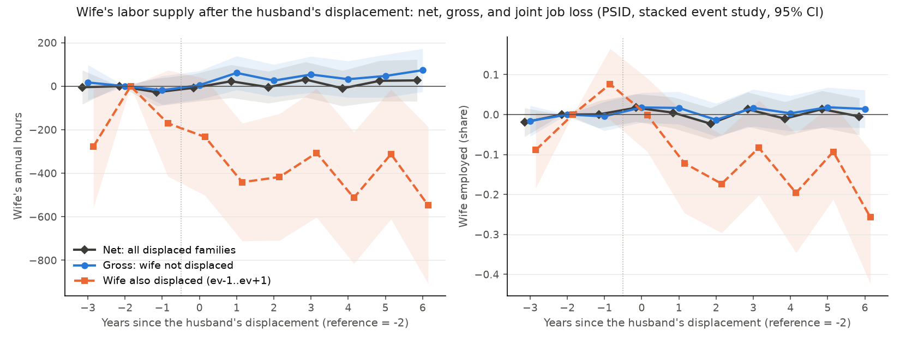
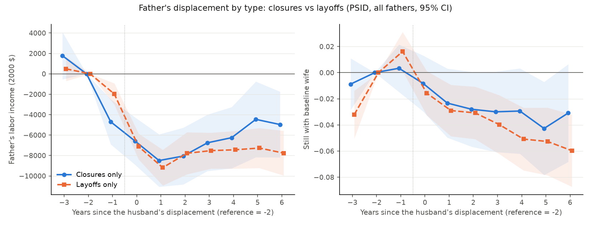
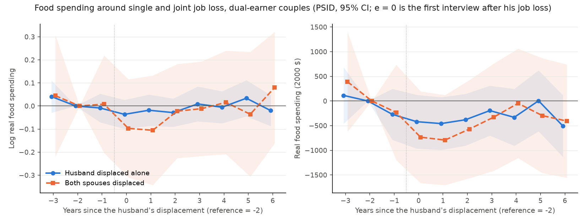

# PSID checks on the joint job loss of spouses (referee review of Paper A)

Built by `38.PSIDJointLossChecks.py` (2026-10-17); definitions in its docstring. Requested by `proposals/fable_review_paperA.md` Secs. 3.1-3.2, plan items 3, 6, 11. Unweighted PSID SRC + SEO, Black and White (head's race). S.e. clustered by 1968 family; *** p<0.01, ** p<0.05, * p<0.1. Every cell: coefficient*** (s.e.; p). Dollars are 2000 dollars.

## 1. Gross vs net added-worker effect

19's stacked design restricted to event years 1984-2021 (the wife's own job-end reports start with the 1984 wave) and to fathers with a wife at baseline. J = the baseline wife reports her own displacement (closure, layoff or firing) dated ev-1..ev+1, all three years covered (J = 0 if she did not work at baseline). Coverage: J is defined for 0.824 of 1,366 displaced and 0.835 of 41,264 control father-stacks with a wife (it is missing when the couple has split up or is not interviewed by the interview that covers ev+1). Outcomes: wife's annual hours and employment (hours > 0) while she is the baseline wife; mean of event years +1..+3 relative to e = -2. Table 1 of the paper (all event years 1968-2022): wife's hours 51** (23; p=0.029), employed 0.008 (0.013; p=0.565).

### 1a. Interaction model (one regression per cell column; mean of e = +1..+3)

Rows: 'Displaced' = displaced x e (the GROSS response: displaced families whose wife was not displaced vs control families whose wife was not displaced); 'Wife's own displacement' = J x e among control families (what a wife's displacement does to her hours absent his); 'Displaced x wife's own displacement' = the triple interaction. Derived rows are linear combinations of the same regression. Implied net = gross + (P1 - P0) x own + P1 x triple (exact in group means); 'joint-loss offset' = implied net - gross. 'Net, plain event study' = 19's event study on the same sample.

| | Wife's annual hours | Wife employed |
|---|---|---|
| **All wives present at baseline** | | |
| Displaced (gross response: wife not displaced) | 47 (34; p=0.165) | 0.007 (0.019; p=0.714) |
| Wife's own displacement (controls) | -213*** (39; p=<0.001) | -0.097*** (0.015; p=<0.001) |
| Displaced x wife's own displacement | -222 (139; p=0.110) | -0.036 (0.058; p=0.534) |
| Derived: displaced, wife also displaced, vs controls with wife not displaced | -388*** (129; p=0.003) | -0.126** (0.053; p=0.017) |
| Derived: displaced, wife also displaced, vs controls with wife displaced | -175 (135; p=0.192) | -0.029 (0.055; p=0.592) |
| Derived: implied net = gross + (P1-P0) own + P1 triple | 12 (33; p=0.726) | -0.002 (0.017; p=0.889) |
| Derived: joint-loss offset (implied net - gross) | -35** (14; p=0.013) | -0.009 (0.006; p=0.126) |
| Net, plain event study (same sample) | 16 (33; p=0.626) | -0.002 (0.017; p=0.926) |
| P1 / P0 (wife displaced: displaced / control families) | 0.106 / 0.050 | 0.106 / 0.050 |
| Treated mean at e = -2, -1: wife not displaced / displaced | 1,069 / 1,438 | 0.711 / 0.968 |
| Displaced fathers (wife displaced) / control stacks (wife displaced) | 1,126 (119) / 34,451 (1,725) | 1,126 (119) / 34,451 (1,725) |
| N (man-years, stacked) / clusters | 202,889 / 1,826 | 202,889 / 1,826 |
| **Youngest child 0-5** | | |
| Displaced (gross response: wife not displaced) | 97** (45; p=0.032) | 0.043* (0.026; p=0.097) |
| Wife's own displacement (controls) | -252*** (59; p=<0.001) | -0.098*** (0.024; p=<0.001) |
| Displaced x wife's own displacement | -158 (196; p=0.418) | -0.061 (0.082; p=0.461) |
| Derived: displaced, wife also displaced, vs controls with wife not displaced | -313* (183; p=0.087) | -0.116 (0.074; p=0.120) |
| Derived: displaced, wife also displaced, vs controls with wife displaced | -61 (190; p=0.748) | -0.018 (0.078; p=0.821) |
| Derived: implied net = gross + (P1-P0) own + P1 triple | 69 (45; p=0.125) | 0.032 (0.025; p=0.190) |
| Derived: joint-loss offset (implied net - gross) | -28 (19; p=0.129) | -0.011 (0.008; p=0.162) |
| Net, plain event study (same sample) | 72 (45; p=0.106) | 0.033 (0.025; p=0.178) |
| P1 / P0 (wife displaced: displaced / control families) | 0.099 / 0.048 | 0.099 / 0.048 |
| Treated mean at e = -2, -1: wife not displaced / displaced | 952 / 1,260 | 0.669 / 0.965 |
| Displaced fathers (wife displaced) / control stacks (wife displaced) | 659 (65) / 17,349 (830) | 659 (65) / 17,349 (830) |
| N (man-years, stacked) / clusters | 102,291 / 1,606 | 102,291 / 1,606 |
| **Youngest child 6-17** | | |
| Displaced (gross response: wife not displaced) | -13 (52; p=0.795) | -0.043* (0.025; p=0.087) |
| Wife's own displacement (controls) | -188*** (51; p=<0.001) | -0.098*** (0.018; p=<0.001) |
| Displaced x wife's own displacement | -252 (194; p=0.194) | 0.005 (0.081; p=0.953) |
| Derived: displaced, wife also displaced, vs controls with wife not displaced | -453** (179; p=0.012) | -0.136* (0.075; p=0.072) |
| Derived: displaced, wife also displaced, vs controls with wife displaced | -265 (187; p=0.156) | -0.038 (0.077; p=0.620) |
| Derived: implied net = gross + (P1-P0) own + P1 triple | -54 (50; p=0.279) | -0.049** (0.024; p=0.043) |
| Derived: joint-loss offset (implied net - gross) | -41* (22; p=0.060) | -0.006 (0.009; p=0.540) |
| Net, plain event study (same sample) | -51 (51; p=0.321) | -0.048** (0.024; p=0.047) |
| P1 / P0 (wife displaced: displaced / control families) | 0.116 / 0.052 | 0.116 / 0.052 |
| Treated mean at e = -2, -1: wife not displaced / displaced | 1,238 / 1,649 | 0.773 / 0.972 |
| Displaced fathers (wife displaced) / control stacks (wife displaced) | 467 (54) / 17,102 (895) | 467 (54) / 17,102 (895) |
| N (man-years, stacked) / clusters | 100,598 / 1,552 | 100,598 / 1,552 |
| **Wife employed at baseline** | | |
| Displaced (gross response: wife not displaced) | -7 (41; p=0.867) | -0.027* (0.016; p=0.100) |
| Wife's own displacement (controls) | -157*** (40; p=<0.001) | -0.042*** (0.015; p=0.004) |
| Displaced x wife's own displacement | -160 (140; p=0.255) | 0.006 (0.057; p=0.921) |
| Derived: displaced, wife also displaced, vs controls with wife not displaced | -324** (128; p=0.012) | -0.063 (0.052; p=0.225) |
| Derived: displaced, wife also displaced, vs controls with wife displaced | -167 (134; p=0.214) | -0.021 (0.054; p=0.693) |
| Derived: implied net = gross + (P1-P0) own + P1 triple | -42 (40; p=0.289) | -0.030* (0.016; p=0.063) |
| Derived: joint-loss offset (implied net - gross) | -35* (20; p=0.071) | -0.002 (0.008; p=0.758) |
| Net, plain event study (same sample) | -36 (40; p=0.369) | -0.029* (0.016; p=0.067) |
| P1 / P0 (wife displaced: displaced / control families) | 0.144 / 0.066 | 0.144 / 0.066 |
| Treated mean at e = -2, -1: wife not displaced / displaced | 1,497 / 1,438 | 0.975 / 0.968 |
| Displaced fathers (wife displaced) / control stacks (wife displaced) | 826 (119) / 26,196 (1,725) | 826 (119) / 26,196 (1,725) |
| N (man-years, stacked) / clusters | 157,219 / 1,695 | 157,219 / 1,695 |
| **Wife employed at baseline, youngest 0-5** | | |
| Displaced (gross response: wife not displaced) | 4 (57; p=0.949) | -0.015 (0.025; p=0.543) |
| Wife's own displacement (controls) | -180*** (60; p=0.003) | -0.030 (0.024; p=0.207) |
| Displaced x wife's own displacement | -56 (196; p=0.776) | 0.009 (0.081; p=0.912) |
| Derived: displaced, wife also displaced, vs controls with wife not displaced | -232 (182; p=0.201) | -0.037 (0.074; p=0.621) |
| Derived: displaced, wife also displaced, vs controls with wife displaced | -52 (190; p=0.783) | -0.006 (0.078; p=0.937) |
| Derived: implied net = gross + (P1-P0) own + P1 triple | -18 (56; p=0.747) | -0.016 (0.024; p=0.503) |
| Derived: joint-loss offset (implied net - gross) | -22 (27; p=0.424) | -0.001 (0.011; p=0.927) |
| Net, plain event study (same sample) | -14 (55; p=0.803) | -0.015 (0.024; p=0.515) |
| P1 / P0 (wife displaced: displaced / control families) | 0.143 / 0.067 | 0.143 / 0.067 |
| Treated mean at e = -2, -1: wife not displaced / displaced | 1,413 / 1,260 | 0.968 / 0.965 |
| Displaced fathers (wife displaced) / control stacks (wife displaced) | 455 (65) / 12,411 (830) | 455 (65) / 12,411 (830) |
| N (man-years, stacked) / clusters | 74,661 / 1,446 | 74,661 / 1,446 |
| **Wife employed at baseline, youngest 6-17** | | |
| Displaced (gross response: wife not displaced) | -9 (59; p=0.882) | -0.037* (0.020; p=0.070) |
| Wife's own displacement (controls) | -142*** (51; p=0.006) | -0.053*** (0.018; p=0.003) |
| Displaced x wife's own displacement | -250 (196; p=0.202) | 0.003 (0.079; p=0.967) |
| Derived: displaced, wife also displaced, vs controls with wife not displaced | -401** (179; p=0.025) | -0.087 (0.075; p=0.247) |
| Derived: displaced, wife also displaced, vs controls with wife displaced | -259 (187; p=0.166) | -0.034 (0.077; p=0.661) |
| Derived: implied net = gross + (P1-P0) own + P1 triple | -57 (57; p=0.319) | -0.041** (0.021; p=0.048) |
| Derived: joint-loss offset (implied net - gross) | -48* (28; p=0.084) | -0.004 (0.011; p=0.738) |
| Net, plain event study (same sample) | -51 (57; p=0.377) | -0.040* (0.020; p=0.050) |
| P1 / P0 (wife displaced: displaced / control families) | 0.146 / 0.065 | 0.146 / 0.065 |
| Treated mean at e = -2, -1: wife not displaced / displaced | 1,599 / 1,649 | 0.984 / 0.972 |
| Displaced fathers (wife displaced) / control stacks (wife displaced) | 371 (54) / 13,785 (895) | 371 (54) / 13,785 (895) |
| N (man-years, stacked) / clusters | 82,558 / 1,439 | 82,558 / 1,439 |
| **Black** | | |
| Displaced (gross response: wife not displaced) | -20 (56; p=0.723) | -0.022 (0.028; p=0.439) |
| Wife's own displacement (controls) | -178*** (66; p=0.008) | -0.071*** (0.027; p=0.008) |
| Displaced x wife's own displacement | -203 (215; p=0.347) | -0.008 (0.086; p=0.922) |
| Derived: displaced, wife also displaced, vs controls with wife not displaced | -400** (199; p=0.045) | -0.101 (0.076; p=0.186) |
| Derived: displaced, wife also displaced, vs controls with wife displaced | -222 (209; p=0.287) | -0.030 (0.080; p=0.706) |
| Derived: implied net = gross + (P1-P0) own + P1 triple | -53 (55; p=0.337) | -0.026 (0.026; p=0.314) |
| Derived: joint-loss offset (implied net - gross) | -33 (25; p=0.183) | -0.005 (0.010; p=0.644) |
| Net, plain event study (same sample) | -49 (56; p=0.381) | -0.028 (0.026; p=0.293) |
| P1 / P0 (wife displaced: displaced / control families) | 0.119 / 0.069 | 0.119 / 0.069 |
| Treated mean at e = -2, -1: wife not displaced / displaced | 1,172 / 1,438 | 0.719 / 0.967 |
| Displaced fathers (wife displaced) / control stacks (wife displaced) | 403 (48) / 8,410 (577) | 403 (48) / 8,410 (577) |
| N (man-years, stacked) / clusters | 49,084 / 613 | 49,084 / 613 |
| **White** | | |
| Displaced (gross response: wife not displaced) | 78* (43; p=0.071) | 0.020 (0.024; p=0.404) |
| Wife's own displacement (controls) | -235*** (49; p=<0.001) | -0.110*** (0.017; p=<0.001) |
| Displaced x wife's own displacement | -233 (183; p=0.203) | -0.053 (0.078; p=0.494) |
| Derived: displaced, wife also displaced, vs controls with wife not displaced | -390** (170; p=0.022) | -0.143** (0.071; p=0.045) |
| Derived: displaced, wife also displaced, vs controls with wife displaced | -155 (177; p=0.379) | -0.033 (0.074; p=0.653) |
| Derived: implied net = gross + (P1-P0) own + P1 triple | 42 (42; p=0.314) | 0.009 (0.023; p=0.695) |
| Derived: joint-loss offset (implied net - gross) | -36** (17; p=0.042) | -0.011 (0.007; p=0.136) |
| Net, plain event study (same sample) | 47 (42; p=0.257) | 0.011 (0.023; p=0.638) |
| P1 / P0 (wife displaced: displaced / control families) | 0.098 / 0.044 | 0.098 / 0.044 |
| Treated mean at e = -2, -1: wife not displaced / displaced | 1,017 / 1,439 | 0.708 / 0.969 |
| Displaced fathers (wife displaced) / control stacks (wife displaced) | 723 (71) / 26,041 (1,148) | 723 (71) / 26,041 (1,148) |
| N (man-years, stacked) / clusters | 153,805 / 1,289 | 153,805 / 1,289 |
| Fixed effects | father x stack, calendar year x stack | father x stack, calendar year x stack |

Robustness: J from the covered years of ev-1..ev+1 (at least one covered) instead of all three:

| | Wife's annual hours | Wife employed |
|---|---|---|
| **All wives present at baseline (lenient J)** | | |
| Displaced (gross response: wife not displaced) | 59* (33; p=0.075) | 0.016 (0.018; p=0.364) |
| Wife's own displacement (controls) | -226*** (39; p=<0.001) | -0.101*** (0.014; p=<0.001) |
| Displaced x wife's own displacement | -219 (134; p=0.102) | -0.040 (0.058; p=0.490) |
| Derived: displaced, wife also displaced, vs controls with wife not displaced | -386*** (124; p=0.002) | -0.125** (0.053; p=0.018) |
| Derived: displaced, wife also displaced, vs controls with wife displaced | -160 (130; p=0.217) | -0.024 (0.055; p=0.666) |
| Derived: implied net = gross + (P1-P0) own + P1 triple | 21 (32; p=0.507) | 0.006 (0.017; p=0.727) |
| Derived: joint-loss offset (implied net - gross) | -37*** (14; p=0.009) | -0.010* (0.006; p=0.095) |
| P1 / P0 | 0.110 / 0.050 | 0.110 / 0.050 |
| N (man-years, stacked) | 215,961 | 215,961 |

### 1a'. The net response by sample period (19's plain event study)

Where the Table 1 net (+51 hours) comes from: the added-worker response is concentrated in event years before 1984, when the wife's own job ends are not measured; the gross / net decomposition can only be estimated from 1984.

| | Wife's annual hours | Wife employed |
|---|---|---|
| **Table 1 sample: event years 1968-2022** | | |
| Displaced, mean e = +1..+3 (all) | 51** (23; p=0.029) | 0.008 (0.013; p=0.565) |
| Displaced / N (all) | 2,295 / 386,254 | 2,295 / 386,254 |
| Displaced, mean e = +1..+3 (youngest 0-5) | 112*** (31; p=<0.001) | 0.041** (0.018; p=0.025) |
| Displaced / N (youngest 0-5) | 1,415 / 193,277 | 1,415 / 193,277 |
| Displaced, mean e = +1..+3 (youngest 6-17) | -26 (36; p=0.474) | -0.038** (0.018; p=0.036) |
| Displaced / N (youngest 6-17) | 880 / 192,977 | 880 / 192,977 |
| **Event years 1968-1983** | | |
| Displaced, mean e = +1..+3 (all) | 74** (34; p=0.029) | 0.009 (0.020; p=0.655) |
| Displaced / N (all) | 911 / 165,498 | 911 / 165,498 |
| Displaced, mean e = +1..+3 (youngest 0-5) | 140*** (45; p=0.002) | 0.041 (0.027; p=0.128) |
| Displaced / N (youngest 0-5) | 591 / 82,090 | 591 / 82,090 |
| Displaced, mean e = +1..+3 (youngest 6-17) | -15 (53; p=0.779) | -0.036 (0.028; p=0.204) |
| Displaced / N (youngest 6-17) | 320 / 83,408 | 320 / 83,408 |
| **Event years 1984-2021, all** | | |
| Displaced, mean e = +1..+3 (all) | 30 (33; p=0.364) | 0.008 (0.017; p=0.629) |
| Displaced / N (all) | 1,366 / 218,835 | 1,366 / 218,835 |
| Displaced, mean e = +1..+3 (youngest 0-5) | 89** (44; p=0.044) | 0.045* (0.024; p=0.063) |
| Displaced / N (youngest 0-5) | 814 / 110,206 | 814 / 110,206 |
| Displaced, mean e = +1..+3 (youngest 6-17) | -41 (50; p=0.409) | -0.041* (0.023; p=0.083) |
| Displaced / N (youngest 6-17) | 552 / 108,629 | 552 / 108,629 |
| **Event years 1984-2021, J defined (section 1a sample)** | | |
| Displaced, mean e = +1..+3 (all) | 16 (33; p=0.626) | -0.002 (0.017; p=0.926) |
| Displaced / N (all) | 1,126 / 202,889 | 1,126 / 202,889 |
| Displaced, mean e = +1..+3 (youngest 0-5) | 72 (45; p=0.106) | 0.033 (0.025; p=0.178) |
| Displaced / N (youngest 0-5) | 659 / 102,291 | 659 / 102,291 |
| Displaced, mean e = +1..+3 (youngest 6-17) | -51 (51; p=0.321) | -0.048** (0.024; p=0.047) |
| Displaced / N (youngest 6-17) | 467 / 100,598 | 467 / 100,598 |
| Fixed effects | father x stack, calendar year x stack | father x stack, calendar year x stack |

### 1b. Descriptive split (separate event studies; every event-time coefficient)

Each panel is one sample, each column one regression (19's specification). Wife's own displacement J as above. 'Gross' compares displaced and control families in which the wife was not displaced.

| | Wife's annual hours | Wife employed |
|---|---|---|
| **All wives present at baseline: Net: all displaced vs all controls** | | |
| e=-3 | -5 (40; p=0.909) | -0.019 (0.018; p=0.290) |
| e=-1 | -28 (32; p=0.392) | 0.001 (0.017; p=0.974) |
| e=+0 | -7 (32; p=0.818) | 0.017 (0.018; p=0.335) |
| e=+1 | 23 (39; p=0.557) | 0.005 (0.020; p=0.810) |
| e=+2 | -5 (37; p=0.903) | -0.023 (0.020; p=0.256) |
| e=+3 | 31 (41; p=0.461) | 0.013 (0.022; p=0.548) |
| e=+4 | -10 (42; p=0.815) | -0.010 (0.022; p=0.635) |
| e=+5 | 25 (48; p=0.602) | 0.014 (0.024; p=0.565) |
| e=+6 | 27 (49; p=0.585) | -0.005 (0.023; p=0.841) |
| mean +1..+3 | 16 (33; p=0.626) | -0.002 (0.017; p=0.926) |
| Displaced / controls / N / clusters | 1,126 / 34,451 / 202,889 / 1,826 | 1,126 / 34,451 / 202,889 / 1,826 |
| **All wives present at baseline: Gross: displaced, wife NOT displaced vs controls, wife not displaced** | | |
| e=-3 | 17 (41; p=0.687) | -0.016 (0.020; p=0.402) |
| e=-1 | -18 (34; p=0.601) | -0.004 (0.019; p=0.824) |
| e=+0 | 5 (33; p=0.879) | 0.018 (0.019; p=0.348) |
| e=+1 | 61 (40; p=0.126) | 0.016 (0.021; p=0.430) |
| e=+2 | 25 (38; p=0.504) | -0.013 (0.021; p=0.525) |
| e=+3 | 54 (43; p=0.207) | 0.017 (0.024; p=0.472) |
| e=+4 | 32 (43; p=0.454) | 0.003 (0.023; p=0.886) |
| e=+5 | 47 (50; p=0.352) | 0.018 (0.025; p=0.475) |
| e=+6 | 73 (51; p=0.148) | 0.014 (0.024; p=0.560) |
| mean +1..+3 | 47 (34; p=0.168) | 0.007 (0.019; p=0.719) |
| Displaced / controls / N / clusters | 1,007 / 32,726 / 191,767 / 1,804 | 1,007 / 32,726 / 191,767 / 1,804 |
| **All wives present at baseline: Displaced, wife ALSO displaced vs controls, wife not displaced** | | |
| e=-3 | -278* (143; p=0.052) | -0.089* (0.048; p=0.064) |
| e=-1 | -170 (124; p=0.172) | 0.076* (0.045; p=0.094) |
| e=+0 | -234* (137; p=0.089) | -0.001 (0.047; p=0.984) |
| e=+1 | -443*** (138; p=0.001) | -0.122* (0.064; p=0.056) |
| e=+2 | -419*** (149; p=0.005) | -0.173*** (0.063; p=0.006) |
| e=+3 | -308** (151; p=0.042) | -0.083 (0.061; p=0.174) |
| e=+4 | -512*** (155; p=<0.001) | -0.194** (0.077; p=0.011) |
| e=+5 | -315** (152; p=0.038) | -0.094 (0.061; p=0.124) |
| e=+6 | -549*** (184; p=0.003) | -0.257*** (0.085; p=0.003) |
| mean +1..+3 | -390*** (129; p=0.003) | -0.126** (0.053; p=0.017) |
| Displaced / controls / N / clusters | 119 / 32,726 / 186,737 / 1,724 | 119 / 32,726 / 186,737 / 1,724 |
| **All wives present at baseline: Displaced, wife also displaced vs controls, wife displaced** | | |
| e=-3 | -170 (144; p=0.238) | -0.025 (0.050; p=0.620) |
| e=-1 | -145 (126; p=0.250) | -0.009 (0.046; p=0.843) |
| e=+0 | -42 (137; p=0.760) | 0.024 (0.048; p=0.626) |
| e=+1 | -172 (146; p=0.237) | -0.050 (0.065; p=0.445) |
| e=+2 | -162 (154; p=0.294) | -0.042 (0.065; p=0.518) |
| e=+3 | -89 (158; p=0.572) | 0.035 (0.063; p=0.577) |
| e=+4 | -315** (160; p=0.049) | -0.082 (0.076; p=0.284) |
| e=+5 | -79 (158; p=0.619) | 0.036 (0.062; p=0.563) |
| e=+6 | -317* (192; p=0.099) | -0.132 (0.087; p=0.127) |
| mean +1..+3 | -141 (135; p=0.297) | -0.019 (0.055; p=0.729) |
| Displaced / controls / N / clusters | 119 / 1,725 / 11,122 / 644 | 119 / 1,725 / 11,122 / 644 |
| **Youngest child 0-5: Net: all displaced vs all controls** | | |
| e=-3 | -24 (57; p=0.676) | -0.020 (0.027; p=0.471) |
| e=-1 | -5 (44; p=0.907) | 0.026 (0.025; p=0.300) |
| e=+0 | -3 (43; p=0.942) | 0.016 (0.026; p=0.547) |
| e=+1 | 87 (54; p=0.110) | 0.041 (0.029; p=0.146) |
| e=+2 | 45 (49; p=0.356) | 0.009 (0.028; p=0.758) |
| e=+3 | 85 (56; p=0.132) | 0.049 (0.031; p=0.110) |
| e=+4 | 11 (56; p=0.846) | 0.018 (0.030; p=0.562) |
| e=+5 | 57 (67; p=0.394) | 0.034 (0.034; p=0.316) |
| e=+6 | 57 (67; p=0.395) | 0.022 (0.033; p=0.511) |
| mean +1..+3 | 72 (45; p=0.106) | 0.033 (0.025; p=0.178) |
| Displaced / controls / N / clusters | 659 / 17,349 / 102,291 / 1,606 | 659 / 17,349 / 102,291 / 1,606 |
| **Youngest child 0-5: Gross: displaced, wife NOT displaced vs controls, wife not displaced** | | |
| e=-3 | -12 (60; p=0.843) | -0.016 (0.029; p=0.593) |
| e=-1 | 6 (45; p=0.899) | 0.021 (0.026; p=0.419) |
| e=+0 | -8 (44; p=0.854) | 0.018 (0.027; p=0.512) |
| e=+1 | 119** (56; p=0.034) | 0.058* (0.030; p=0.050) |
| e=+2 | 62 (49; p=0.212) | 0.018 (0.029; p=0.534) |
| e=+3 | 105* (57; p=0.065) | 0.052 (0.034; p=0.121) |
| e=+4 | 41 (58; p=0.482) | 0.028 (0.032; p=0.379) |
| e=+5 | 75 (70; p=0.287) | 0.036 (0.036; p=0.314) |
| e=+6 | 93 (69; p=0.177) | 0.047 (0.034; p=0.167) |
| mean +1..+3 | 95** (45; p=0.035) | 0.043 (0.026; p=0.101) |
| Displaced / controls / N / clusters | 594 / 16,519 / 96,934 / 1,587 | 594 / 16,519 / 96,934 / 1,587 |
| **Youngest child 0-5: Displaced, wife ALSO displaced vs controls, wife not displaced** | | |
| e=-3 | -256 (193; p=0.185) | -0.109 (0.069; p=0.112) |
| e=-1 | -152 (169; p=0.367) | 0.099 (0.068; p=0.144) |
| e=+0 | -88 (181; p=0.626) | -0.022 (0.077; p=0.771) |
| e=+1 | -367** (182; p=0.044) | -0.131 (0.093; p=0.157) |
| e=+2 | -297 (216; p=0.170) | -0.161* (0.090; p=0.072) |
| e=+3 | -274 (220; p=0.213) | -0.054 (0.077; p=0.480) |
| e=+4 | -452** (213; p=0.034) | -0.164 (0.102; p=0.108) |
| e=+5 | -312 (234; p=0.182) | -0.084 (0.083; p=0.313) |
| e=+6 | -470* (272; p=0.085) | -0.298** (0.122; p=0.014) |
| mean +1..+3 | -313* (182; p=0.086) | -0.116 (0.074; p=0.120) |
| Displaced / controls / N / clusters | 65 / 16,519 / 93,996 / 1,503 | 65 / 16,519 / 93,996 / 1,503 |
| **Youngest child 0-5: Displaced, wife also displaced vs controls, wife displaced** | | |
| e=-3 | -155 (198; p=0.433) | -0.056 (0.073; p=0.443) |
| e=-1 | -178 (175; p=0.309) | -0.011 (0.068; p=0.874) |
| e=+0 | 62 (173; p=0.720) | -0.014 (0.079; p=0.859) |
| e=+1 | -77 (192; p=0.690) | -0.052 (0.094; p=0.582) |
| e=+2 | -14 (220; p=0.948) | -0.017 (0.096; p=0.862) |
| e=+3 | -29 (235; p=0.901) | 0.090 (0.081; p=0.269) |
| e=+4 | -238 (223; p=0.284) | -0.044 (0.101; p=0.667) |
| e=+5 | -3 (234; p=0.989) | 0.080 (0.083; p=0.330) |
| e=+6 | -258 (282; p=0.360) | -0.194 (0.125; p=0.120) |
| mean +1..+3 | -40 (191; p=0.834) | 0.007 (0.077; p=0.927) |
| Displaced / controls / N / clusters | 65 / 830 / 5,357 / 406 | 65 / 830 / 5,357 / 406 |
| **Youngest child 6-17: Net: all displaced vs all controls** | | |
| e=-3 | 1 (55; p=0.987) | -0.029 (0.022; p=0.191) |
| e=-1 | -50 (49; p=0.304) | -0.032 (0.023; p=0.175) |
| e=+0 | -3 (51; p=0.959) | 0.023 (0.021; p=0.281) |
| e=+1 | -54 (56; p=0.334) | -0.042 (0.026; p=0.105) |
| e=+2 | -65 (57; p=0.256) | -0.065** (0.028; p=0.018) |
| e=+3 | -33 (63; p=0.600) | -0.036 (0.031; p=0.249) |
| e=+4 | -32 (63; p=0.615) | -0.049* (0.029; p=0.097) |
| e=+5 | -13 (66; p=0.840) | -0.015 (0.032; p=0.642) |
| e=+6 | -19 (71; p=0.786) | -0.049 (0.032; p=0.125) |
| mean +1..+3 | -51 (51; p=0.321) | -0.048** (0.024; p=0.047) |
| Displaced / controls / N / clusters | 467 / 17,102 / 100,598 / 1,552 | 467 / 17,102 / 100,598 / 1,552 |
| **Youngest child 6-17: Gross: displaced, wife NOT displaced vs controls, wife not displaced** | | |
| e=-3 | 32 (55; p=0.563) | -0.028 (0.024; p=0.236) |
| e=-1 | -41 (49; p=0.405) | -0.038 (0.025; p=0.128) |
| e=+0 | 33 (51; p=0.516) | 0.021 (0.023; p=0.364) |
| e=+1 | -10 (56; p=0.854) | -0.038 (0.027; p=0.159) |
| e=+2 | -21 (58; p=0.722) | -0.057** (0.029; p=0.048) |
| e=+3 | -9 (66; p=0.888) | -0.032 (0.033; p=0.323) |
| e=+4 | 24 (63; p=0.705) | -0.033 (0.030; p=0.266) |
| e=+5 | 11 (70; p=0.873) | -0.008 (0.034; p=0.809) |
| e=+6 | 39 (73; p=0.596) | -0.040 (0.033; p=0.231) |
| mean +1..+3 | -13 (52; p=0.796) | -0.043* (0.025; p=0.090) |
| Displaced / controls / N / clusters | 413 / 16,207 / 94,833 / 1,528 | 413 / 16,207 / 94,833 / 1,528 |
| **Youngest child 6-17: Displaced, wife ALSO displaced vs controls, wife not displaced** | | |
| e=-3 | -292 (208; p=0.161) | -0.071 (0.065; p=0.280) |
| e=-1 | -168 (177; p=0.343) | 0.051 (0.059; p=0.387) |
| e=+0 | -381* (204; p=0.061) | 0.030 (0.050; p=0.545) |
| e=+1 | -510** (210; p=0.015) | -0.105 (0.085; p=0.214) |
| e=+2 | -542*** (201; p=0.007) | -0.187** (0.087; p=0.031) |
| e=+3 | -312 (194; p=0.107) | -0.114 (0.098; p=0.243) |
| e=+4 | -563** (222; p=0.011) | -0.229** (0.115; p=0.045) |
| e=+5 | -284 (178; p=0.110) | -0.110 (0.089; p=0.219) |
| e=+6 | -623*** (221; p=0.005) | -0.197* (0.113; p=0.081) |
| mean +1..+3 | -455** (179; p=0.011) | -0.135* (0.075; p=0.073) |
| Displaced / controls / N / clusters | 54 / 16,207 / 92,741 / 1,456 | 54 / 16,207 / 92,741 / 1,456 |
| **Youngest child 6-17: Displaced, wife also displaced vs controls, wife displaced** | | |
| e=-3 | -214 (214; p=0.316) | 0.009 (0.071; p=0.902) |
| e=-1 | -146 (182; p=0.422) | -0.025 (0.061; p=0.688) |
| e=+0 | -207 (222; p=0.350) | 0.047 (0.055; p=0.398) |
| e=+1 | -316 (231; p=0.170) | -0.049 (0.088; p=0.578) |
| e=+2 | -338 (214; p=0.115) | -0.062 (0.091; p=0.496) |
| e=+3 | -136 (211; p=0.519) | -0.023 (0.105; p=0.828) |
| e=+4 | -463** (226; p=0.040) | -0.147 (0.116; p=0.206) |
| e=+5 | -139 (203; p=0.491) | -0.016 (0.093; p=0.868) |
| e=+6 | -441* (228; p=0.054) | -0.095 (0.120; p=0.427) |
| mean +1..+3 | -263 (197; p=0.181) | -0.045 (0.080; p=0.577) |
| Displaced / controls / N / clusters | 54 / 895 / 5,765 / 380 | 54 / 895 / 5,765 / 380 |
| **Wife employed at baseline: Net: all displaced vs all controls** | | |
| e=-3 | -22 (46; p=0.629) | -0.019 (0.017; p=0.265) |
| e=-1 | -40 (39; p=0.308) | 0.011 (0.015; p=0.452) |
| e=+0 | -59 (39; p=0.130) | -0.014 (0.015; p=0.348) |
| e=+1 | -27 (46; p=0.559) | -0.022 (0.018; p=0.223) |
| e=+2 | -67 (43; p=0.120) | -0.057*** (0.019; p=0.002) |
| e=+3 | -13 (49; p=0.787) | -0.007 (0.021; p=0.732) |
| e=+4 | -38 (47; p=0.423) | -0.015 (0.020; p=0.456) |
| e=+5 | -26 (54; p=0.637) | 0.002 (0.022; p=0.926) |
| e=+6 | -14 (54; p=0.798) | -0.019 (0.022; p=0.390) |
| mean +1..+3 | -36 (40; p=0.369) | -0.029* (0.016; p=0.067) |
| Displaced / controls / N / clusters | 826 / 26,196 / 157,219 / 1,695 | 826 / 26,196 / 157,219 / 1,695 |
| **Wife employed at baseline: Gross: displaced, wife NOT displaced vs controls, wife not displaced** | | |
| e=-3 | -0 (48; p=0.993) | -0.018 (0.018; p=0.305) |
| e=-1 | -23 (41; p=0.580) | 0.012 (0.015; p=0.434) |
| e=+0 | -51 (41; p=0.215) | -0.021 (0.016; p=0.204) |
| e=+1 | 14 (49; p=0.773) | -0.015 (0.019; p=0.432) |
| e=+2 | -41 (44; p=0.346) | -0.055*** (0.019; p=0.004) |
| e=+3 | 6 (51; p=0.911) | -0.011 (0.023; p=0.621) |
| e=+4 | 7 (49; p=0.884) | -0.004 (0.021; p=0.842) |
| e=+5 | -11 (59; p=0.850) | -0.000 (0.024; p=0.987) |
| e=+6 | 34 (56; p=0.540) | -0.003 (0.022; p=0.886) |
| mean +1..+3 | -7 (41; p=0.862) | -0.027 (0.016; p=0.102) |
| Displaced / controls / N / clusters | 707 / 24,471 / 146,097 / 1,660 | 707 / 24,471 / 146,097 / 1,660 |
| **Wife employed at baseline: Displaced, wife ALSO displaced vs controls, wife not displaced** | | |
| e=-3 | -204 (143; p=0.152) | -0.033 (0.048; p=0.492) |
| e=-1 | -212* (124; p=0.086) | 0.017 (0.045; p=0.712) |
| e=+0 | -208 (136; p=0.127) | 0.035 (0.046; p=0.447) |
| e=+1 | -401*** (138; p=0.004) | -0.078 (0.063; p=0.214) |
| e=+2 | -348** (148; p=0.019) | -0.104* (0.062; p=0.096) |
| e=+3 | -228 (151; p=0.130) | -0.008 (0.060; p=0.893) |
| e=+4 | -419*** (154; p=0.007) | -0.107 (0.076; p=0.157) |
| e=+5 | -216 (152; p=0.155) | -0.005 (0.061; p=0.932) |
| e=+6 | -439** (183; p=0.017) | -0.157* (0.084; p=0.062) |
| mean +1..+3 | -326** (128; p=0.011) | -0.063 (0.052; p=0.226) |
| Displaced / controls / N / clusters | 119 / 24,471 / 142,584 / 1,592 | 119 / 24,471 / 142,584 / 1,592 |
| **Wife employed at baseline: Displaced, wife also displaced vs controls, wife displaced** | | |
| e=-3 | -170 (144; p=0.238) | -0.025 (0.050; p=0.620) |
| e=-1 | -145 (126; p=0.250) | -0.009 (0.046; p=0.843) |
| e=+0 | -42 (137; p=0.760) | 0.024 (0.048; p=0.626) |
| e=+1 | -172 (146; p=0.237) | -0.050 (0.065; p=0.445) |
| e=+2 | -162 (154; p=0.294) | -0.042 (0.065; p=0.518) |
| e=+3 | -89 (158; p=0.572) | 0.035 (0.063; p=0.577) |
| e=+4 | -315** (160; p=0.049) | -0.082 (0.076; p=0.284) |
| e=+5 | -79 (158; p=0.619) | 0.036 (0.062; p=0.563) |
| e=+6 | -317* (192; p=0.099) | -0.132 (0.087; p=0.127) |
| mean +1..+3 | -141 (135; p=0.297) | -0.019 (0.055; p=0.729) |
| Displaced / controls / N / clusters | 119 / 1,725 / 11,122 / 644 | 119 / 1,725 / 11,122 / 644 |
| Fixed effects | father x stack, calendar year x stack | father x stack, calendar year x stack |

## 2. Closures only: the family event study and the marriage response

19's stacked design (all event years 1968-2022, fathers with a child 0-17 and positive hours at baseline). Closures only = the father's first displacement is a plant closure / move (19's 'strict'); layoffs only = his first displacement is a layoff or firing (closure-treated dropped); controls as in 19. All event-time coefficients (reference e = -2).

### 2a. Closures only: full parallel version of Table 1

| | Head's hours | Head's labor income | Wife's hours | Wife employed | Family income | Still with baseline wife | AFDC/TANF | Food stamps |
|---|---|---|---|---|---|---|---|---|
| **Closures only: All** | | | | | | | | |
| e=-3 | 38 (33; p=0.256) | 1,780 (1,182; p=0.132) | 16 (38; p=0.677) | -0.026 (0.021; p=0.230) | 2,305 (1,957; p=0.239) | -0.009 (0.010; p=0.384) | 0.003 (0.007; p=0.708) | -0.007 (0.012; p=0.567) |
| e=-1 | 30 (34; p=0.382) | -4,699*** (1,127; p=<0.001) | 51 (34; p=0.137) | 0.012 (0.020; p=0.561) | -6,000*** (1,720; p=<0.001) | 0.003 (0.009; p=0.717) | 0.005 (0.008; p=0.549) | 0.000 (0.014; p=0.994) |
| e=+0 | -223*** (39; p=<0.001) | -6,572*** (1,181; p=<0.001) | 12 (40; p=0.756) | 0.010 (0.022; p=0.644) | -6,648*** (1,678; p=<0.001) | -0.008 (0.011; p=0.449) | -0.002 (0.008; p=0.812) | 0.016 (0.015; p=0.265) |
| e=+1 | -197*** (45; p=<0.001) | -8,493*** (1,310; p=<0.001) | 103** (45; p=0.022) | 0.037 (0.024; p=0.121) | -9,301*** (1,697; p=<0.001) | -0.023* (0.013; p=0.084) | 0.002 (0.008; p=0.840) | 0.040** (0.018; p=0.022) |
| e=+2 | -134*** (44; p=0.002) | -8,054*** (1,418; p=<0.001) | 69 (45; p=0.120) | -0.009 (0.025; p=0.714) | -9,696*** (1,955; p=<0.001) | -0.028* (0.015; p=0.055) | 0.006 (0.008; p=0.445) | 0.025 (0.016; p=0.130) |
| e=+3 | -69 (46; p=0.130) | -6,755*** (1,411; p=<0.001) | 78 (48; p=0.102) | 0.011 (0.027; p=0.691) | -8,148*** (2,001; p=<0.001) | -0.030* (0.016; p=0.056) | 0.006 (0.009; p=0.484) | 0.010 (0.016; p=0.542) |
| e=+4 | -70 (44; p=0.111) | -6,255*** (1,532; p=<0.001) | 81* (47; p=0.081) | 0.041 (0.027; p=0.123) | -8,063*** (2,042; p=<0.001) | -0.029* (0.017; p=0.078) | -0.003 (0.007; p=0.654) | -0.002 (0.016; p=0.883) |
| e=+5 | -23 (46; p=0.608) | -4,460** (1,891; p=0.018) | 115** (55; p=0.037) | 0.041 (0.030; p=0.171) | -3,157 (3,271; p=0.334) | -0.043** (0.018; p=0.019) | 0.002 (0.007; p=0.820) | -0.004 (0.015; p=0.801) |
| e=+6 | -41 (48; p=0.391) | -4,966*** (1,644; p=0.003) | 147*** (54; p=0.007) | 0.040 (0.029; p=0.168) | -7,337*** (2,206; p=<0.001) | -0.031 (0.019; p=0.105) | -0.006 (0.006; p=0.327) | -0.013 (0.015; p=0.373) |
| mean +1..+3 | -133*** (38; p=<0.001) | -7,767*** (1,252; p=<0.001) | 83** (41; p=0.040) | 0.013 (0.022; p=0.559) | -9,048*** (1,712; p=<0.001) | -0.027** (0.014; p=0.045) | 0.005 (0.007; p=0.516) | 0.025* (0.014; p=0.076) |
| Treated mean at e = -2, -1 | 2,267 | 38,231 | 968 | 0.692 | 56,130 | 0.989 | 0.023 | 0.085 |
| Displaced / controls | 735 / 63,669 | 735 / 63,669 | 706 / 61,958 | 706 / 61,958 | 735 / 63,669 | 706 / 61,958 | 735 / 63,126 | 735 / 63,641 |
| N / clusters | 403,106 / 2,610 | 403,108 / 2,610 | 376,839 / 2,595 | 376,839 / 2,595 | 403,108 / 2,610 | 393,936 / 2,595 | 385,183 / 2,609 | 393,407 / 2,606 |
| **Closures only: Black** | | | | | | | | |
| e=-3 | 39 (64; p=0.550) | 2,380* (1,311; p=0.069) | -13 (68; p=0.850) | -0.002 (0.034; p=0.961) | 3,267 (2,577; p=0.205) | -0.028 (0.023; p=0.219) | 0.010 (0.012; p=0.428) | 0.009 (0.031; p=0.758) |
| e=-1 | 65 (63; p=0.305) | -446 (1,289; p=0.729) | 77 (70; p=0.271) | 0.026 (0.033; p=0.425) | -453 (2,180; p=0.835) | 0.010 (0.018; p=0.576) | 0.008 (0.015; p=0.601) | 0.010 (0.031; p=0.745) |
| e=+0 | -209*** (63; p=<0.001) | -3,116* (1,694; p=0.066) | 70 (72; p=0.333) | 0.021 (0.033; p=0.520) | -1,119 (2,522; p=0.657) | -0.010 (0.021; p=0.632) | -0.001 (0.016; p=0.950) | 0.020 (0.029; p=0.494) |
| e=+1 | -201*** (71; p=0.005) | -3,992** (1,614; p=0.013) | 71 (80; p=0.378) | 0.032 (0.036; p=0.370) | -3,454 (2,312; p=0.135) | -0.033 (0.028; p=0.230) | 0.011 (0.019; p=0.555) | 0.062 (0.039; p=0.111) |
| e=+2 | -156** (78; p=0.045) | -3,323* (1,893; p=0.079) | 70 (80; p=0.382) | -0.003 (0.036; p=0.934) | -3,416 (2,908; p=0.240) | -0.047 (0.030; p=0.114) | 0.015 (0.016; p=0.364) | 0.063* (0.036; p=0.077) |
| e=+3 | -3 (80; p=0.966) | -2,345 (1,832; p=0.201) | 82 (85; p=0.335) | -0.003 (0.039; p=0.933) | -3,445 (2,561; p=0.178) | -0.052 (0.033; p=0.119) | 0.017 (0.020; p=0.375) | 0.017 (0.035; p=0.625) |
| e=+4 | -13 (77; p=0.862) | -1,487 (1,777; p=0.403) | -5 (86; p=0.958) | 0.008 (0.044; p=0.851) | -3,405 (2,757; p=0.217) | -0.053 (0.034; p=0.118) | 0.002 (0.017; p=0.915) | 0.000 (0.034; p=0.991) |
| e=+5 | 32 (83; p=0.698) | -547 (1,949; p=0.779) | 99 (102; p=0.332) | 0.018 (0.049; p=0.709) | -396 (2,855; p=0.890) | -0.091** (0.038; p=0.016) | 0.022 (0.018; p=0.203) | -0.003 (0.034; p=0.940) |
| e=+6 | 57 (84; p=0.499) | 525 (2,221; p=0.813) | 94 (97; p=0.330) | 0.047 (0.046; p=0.297) | -1,375 (2,872; p=0.632) | -0.055 (0.037; p=0.140) | -0.004 (0.015; p=0.780) | 0.015 (0.034; p=0.658) |
| mean +1..+3 | -120* (65; p=0.063) | -3,220** (1,625; p=0.047) | 74 (74; p=0.314) | 0.009 (0.031; p=0.783) | -3,438 (2,418; p=0.155) | -0.044 (0.027; p=0.108) | 0.014 (0.015; p=0.323) | 0.048 (0.030; p=0.115) |
| Treated mean at e = -2, -1 | 2,139 | 28,028 | 1,142 | 0.740 | 44,023 | 0.987 | 0.035 | 0.146 |
| Displaced / controls | 266 / 17,746 | 266 / 17,746 | 244 / 16,927 | 244 / 16,927 | 266 / 17,746 | 244 / 16,927 | 266 / 17,591 | 266 / 17,726 |
| N / clusters | 107,370 / 945 | 107,370 / 945 | 97,327 / 933 | 97,327 / 933 | 107,370 / 945 | 102,978 / 933 | 103,190 / 942 | 104,526 / 941 |
| **Closures only: White** | | | | | | | | |
| e=-3 | 39 (39; p=0.316) | 1,290 (1,606; p=0.422) | 32 (46; p=0.478) | -0.036 (0.027; p=0.188) | 1,771 (2,575; p=0.492) | 0.004 (0.010; p=0.715) | -0.000 (0.008; p=0.988) | -0.013 (0.010; p=0.169) |
| e=-1 | 15 (39; p=0.701) | -6,719*** (1,567; p=<0.001) | 41 (37; p=0.270) | 0.005 (0.025; p=0.834) | -8,588*** (2,338; p=<0.001) | 0.002 (0.011; p=0.878) | 0.003 (0.009; p=0.703) | -0.004 (0.015; p=0.813) |
| e=+0 | -223*** (49; p=<0.001) | -8,153*** (1,568; p=<0.001) | -17 (47; p=0.725) | 0.005 (0.028; p=0.868) | -9,296*** (2,170; p=<0.001) | -0.005 (0.012; p=0.664) | -0.002 (0.009; p=0.823) | 0.015 (0.017; p=0.363) |
| e=+1 | -187*** (56; p=<0.001) | -10,367*** (1,784; p=<0.001) | 121** (55; p=0.027) | 0.040 (0.031; p=0.197) | -11,748*** (2,253; p=<0.001) | -0.015 (0.015; p=0.307) | -0.003 (0.008; p=0.742) | 0.031* (0.018; p=0.082) |
| e=+2 | -110** (53; p=0.037) | -9,906*** (1,906; p=<0.001) | 73 (54; p=0.174) | -0.012 (0.032; p=0.712) | -12,154*** (2,546; p=<0.001) | -0.015 (0.016; p=0.362) | 0.002 (0.009; p=0.785) | 0.006 (0.016; p=0.727) |
| e=+3 | -90 (56; p=0.106) | -8,482*** (1,876; p=<0.001) | 79 (57; p=0.167) | 0.017 (0.035; p=0.627) | -9,844*** (2,665; p=<0.001) | -0.016 (0.017; p=0.337) | 0.001 (0.009; p=0.906) | 0.004 (0.016; p=0.781) |
| e=+4 | -88 (53; p=0.101) | -8,011*** (2,111; p=<0.001) | 125** (55; p=0.024) | 0.058* (0.033; p=0.078) | -9,395*** (2,720; p=<0.001) | -0.013 (0.018; p=0.467) | -0.005 (0.007; p=0.508) | -0.001 (0.016; p=0.956) |
| e=+5 | -38 (55; p=0.486) | -5,795** (2,602; p=0.026) | 127* (66; p=0.053) | 0.052 (0.037; p=0.155) | -3,721 (4,569; p=0.415) | -0.017 (0.020; p=0.397) | -0.007 (0.006; p=0.234) | -0.003 (0.015; p=0.823) |
| e=+6 | -75 (59; p=0.201) | -6,929*** (2,181; p=0.001) | 177*** (65; p=0.006) | 0.039 (0.037; p=0.288) | -9,236*** (2,969; p=0.002) | -0.015 (0.022; p=0.499) | -0.007 (0.006; p=0.269) | -0.027* (0.014; p=0.062) |
| mean +1..+3 | -129*** (48; p=0.007) | -9,585*** (1,682; p=<0.001) | 91* (49; p=0.062) | 0.015 (0.029; p=0.604) | -11,249*** (2,249; p=<0.001) | -0.015 (0.015; p=0.304) | 0.000 (0.008; p=0.971) | 0.014 (0.014; p=0.343) |
| Treated mean at e = -2, -1 | 2,335 | 43,679 | 880 | 0.668 | 62,595 | 0.991 | 0.016 | 0.052 |
| Displaced / controls | 469 / 45,923 | 469 / 45,923 | 462 / 45,031 | 462 / 45,031 | 469 / 45,923 | 462 / 45,031 | 469 / 45,535 | 469 / 45,915 |
| N / clusters | 295,736 / 1,762 | 295,738 / 1,762 | 279,512 / 1,756 | 279,512 / 1,756 | 295,738 / 1,762 | 290,958 / 1,756 | 281,993 / 1,756 | 288,881 / 1,762 |
| **Closures only: Youngest child 0-5** | | | | | | | | |
| e=-3 | 22 (51; p=0.666) | 3,397** (1,643; p=0.039) | 72 (54; p=0.181) | 0.009 (0.033; p=0.789) | 2,628 (2,384; p=0.270) | -0.001 (0.015; p=0.969) | -0.003 (0.009; p=0.716) | -0.008 (0.019; p=0.655) |
| e=-1 | -1 (47; p=0.987) | -1,989 (1,451; p=0.171) | 122*** (43; p=0.004) | 0.051* (0.030; p=0.084) | -2,573 (1,946; p=0.186) | 0.006 (0.013; p=0.622) | 0.005 (0.013; p=0.716) | 0.006 (0.022; p=0.802) |
| e=+0 | -179*** (54; p=<0.001) | -4,404*** (1,645; p=0.007) | 80 (56; p=0.150) | 0.035 (0.032; p=0.283) | -4,162** (2,096; p=0.047) | -0.009 (0.017; p=0.581) | 0.000 (0.013; p=0.984) | 0.009 (0.021; p=0.681) |
| e=+1 | -138** (61; p=0.023) | -5,771*** (1,585; p=<0.001) | 237*** (63; p=<0.001) | 0.098*** (0.035; p=0.005) | -6,086*** (1,939; p=0.002) | -0.007 (0.019; p=0.698) | 0.015 (0.013; p=0.234) | 0.036 (0.025; p=0.154) |
| e=+2 | -110* (63; p=0.080) | -5,126*** (1,589; p=0.001) | 186*** (62; p=0.003) | 0.049 (0.035; p=0.168) | -4,833*** (1,845; p=0.009) | -0.018 (0.020; p=0.373) | 0.004 (0.013; p=0.786) | 0.018 (0.024; p=0.454) |
| e=+3 | -36 (63; p=0.571) | -4,199** (1,751; p=0.016) | 208*** (69; p=0.003) | 0.060 (0.040; p=0.128) | -2,734 (2,282; p=0.231) | -0.023 (0.022; p=0.299) | 0.013 (0.014; p=0.356) | 0.002 (0.022; p=0.921) |
| e=+4 | -33 (62; p=0.597) | -3,528* (1,991; p=0.076) | 218*** (67; p=0.001) | 0.093** (0.038; p=0.015) | -2,514 (2,521; p=0.319) | -0.014 (0.023; p=0.554) | -0.012 (0.009; p=0.210) | -0.026 (0.022; p=0.234) |
| e=+5 | -37 (64; p=0.560) | -1,661 (2,885; p=0.565) | 267*** (78; p=<0.001) | 0.087** (0.042; p=0.039) | -340 (5,251; p=0.948) | -0.042 (0.026; p=0.108) | 0.003 (0.012; p=0.769) | -0.021 (0.021; p=0.310) |
| e=+6 | -64 (65; p=0.326) | -4,121* (2,173; p=0.058) | 271*** (73; p=<0.001) | 0.083** (0.039; p=0.036) | -5,067** (2,478; p=0.041) | -0.016 (0.026; p=0.533) | -0.007 (0.010; p=0.507) | -0.026 (0.023; p=0.254) |
| mean +1..+3 | -95* (53; p=0.074) | -5,032*** (1,455; p=<0.001) | 210*** (56; p=<0.001) | 0.069** (0.032; p=0.030) | -4,551*** (1,719; p=0.008) | -0.016 (0.019; p=0.386) | 0.011 (0.012; p=0.357) | 0.019 (0.020; p=0.352) |
| Treated mean at e = -2, -1 | 2,242 | 33,926 | 852 | 0.663 | 48,000 | 0.989 | 0.026 | 0.111 |
| Displaced / controls | 392 / 31,782 | 392 / 31,782 | 380 / 31,252 | 380 / 31,252 | 392 / 31,782 | 380 / 31,252 | 392 / 31,521 | 392 / 31,760 |
| N / clusters | 199,440 / 2,243 | 199,440 / 2,243 | 187,281 / 2,234 | 187,281 / 2,234 | 199,440 / 2,243 | 196,841 / 2,234 | 190,450 / 2,239 | 194,805 / 2,240 |
| **Closures only: Youngest child 6-17** | | | | | | | | |
| e=-3 | 53 (42; p=0.207) | 234 (1,711; p=0.891) | -53 (53; p=0.314) | -0.067** (0.026; p=0.010) | 1,896 (3,097; p=0.540) | -0.018 (0.014; p=0.199) | 0.008 (0.010; p=0.423) | -0.005 (0.015; p=0.728) |
| e=-1 | 67 (48; p=0.160) | -7,484*** (1,772; p=<0.001) | -24 (55; p=0.667) | -0.031 (0.026; p=0.225) | -9,533*** (2,903; p=0.001) | -0.001 (0.013; p=0.964) | 0.005 (0.008; p=0.561) | -0.007 (0.018; p=0.687) |
| e=+0 | -273*** (55; p=<0.001) | -8,755*** (1,647; p=<0.001) | -55 (56; p=0.319) | -0.015 (0.027; p=0.579) | -9,087*** (2,650; p=<0.001) | -0.007 (0.013; p=0.619) | -0.004 (0.009; p=0.662) | 0.024 (0.021; p=0.241) |
| e=+1 | -265*** (64; p=<0.001) | -11,468*** (2,005; p=<0.001) | -44 (64; p=0.488) | -0.031 (0.031; p=0.322) | -12,659*** (2,771; p=<0.001) | -0.041** (0.020; p=0.039) | -0.013 (0.009; p=0.151) | 0.044* (0.023; p=0.060) |
| e=+2 | -164*** (61; p=0.007) | -11,440*** (2,282; p=<0.001) | -56 (64; p=0.385) | -0.073** (0.034; p=0.030) | -15,040*** (3,439; p=<0.001) | -0.038* (0.021; p=0.075) | 0.010 (0.009; p=0.305) | 0.031 (0.022; p=0.150) |
| e=+3 | -110* (65; p=0.091) | -9,645*** (2,187; p=<0.001) | -64 (65; p=0.319) | -0.045 (0.036; p=0.212) | -14,157*** (3,295; p=<0.001) | -0.036 (0.022; p=0.109) | -0.001 (0.009; p=0.881) | 0.017 (0.022; p=0.453) |
| e=+4 | -117* (61; p=0.055) | -9,411*** (2,230; p=<0.001) | -71 (64; p=0.267) | -0.020 (0.036; p=0.583) | -14,301*** (3,098; p=<0.001) | -0.045* (0.024; p=0.064) | 0.007 (0.012; p=0.561) | 0.022 (0.023; p=0.330) |
| e=+5 | -12 (62; p=0.851) | -7,943*** (2,131; p=<0.001) | -54 (78; p=0.487) | -0.014 (0.041; p=0.728) | -6,348* (3,435; p=0.065) | -0.041 (0.026; p=0.113) | -0.000 (0.006; p=0.970) | 0.015 (0.023; p=0.498) |
| e=+6 | -27 (69; p=0.699) | -6,202*** (2,363; p=0.009) | 1 (79; p=0.986) | -0.018 (0.041; p=0.655) | -9,791*** (3,645; p=0.007) | -0.043 (0.028; p=0.123) | -0.005 (0.008; p=0.498) | 0.000 (0.020; p=0.980) |
| mean +1..+3 | -180*** (55; p=0.001) | -10,851*** (1,964; p=<0.001) | -55 (58; p=0.346) | -0.050* (0.029; p=0.093) | -13,952*** (2,952; p=<0.001) | -0.038* (0.020; p=0.055) | -0.002 (0.008; p=0.827) | 0.031 (0.019; p=0.114) |
| Treated mean at e = -2, -1 | 2,295 | 43,089 | 1,100 | 0.727 | 65,306 | 0.991 | 0.019 | 0.055 |
| Displaced / controls | 343 / 31,887 | 343 / 31,887 | 326 / 30,706 | 326 / 30,706 | 343 / 31,887 | 326 / 30,706 | 343 / 31,605 | 343 / 31,881 |
| N / clusters | 203,666 / 2,217 | 203,668 / 2,217 | 189,558 / 2,187 | 189,558 / 2,187 | 203,668 / 2,217 | 197,095 / 2,187 | 194,733 / 2,215 | 198,602 / 2,215 |
| Fixed effects | father x stack, calendar year x stack | father x stack, calendar year x stack | father x stack, calendar year x stack | father x stack, calendar year x stack | father x stack, calendar year x stack | father x stack, calendar year x stack | father x stack, calendar year x stack | father x stack, calendar year x stack |

### 2b. Layoffs only (parallel)

| | Head's hours | Head's labor income | Wife's hours | Wife employed | Family income | Still with baseline wife | AFDC/TANF | Food stamps |
|---|---|---|---|---|---|---|---|---|
| **Layoffs only: All** | | | | | | | | |
| e=-3 | 3 (27; p=0.903) | 488 (612; p=0.425) | -17 (30; p=0.578) | -0.012 (0.017; p=0.474) | 529 (773; p=0.494) | -0.032*** (0.009; p=<0.001) | 0.002 (0.006; p=0.714) | -0.001 (0.014; p=0.927) |
| e=-1 | -36 (25; p=0.146) | -1,974*** (533; p=<0.001) | -35 (25; p=0.174) | 0.002 (0.015; p=0.894) | -3,010*** (712; p=<0.001) | 0.016** (0.008; p=0.033) | 0.004 (0.007; p=0.578) | 0.014 (0.012; p=0.242) |
| e=+0 | -333*** (27; p=<0.001) | -7,112*** (646; p=<0.001) | -1 (27; p=0.960) | 0.013 (0.016; p=0.433) | -6,854*** (790; p=<0.001) | -0.016* (0.009; p=0.068) | 0.012* (0.007; p=0.097) | 0.071*** (0.013; p=<0.001) |
| e=+1 | -259*** (31; p=<0.001) | -9,188*** (891; p=<0.001) | 28 (31; p=0.362) | 0.001 (0.017; p=0.951) | -9,524*** (1,105; p=<0.001) | -0.029*** (0.010; p=0.004) | 0.009 (0.008; p=0.251) | 0.049*** (0.015; p=0.002) |
| e=+2 | -129*** (30; p=<0.001) | -7,783*** (1,052; p=<0.001) | 36 (33; p=0.279) | -0.006 (0.018; p=0.763) | -9,397*** (1,253; p=<0.001) | -0.031*** (0.010; p=0.003) | 0.012 (0.008; p=0.126) | 0.049*** (0.014; p=<0.001) |
| e=+3 | -64* (33; p=0.053) | -7,521*** (896; p=<0.001) | 40 (33; p=0.231) | 0.019 (0.019; p=0.327) | -9,564*** (1,144; p=<0.001) | -0.040*** (0.011; p=<0.001) | 0.008 (0.008; p=0.334) | 0.027* (0.015; p=0.067) |
| e=+6 | -47 (37; p=0.208) | -7,766*** (1,119; p=<0.001) | 32 (41; p=0.439) | 0.008 (0.021; p=0.717) | -11,406*** (1,456; p=<0.001) | -0.060*** (0.014; p=<0.001) | -0.007 (0.008; p=0.387) | 0.016 (0.015; p=0.284) |
| mean +1..+3 | -151*** (26; p=<0.001) | -8,164*** (855; p=<0.001) | 35 (28; p=0.220) | 0.005 (0.016; p=0.763) | -9,495*** (1,056; p=<0.001) | -0.033*** (0.010; p=<0.001) | 0.010 (0.007; p=0.140) | 0.042*** (0.012; p=<0.001) |
| Displaced / controls / N | 1,682 / 63,669 / 408,770 | 1,682 / 63,669 / 408,772 | 1,589 / 61,958 / 381,608 | 1,589 / 61,958 / 381,608 | 1,682 / 63,669 / 408,772 | 1,589 / 61,958 / 399,236 | 1,678 / 63,126 / 390,679 | 1,681 / 63,641 / 398,903 |
| **Layoffs only: Black** | | | | | | | | |
| e=-3 | -11 (43; p=0.800) | 256 (812; p=0.753) | 30 (47; p=0.528) | 0.012 (0.026; p=0.647) | 359 (1,112; p=0.747) | -0.023 (0.017; p=0.177) | 0.009 (0.010; p=0.395) | 0.009 (0.026; p=0.739) |
| e=-1 | -47 (39; p=0.227) | -1,062 (676; p=0.116) | -69* (41; p=0.090) | 0.012 (0.023; p=0.586) | -2,143** (934; p=0.022) | 0.036*** (0.014; p=0.008) | 0.003 (0.011; p=0.792) | 0.013 (0.021; p=0.542) |
| e=+0 | -324*** (45; p=<0.001) | -4,990*** (799; p=<0.001) | -11 (41; p=0.780) | 0.039* (0.023; p=0.095) | -4,372*** (1,100; p=<0.001) | -0.014 (0.016; p=0.362) | 0.015 (0.012; p=0.223) | 0.066*** (0.024; p=0.006) |
| e=+1 | -263*** (48; p=<0.001) | -6,129*** (856; p=<0.001) | 8 (50; p=0.875) | 0.030 (0.027; p=0.263) | -6,810*** (1,092; p=<0.001) | -0.039** (0.019; p=0.041) | 0.006 (0.013; p=0.668) | 0.037 (0.027; p=0.171) |
| e=+2 | -119** (49; p=0.016) | -4,134*** (916; p=<0.001) | 27 (50; p=0.592) | 0.028 (0.026; p=0.275) | -5,167*** (1,275; p=<0.001) | -0.041** (0.019; p=0.026) | 0.001 (0.012; p=0.923) | 0.053** (0.026; p=0.038) |
| e=+3 | -90* (53; p=0.086) | -3,430*** (957; p=<0.001) | 44 (58; p=0.452) | 0.043 (0.030; p=0.158) | -4,332*** (1,349; p=0.001) | -0.053*** (0.020; p=0.009) | 0.017 (0.016; p=0.278) | 0.032 (0.027; p=0.240) |
| e=+6 | -48 (64; p=0.458) | -3,200*** (1,180; p=0.007) | 17 (64; p=0.794) | 0.033 (0.032; p=0.295) | -5,835*** (1,664; p=<0.001) | -0.082*** (0.025; p=<0.001) | -0.001 (0.016; p=0.972) | 0.033 (0.029; p=0.256) |
| mean +1..+3 | -157*** (41; p=<0.001) | -4,564*** (788; p=<0.001) | 26 (44; p=0.551) | 0.033 (0.023; p=0.145) | -5,436*** (1,090; p=<0.001) | -0.044** (0.018; p=0.012) | 0.008 (0.011; p=0.466) | 0.041* (0.022; p=0.068) |
| Displaced / controls / N | 723 / 17,746 / 110,010 | 723 / 17,746 / 110,010 | 665 / 16,927 / 99,457 | 665 / 16,927 / 99,457 | 723 / 17,746 / 110,010 | 665 / 16,927 / 105,420 | 722 / 17,591 / 105,755 | 723 / 17,726 / 107,091 |
| **Layoffs only: White** | | | | | | | | |
| e=-3 | 13 (33; p=0.697) | 381 (849; p=0.653) | -37 (38; p=0.332) | -0.026 (0.021; p=0.221) | 371 (1,034; p=0.720) | -0.033*** (0.011; p=0.003) | -0.002 (0.007; p=0.777) | -0.007 (0.015; p=0.629) |
| e=-1 | -29 (32; p=0.372) | -2,300*** (772; p=0.003) | -12 (33; p=0.716) | -0.004 (0.020; p=0.827) | -3,303*** (1,010; p=0.001) | 0.002 (0.008; p=0.856) | 0.004 (0.008; p=0.604) | 0.016 (0.015; p=0.273) |
| e=+0 | -331*** (34; p=<0.001) | -8,064*** (927; p=<0.001) | -0 (36; p=0.997) | -0.006 (0.022; p=0.798) | -8,060*** (1,072; p=<0.001) | -0.014 (0.010; p=0.153) | 0.010 (0.009; p=0.248) | 0.075*** (0.015; p=<0.001) |
| e=+1 | -246*** (41; p=<0.001) | -10,511*** (1,370; p=<0.001) | 37 (40; p=0.360) | -0.017 (0.023; p=0.467) | -10,566*** (1,690; p=<0.001) | -0.019* (0.011; p=0.092) | 0.012 (0.010; p=0.232) | 0.058*** (0.018; p=0.001) |
| e=+2 | -118*** (38; p=0.002) | -9,342*** (1,612; p=<0.001) | 43 (43; p=0.321) | -0.024 (0.025; p=0.347) | -11,221*** (1,869; p=<0.001) | -0.019 (0.012; p=0.104) | 0.019* (0.010; p=0.055) | 0.047*** (0.017; p=0.006) |
| e=+3 | -28 (43; p=0.518) | -9,048*** (1,290; p=<0.001) | 43 (41; p=0.301) | 0.007 (0.025; p=0.766) | -11,623*** (1,616; p=<0.001) | -0.026* (0.014; p=0.059) | 0.002 (0.009; p=0.819) | 0.024 (0.017; p=0.145) |
| e=+6 | -20 (45; p=0.662) | -9,233*** (1,593; p=<0.001) | 60 (54; p=0.264) | 0.003 (0.028; p=0.928) | -12,909*** (2,040; p=<0.001) | -0.039** (0.017; p=0.020) | -0.011 (0.009; p=0.244) | 0.007 (0.016; p=0.649) |
| mean +1..+3 | -131*** (34; p=<0.001) | -9,633*** (1,291; p=<0.001) | 41 (37; p=0.273) | -0.011 (0.022; p=0.611) | -11,136*** (1,564; p=<0.001) | -0.021* (0.011; p=0.060) | 0.011 (0.008; p=0.174) | 0.043*** (0.014; p=0.002) |
| Displaced / controls / N | 959 / 45,923 / 298,760 | 959 / 45,923 / 298,762 | 924 / 45,031 / 282,151 | 924 / 45,031 / 282,151 | 959 / 45,923 / 298,762 | 924 / 45,031 / 293,816 | 956 / 45,535 / 284,924 | 958 / 45,915 / 291,812 |
| Fixed effects | father x stack, calendar year x stack | father x stack, calendar year x stack | father x stack, calendar year x stack | father x stack, calendar year x stack | father x stack, calendar year x stack | father x stack, calendar year x stack | father x stack, calendar year x stack | father x stack, calendar year x stack |

### 2c. Marriage response by race and type of job loss ('still with baseline wife')

Columns: Black fathers, White fathers, difference (separate regressions; 1968-family clusters are disjoint by race up to a few split-offs, so the variance of the difference is the sum). Charles and Stephens (2004) find divorce rises after layoffs, not after plant closures.

| | Black | White | Black - White |
|---|---|---|---|
| **Mean of e = +1..+3 unless stated** | | | |
| Main | -0.045*** (0.015; p=0.003) | -0.019** (0.009; p=0.035) | -0.025 (0.018; p=0.149) |
| Closures only | -0.044 (0.027; p=0.108) | -0.015 (0.015; p=0.304) | -0.029 (0.031; p=0.358) |
| Layoffs only | -0.044** (0.018; p=0.012) | -0.021* (0.011; p=0.060) | -0.023 (0.021; p=0.271) |
| Closures only, e=+3 | -0.052 (0.033; p=0.119) | -0.016 (0.017; p=0.337) | -0.035 (0.037; p=0.342) |
| Layoffs only, e=+3 | -0.053*** (0.020; p=0.009) | -0.026* (0.014; p=0.059) | -0.028 (0.025; p=0.261) |
| Closures only, e=+6 | -0.055 (0.037; p=0.140) | -0.015 (0.022; p=0.499) | -0.040 (0.043; p=0.352) |
| Layoffs only, e=+6 | -0.082*** (0.025; p=<0.001) | -0.039** (0.017; p=0.020) | -0.043 (0.030; p=0.150) |
| Closures - layoffs (mean +1..+3) | 0.000 (0.033; p=0.992) | 0.006 (0.019; p=0.751) |  |

### 2d. The pre-displacement dip at e = -1 (Jacobson-LaLonde-Sullivan)

Same design; event-time coefficients relative to e = -2. 'Dated' = the displacement year comes from a reported end year; 'undated' = placed in the year before the interview (all pre-1984 E-branch reports). Hourly earnings = labor income / annual hours, years with at least 260 hours.

| | Head's hours | Head's labor income | Head's hourly earnings (hours >= 260) | Family income |
|---|---|---|---|---|
| **Main: all** | | | | |
| e=-3 | 15 (21; p=0.480) | 907 (571; p=0.112) | 0.239 (0.274; p=0.383) | 1,101 (833; p=0.186) |
| e=-1 | -15 (21; p=0.477) | -2,821*** (521; p=<0.001) | -1.009*** (0.264; p=<0.001) | -3,924*** (746; p=<0.001) |
| e=+0 | -298*** (23; p=<0.001) | -6,938*** (599; p=<0.001) | -0.453 (0.330; p=0.170) | -6,783*** (797; p=<0.001) |
| mean +1..+3 | -145*** (22; p=<0.001) | -8,037*** (748; p=<0.001) | -2.666*** (0.343; p=<0.001) | -9,345*** (960; p=<0.001) |
| Treated mean at e = -2, -1 | 2,111.45 | 34,097.37 | 16.27 | 49,740.03 |
| Displaced / N | 2,417 / 413,933 | 2,417 / 413,935 | 2,413 / 403,690 | 2,417 / 413,935 |
| **Main: dated reports** | | | | |
| e=-3 | -6 (27; p=0.840) | 497 (809; p=0.538) | 0.157 (0.392; p=0.688) | 312 (1,216; p=0.798) |
| e=-1 | -35 (28; p=0.206) | -3,687*** (729; p=<0.001) | -1.279*** (0.374; p=<0.001) | -4,748*** (1,080; p=<0.001) |
| e=+0 | -328*** (28; p=<0.001) | -7,922*** (837; p=<0.001) | -0.461 (0.472; p=0.328) | -7,396*** (1,115; p=<0.001) |
| mean +1..+3 | -176*** (28; p=<0.001) | -10,161*** (1,064; p=<0.001) | -3.371*** (0.480; p=<0.001) | -11,560*** (1,360; p=<0.001) |
| Treated mean at e = -2, -1 | 2,074.86 | 34,243.10 | 16.51 | 52,392.61 |
| Displaced / N | 1,672 / 407,554 | 1,672 / 407,556 | 1,668 / 397,531 | 1,672 / 407,556 |
| **Main: undated reports (year before the interview)** | | | | |
| e=-3 | 51 (32; p=0.111) | 1,945*** (690; p=0.005) | 0.480 (0.319; p=0.132) | 2,883*** (841; p=<0.001) |
| e=-1 | 19 (28; p=0.492) | -863 (643; p=0.179) | -0.401 (0.338; p=0.235) | -1,888** (784; p=0.016) |
| e=+0 | -243*** (36; p=<0.001) | -4,936*** (701; p=<0.001) | -0.336 (0.354; p=0.342) | -5,374*** (893; p=<0.001) |
| mean +1..+3 | -96*** (36; p=0.008) | -4,338*** (851; p=<0.001) | -1.469*** (0.424; p=<0.001) | -5,361*** (1,004; p=<0.001) |
| Treated mean at e = -2, -1 | 2,175.29 | 33,843.08 | 15.87 | 45,111.21 |
| Displaced / N | 745 / 404,322 | 745 / 404,324 | 745 / 394,657 | 745 / 404,324 |
| **Main: event years 1968-1983** | | | | |
| e=-3 | 49* (28; p=0.080) | 1,564*** (556; p=0.005) | 0.312 (0.264; p=0.237) | 2,337*** (687; p=<0.001) |
| e=-1 | -18 (26; p=0.483) | -1,447*** (536; p=0.007) | -0.425 (0.284; p=0.135) | -2,008*** (668; p=0.003) |
| e=+0 | -302*** (31; p=<0.001) | -6,294*** (608; p=<0.001) | -0.611** (0.312; p=0.050) | -5,834*** (756; p=<0.001) |
| mean +1..+3 | -167*** (33; p=<0.001) | -6,109*** (762; p=<0.001) | -1.923*** (0.367; p=<0.001) | -6,409*** (884; p=<0.001) |
| Treated mean at e = -2, -1 | 2,127.50 | 32,483.57 | 15.58 | 43,688.00 |
| Displaced / N | 933 / 176,615 | 933 / 176,615 | 932 / 171,593 | 933 / 176,615 |
| **Main: event years 1984-2022** | | | | |
| e=-3 | -20 (31; p=0.533) | 503 (968; p=0.603) | 0.238 (0.471; p=0.614) | 419 (1,458; p=0.774) |
| e=-1 | -17 (31; p=0.586) | -3,844*** (858; p=<0.001) | -1.478*** (0.444; p=<0.001) | -5,157*** (1,271; p=<0.001) |
| e=+0 | -295*** (31; p=<0.001) | -7,341*** (951; p=<0.001) | -0.276 (0.541; p=0.610) | -7,364*** (1,279; p=<0.001) |
| mean +1..+3 | -127*** (29; p=<0.001) | -9,638*** (1,228; p=<0.001) | -3.299*** (0.560; p=<0.001) | -11,674*** (1,579; p=<0.001) |
| Treated mean at e = -2, -1 | 2,097.98 | 35,450.71 | 16.86 | 54,815.26 |
| Displaced / N | 1,484 / 237,318 | 1,484 / 237,320 | 1,481 / 232,097 | 1,484 / 237,320 |
| **Closures only** | | | | |
| e=-3 | 38 (33; p=0.256) | 1,780 (1,182; p=0.132) | 0.419 (0.473; p=0.376) | 2,305 (1,957; p=0.239) |
| e=-1 | 30 (34; p=0.382) | -4,699*** (1,127; p=<0.001) | -2.132*** (0.489; p=<0.001) | -6,000*** (1,720; p=<0.001) |
| e=+0 | -223*** (39; p=<0.001) | -6,572*** (1,181; p=<0.001) | -0.717 (0.587; p=0.222) | -6,648*** (1,678; p=<0.001) |
| mean +1..+3 | -133*** (38; p=<0.001) | -7,767*** (1,252; p=<0.001) | -2.746*** (0.551; p=<0.001) | -9,048*** (1,712; p=<0.001) |
| Treated mean at e = -2, -1 | 2,267.16 | 38,231.10 | 17.11 | 56,130.12 |
| Displaced / N | 735 / 403,106 | 735 / 403,108 | 734 / 393,477 | 735 / 403,108 |
| **Layoffs only** | | | | |
| e=-3 | 3 (27; p=0.903) | 488 (612; p=0.425) | 0.158 (0.334; p=0.637) | 529 (773; p=0.494) |
| e=-1 | -36 (25; p=0.146) | -1,974*** (533; p=<0.001) | -0.479 (0.302; p=0.112) | -3,010*** (712; p=<0.001) |
| e=+0 | -333*** (27; p=<0.001) | -7,112*** (646; p=<0.001) | -0.325 (0.383; p=0.395) | -6,854*** (790; p=<0.001) |
| mean +1..+3 | -151*** (26; p=<0.001) | -8,164*** (855; p=<0.001) | -2.624*** (0.404; p=<0.001) | -9,495*** (1,056; p=<0.001) |
| Treated mean at e = -2, -1 | 2,039.69 | 32,192.62 | 15.88 | 46,795.58 |
| Displaced / N | 1,682 / 408,770 | 1,682 / 408,772 | 1,679 / 398,711 | 1,682 / 408,772 |
| Fixed effects | father x stack, calendar year x stack | father x stack, calendar year x stack | father x stack, calendar year x stack | father x stack, calendar year x stack |

## 3. PSID joint job loss with the placebo window, and its decomposition

25's window design (father x stack units, wife employed at baseline, event years 1987-2021, both windows covered, event-year FE). This reproduces Table 2 of `joint_job_loss.md`.

| | Wife displaced, ev-1..ev+1 | Wife displaced, ev-4..ev-2 (placebo window) | Difference W - PL (couple FE) |
|---|---|---|---|
| **All** | | | |
| Husband displaced in ev | 0.052*** (0.014; p=<0.001) | 0.021* (0.013; p=0.093) | 0.031* (0.017; p=0.077) |
| Husband displaced in ev+4..ev+6 (future placebo) | 0.007 (0.012; p=0.553) | 0.033** (0.013; p=0.012) | -0.026 (0.016; p=0.114) |
| Control mean | 0.058 | 0.056 | 0.001 |
| N couples / clusters | 21,584 / 1,495 | 21,584 / 1,495 | 21,584 / 1,495 |
| **Black** | | | |
| Husband displaced in ev | 0.081*** (0.029; p=0.005) | 0.022 (0.026; p=0.392) | 0.059* (0.034; p=0.082) |
| Husband displaced in ev+4..ev+6 (future placebo) | -0.008 (0.025; p=0.741) | 0.051* (0.029; p=0.078) | -0.059 (0.039; p=0.126) |
| Control mean | 0.078 | 0.080 | -0.001 |
| N couples / clusters | 4,920 / 464 | 4,920 / 464 | 4,920 / 464 |
| **White** | | | |
| Husband displaced in ev | 0.036** (0.016; p=0.023) | 0.017 (0.014; p=0.246) | 0.019 (0.020; p=0.334) |
| Husband displaced in ev+4..ev+6 (future placebo) | 0.010 (0.013; p=0.418) | 0.022 (0.014; p=0.117) | -0.012 (0.017; p=0.478) |
| Control mean | 0.052 | 0.050 | 0.002 |
| N couples / clusters | 16,664 / 1,077 | 16,664 / 1,077 | 16,664 / 1,077 |
| Fixed effects | event year | event year | event year |

### 3a. Permanent couple component vs contemporaneous component

Two rows per couple (placebo window ev-4..ev-2 and window ev-1..ev+1), event year x window FE. Column 1: one permanent component pi for every couple whose husband is ever displaced (treated: their placebo window; future placebo: both windows), plus the contemporaneous excess c in the treated's window. Column 2 lets the level differ for treated and future placebo and adds a window effect for the future placebo (its window ev-1..ev+1 is still 3-7 years before his displacement).

| | Wife displaced: one permanent component | Wife displaced: separate levels |
|---|---|---|
| **All** | | |
| Husband ever displaced (treated or future placebo): permanent couple component pi | 0.020** (0.008; p=0.012) |  |
| Treated x window ev-1..ev+1: contemporaneous component c | 0.033** (0.016; p=0.036) | 0.031* (0.017; p=0.077) |
| Treated (level, both windows) |  | 0.021* (0.013; p=0.093) |
| Future placebo (level, both windows) |  | 0.033** (0.013; p=0.012) |
| Future placebo x window ev-1..ev+1 |  | -0.026 (0.016; p=0.114) |
| pi + c (total excess in the window) | 0.053 |  |
| Share permanent pi / (pi + c) (bootstrap s.e., 300 draws of families) | 0.380* (0.220; p=0.083) |  |
| N couple-windows / clusters | 43,168 / 1,495 | 43,168 / 1,495 |
| **Black** | | |
| Husband ever displaced (treated or future placebo): permanent couple component pi | 0.021 (0.016; p=0.178) |  |
| Treated x window ev-1..ev+1: contemporaneous component c | 0.061** (0.031; p=0.046) | 0.059* (0.034; p=0.082) |
| Treated (level, both windows) |  | 0.022 (0.026; p=0.392) |
| Future placebo (level, both windows) |  | 0.051* (0.029; p=0.078) |
| Future placebo x window ev-1..ev+1 |  | -0.059 (0.039; p=0.126) |
| pi + c (total excess in the window) | 0.083 |  |
| N couple-windows / clusters | 9,840 / 464 | 9,840 / 464 |
| **White** | | |
| Husband ever displaced (treated or future placebo): permanent couple component pi | 0.016* (0.009; p=0.081) |  |
| Treated x window ev-1..ev+1: contemporaneous component c | 0.020 (0.018; p=0.260) | 0.019 (0.020; p=0.334) |
| Treated (level, both windows) |  | 0.017 (0.014; p=0.246) |
| Future placebo (level, both windows) |  | 0.022 (0.014; p=0.117) |
| Future placebo x window ev-1..ev+1 |  | -0.012 (0.017; p=0.478) |
| pi + c (total excess in the window) | 0.036 |  |
| N couple-windows / clusters | 33,328 / 1,077 | 33,328 / 1,077 |
| Fixed effects | event year x window | event year x window |

### 3b. Period splits and what explains them

Columns = event-year periods (each cell a separate regression with event-year FE). Window sample: wives employed at baseline whose window ev-1..ev+1 is covered; main sample: both windows covered (event years from 1987, from 2005 for the employer-history column so that both windows come from the 2003+ job histories). Descriptive rows (shares) are sample means. 2000-21 minus 1984-89 (window sample): 0.069** (0.030; p=0.022).

| | 1984-89 | 1990-99 | 2000-21 | Annual interviews (window years 1983-96) | Employer histories (window years 2001+) |
|---|---|---|---|---|---|
| Window sample: husband displaced | 0.027 (0.025; p=0.282) | 0.073*** (0.025; p=0.003) | 0.096*** (0.017; p=<0.001) | 0.054*** (0.019; p=0.006) | 0.095*** (0.017; p=<0.001) |
| Window sample: future placebo | 0.015 (0.026; p=0.560) | 0.046* (0.025; p=0.065) | -0.001 (0.012; p=0.904) | 0.028 (0.022; p=0.192) | 0.002 (0.013; p=0.859) |
| Window sample: control mean / excess as multiple of it | 0.088 / 0.31 | 0.075 / 0.97 | 0.055 / 1.75 | 0.089 / 0.60 | 0.055 / 1.73 |
| Window sample: displaced / N | 175 / 4,606 | 230 / 8,027 | 421 / 15,668 | 356 / 9,518 | 389 / 14,131 |
| Main sample (both windows): W, husband displaced | 0.063 (0.050; p=0.207) | 0.030 (0.027; p=0.252) | 0.061*** (0.018; p=<0.001) | 0.054* (0.029; p=0.059) | 0.076*** (0.022; p=<0.001) |
| Main sample: PL (placebo window), husband displaced | -0.018 (0.035; p=0.602) | 0.027 (0.027; p=0.319) | 0.026 (0.016; p=0.105) | 0.002 (0.023; p=0.921) | 0.031* (0.019; p=0.093) |
| Main sample: difference W - PL (couple FE) | 0.081 (0.056; p=0.150) | 0.004 (0.035; p=0.914) | 0.035 (0.022; p=0.113) | 0.052 (0.033; p=0.119) | 0.044 (0.027; p=0.101) |
| Main sample: PL, future placebo | 0.039 (0.048; p=0.413) | 0.022 (0.025; p=0.377) | 0.036** (0.017; p=0.030) | 0.010 (0.027; p=0.706) | 0.034* (0.020; p=0.097) |
| Main sample: displaced / N | 50 / 1,881 | 137 / 6,245 | 299 / 13,458 | 148 / 5,684 | 237 / 10,254 |
| Wider window ev-2..ev+2: husband displaced | 0.044 (0.037; p=0.235) | 0.078** (0.032; p=0.016) | 0.113*** (0.020; p=<0.001) | 0.081*** (0.029; p=0.005) | 0.111*** (0.021; p=<0.001) |
| Wider window: control mean / N | 0.127 / 3,445 | 0.107 / 6,900 | 0.081 / 13,998 | 0.126 / 7,514 | 0.082 / 12,563 |
| All married fathers (J = 0 if she did not work): husband displaced | 0.017 (0.018; p=0.328) | 0.054*** (0.019; p=0.005) | 0.069*** (0.013; p=<0.001) | 0.037*** (0.014; p=0.009) | 0.068*** (0.013; p=<0.001) |
| Dual-earner share at baseline: all married fathers / displaced | 0.750 / 0.747 | 0.800 / 0.789 | 0.814 / 0.790 | 0.770 / 0.762 | 0.812 / 0.788 |
| Same-sector share: displaced / control dual earners | 0.197 / 0.201 | 0.156 / 0.203 | 0.128 / 0.185 | 0.181 / 0.201 | 0.132 / 0.184 |
| Share of wives' displacement reports dated by an end year | 0.994 | 0.978 | 1.000 | 0.983 | 0.999 |
| Share of the husbands' displacements (treated) dated by an end year | 0.991 | 0.976 | 1.000 | 0.982 | 1.000 |
| Fixed effects | event year | event year | event year | event year | event year |

### 3c. Couple-year joint-loss probabilities by period

25's couple-years (consecutive interviews of the same couple, both working in the earlier year). Difference: OLS of w on h, clustered; ratio s.e. from 300 bootstrap draws of families, stars / p against a ratio of 1. P(w|h), P(w|not h) are sample means.

| | Couple-years | Husband displaced | P(w | h) | P(w | not h) | Difference (OLS) | Ratio |
|---|---|---|---|---|---|---|
| All, 1984-2022 | 62,069 | 3,285 | 0.102 | 0.0390 | 0.063*** (0.005; p=<0.001) | 2.61*** (0.14; p vs 1=<0.001) |
| Intervals ending 1984-89 | 14,427 | 781 | 0.083 | 0.0402 | 0.043*** (0.010; p=<0.001) | 2.07*** (0.25; p vs 1=<0.001) |
| 1990-99 | 20,217 | 903 | 0.103 | 0.0381 | 0.065*** (0.010; p=<0.001) | 2.71*** (0.30; p vs 1=<0.001) |
| 2000-22 | 27,425 | 1,601 | 0.110 | 0.0390 | 0.071*** (0.008; p=<0.001) | 2.82*** (0.23; p vs 1=<0.001) |
| Annual intervals 1984-96 | 32,386 | 1,593 | 0.090 | 0.0394 | 0.051*** (0.007; p=<0.001) | 2.29*** (0.18; p vs 1=<0.001) |
| Two-year intervals 2003-22 (employer histories) | 22,853 | 1,387 | 0.108 | 0.0405 | 0.068*** (0.008; p=<0.001) | 2.67*** (0.23; p vs 1=<0.001) |

## 4. Food spending around single and joint job loss (validation, not a target)

19's stacked design, event years 1984-2021, married at baseline, J defined as in section 1. Interaction model: 'husband displaced alone' = displaced x e (displaced families whose wife was not displaced vs control families whose wife was not displaced); 'both displaced' = displaced + wife's own displacement + their interaction (displaced families whose wife was also displaced in ev-1..ev+1, vs the same controls). Food at event time e is reported at the interview in early ev+e+1 (e = 0 is the first interview after his job loss); food kept while the baseline wife is in the family; no food questions in 1988-89 and biennial interviews after 1997.

| | Food spending (2000 $) | Log food spending |
|---|---|---|
| **Dual-earner couples (wife employed at baseline) (event-time coefficients)** | | |
| Husband displaced alone, e=-3 | 113 (293; p=0.699) | 0.041 (0.036; p=0.251) |
| Husband displaced alone, e=-1 | -271 (264; p=0.306) | -0.009 (0.032; p=0.785) |
| Husband displaced alone, e=+0 | -419 (278; p=0.131) | -0.036 (0.032; p=0.258) |
| Husband displaced alone, e=+1 | -458* (273; p=0.093) | -0.018 (0.035; p=0.597) |
| Husband displaced alone, e=+2 | -381 (268; p=0.155) | -0.029 (0.031; p=0.359) |
| Husband displaced alone, e=+3 | -195 (258; p=0.451) | 0.009 (0.039; p=0.814) |
| Husband displaced alone, e=+4 | -332 (295; p=0.260) | -0.005 (0.035; p=0.878) |
| Husband displaced alone, e=+5 | 4 (316; p=0.989) | 0.034 (0.040; p=0.399) |
| Husband displaced alone, e=+6 | -508 (319; p=0.111) | -0.020 (0.034; p=0.560) |
| Both displaced, e=-3 | 391 (517; p=0.450) | 0.045 (0.134; p=0.739) |
| Both displaced, e=-1 | -232 (493; p=0.638) | 0.008 (0.108; p=0.940) |
| Both displaced, e=+0 | -734 (475; p=0.122) | -0.097 (0.109; p=0.372) |
| Both displaced, e=+1 | -793* (466; p=0.089) | -0.105 (0.121; p=0.386) |
| Both displaced, e=+2 | -570 (508; p=0.261) | -0.022 (0.104; p=0.831) |
| Both displaced, e=+3 | -328 (555; p=0.555) | -0.012 (0.105; p=0.911) |
| Both displaced, e=+4 | -47 (566; p=0.933) | 0.016 (0.114; p=0.891) |
| Both displaced, e=+5 | -298 (594; p=0.616) | -0.036 (0.138; p=0.796) |
| Both displaced, e=+6 | -407 (586; p=0.487) | 0.080 (0.123; p=0.516) |
| **All married couples (event-time coefficients)** | | |
| Husband displaced alone, e=-3 | 81 (226; p=0.722) | 0.033 (0.030; p=0.267) |
| Husband displaced alone, e=-1 | -384* (210; p=0.067) | -0.033 (0.028; p=0.249) |
| Husband displaced alone, e=+0 | -511** (218; p=0.019) | -0.074** (0.030; p=0.014) |
| Husband displaced alone, e=+1 | -426* (220; p=0.053) | -0.023 (0.031; p=0.462) |
| Husband displaced alone, e=+2 | -389* (218; p=0.075) | -0.044 (0.030; p=0.138) |
| Husband displaced alone, e=+3 | -182 (220; p=0.410) | 0.005 (0.034; p=0.892) |
| Husband displaced alone, e=+4 | -313 (240; p=0.192) | -0.009 (0.031; p=0.768) |
| Husband displaced alone, e=+5 | 67 (262; p=0.799) | 0.029 (0.036; p=0.414) |
| Husband displaced alone, e=+6 | -343 (263; p=0.192) | -0.003 (0.031; p=0.911) |
| Both displaced, e=-3 | 403 (516; p=0.435) | 0.045 (0.134; p=0.740) |
| Both displaced, e=-1 | -241 (494; p=0.626) | 0.009 (0.108; p=0.934) |
| Both displaced, e=+0 | -744 (473; p=0.116) | -0.100 (0.109; p=0.355) |
| Both displaced, e=+1 | -810* (466; p=0.082) | -0.110 (0.121; p=0.365) |
| Both displaced, e=+2 | -618 (508; p=0.223) | -0.030 (0.104; p=0.773) |
| Both displaced, e=+3 | -380 (554; p=0.493) | -0.022 (0.105; p=0.834) |
| Both displaced, e=+4 | -102 (565; p=0.857) | 0.005 (0.114; p=0.963) |
| Both displaced, e=+5 | -375 (593; p=0.527) | -0.048 (0.138; p=0.729) |
| Both displaced, e=+6 | -481 (588; p=0.413) | 0.070 (0.124; p=0.570) |
| Fixed effects | father x stack, calendar year x stack | father x stack, calendar year x stack |

### 4b. Means over event years

| | Food spending (2000 $) | Log food spending | Food at home (2000 $) | Food away from home (2000 $) |
|---|---|---|---|---|
| **Dual-earner couples (wife employed at baseline)** | | | | |
| Husband displaced alone (displaced x e), mean e = 0..2 | -419* (249; p=0.092) | -0.028 (0.027; p=0.297) | -136 (125; p=0.276) | -108 (73; p=0.143) |
| Wife's own displacement (controls), mean e = 0..2 | -82 (116; p=0.480) | -0.019 (0.019; p=0.327) | -40 (97; p=0.680) | -41 (56; p=0.464) |
| Displaced x wife's own displacement, mean e = 0..2 | -198 (490; p=0.687) | -0.028 (0.101; p=0.779) | -204 (361; p=0.572) | -100 (182; p=0.584) |
| Derived: both displaced, mean e = 0..2 | -699* (414; p=0.091) | -0.075 (0.097; p=0.442) | -380 (335; p=0.257) | -248 (158; p=0.116) |
| Derived: both - husband alone, mean e = 0..2 | -280 (480; p=0.561) | -0.047 (0.100; p=0.639) | -244 (352; p=0.488) | -141 (174; p=0.419) |
| Husband displaced alone, mean e = 1..3 | -344 (240; p=0.151) | -0.013 (0.028; p=0.655) | -37 (135; p=0.785) | -98 (77; p=0.204) |
| Both displaced, mean e = 1..3 | -564 (434; p=0.194) | -0.046 (0.096; p=0.629) | -246 (354; p=0.487) | -305* (163; p=0.061) |
| Both - husband alone, mean e = 1..3 | -219 (490; p=0.655) | -0.034 (0.099; p=0.734) | -209 (373; p=0.575) | -207 (180; p=0.250) |
| All displaced (plain event study), mean e = 1..3 | -370* (219; p=0.091) | -0.016 (0.028; p=0.562) | -66 (128; p=0.608) | -120* (71; p=0.089) |
| Treated mean at e = -2, -1: alone / both | 6,848.29 / 6,236.78 | 8.68 / 8.57 | 5,140.55 / 4,828.41 | 1,536.63 / 1,340.29 |
| Displaced (both displaced) / N / clusters | 826 (119) / 146,379 / 1,695 | 826 (119) / 146,155 / 1,695 | 826 (119) / 146,637 / 1,695 | 826 (119) / 146,568 / 1,695 |
| **All married couples** | | | | |
| Husband displaced alone (displaced x e), mean e = 0..2 | -442** (196; p=0.024) | -0.047** (0.024; p=0.049) | -195* (108; p=0.071) | -117* (62; p=0.059) |
| Wife's own displacement (controls), mean e = 0..2 | -107 (115; p=0.354) | -0.023 (0.019; p=0.226) | -57 (97; p=0.556) | -50 (55; p=0.361) |
| Displaced x wife's own displacement, mean e = 0..2 | -176 (466; p=0.706) | -0.010 (0.101; p=0.919) | -145 (358; p=0.686) | -92 (178; p=0.605) |
| Derived: both displaced, mean e = 0..2 | -724* (413; p=0.079) | -0.080 (0.097; p=0.410) | -397 (335; p=0.235) | -260* (157; p=0.099) |
| Derived: both - husband alone, mean e = 0..2 | -283 (456; p=0.535) | -0.033 (0.100; p=0.738) | -202 (349; p=0.563) | -143 (170; p=0.400) |
| Husband displaced alone, mean e = 1..3 | -332* (193; p=0.085) | -0.021 (0.025; p=0.414) | -60 (117; p=0.611) | -114* (65; p=0.082) |
| Both displaced, mean e = 1..3 | -603 (433; p=0.164) | -0.054 (0.096; p=0.574) | -272 (354; p=0.442) | -319** (162; p=0.049) |
| Both - husband alone, mean e = 1..3 | -270 (469; p=0.565) | -0.033 (0.098; p=0.735) | -213 (369; p=0.565) | -206 (175; p=0.239) |
| All displaced (plain event study), mean e = 1..3 | -355** (181; p=0.049) | -0.023 (0.025; p=0.352) | -82 (112; p=0.467) | -129** (61; p=0.034) |
| Treated mean at e = -2, -1: alone / both | 6,616.79 / 6,236.78 | 8.63 / 8.57 | 5,067.64 / 4,828.41 | 1,413.32 / 1,340.29 |
| Displaced (both displaced) / N / clusters | 1,123 (119) / 188,207 / 1,824 | 1,121 (119) / 187,775 / 1,824 | 1,124 (119) / 188,549 / 1,824 | 1,123 (119) / 188,446 / 1,824 |
| Fixed effects | father x stack, calendar year x stack | father x stack, calendar year x stack | father x stack, calendar year x stack | father x stack, calendar year x stack |

Food items by wave (data check):

| Wave | Items | Time-unit codes (1994-97) |
|---|---|---|
| 1981 | V7564 / V7566 |  |
| 1982 | V8256 / V8258 |  |
| 1983 | V8864 / V8866 |  |
| 1984 | V10235 / V10237 |  |
| 1985 | V11375 / V11377 |  |
| 1986 | V12774 / V12776 |  |
| 1987 | V13876 / V13878 |  |
| 1990 | V17807 / V17809 |  |
| 1991 | V19107 / V19109 |  |
| 1992 | V20407 / V20409 |  |
| 1993 | V21707 / V21711 |  |
| 1994 | ER3078/ER3079 ER3085/ER3086 ER3081/ER3082 ER3088/ER3089 ER3083/ER3084 ER3090/ER3091 | {0: 42317, 1: 16765, 2: 523, 3: 4020, 4: 582, 8: 227, 9: 150} |
| 1995 | ER6077/ER6078 ER6084/ER6085 ER6080/ER6081 ER6087/ER6088 ER6082/ER6083 ER6089/ER6090 | {0: 42268, 2: 11, 3: 15061, 4: 510, 5: 4078, 6: 254, 7: 26, 8: 127, 9: 71} |
| 1996 | ER8174/ER8175 ER8181/ER8182 ER8177/ER8178 ER8184/ER8185 ER8179/ER8180 ER8186/ER8187 | {0: 34353, 1: 1, 2: 4, 3: 12415, 4: 408, 5: 3461, 6: 322, 7: 3, 8: 50, 9: 49} |
| 1997 | ER11068/ER11069 ER11076/ER11077 ER11071/ER11072 ER11079/ER11080 ER11073/ER11074 ER11081/ER11082 | {0: 26294, 2: 5, 3: 10855, 4: 328, 5: 2651, 6: 265, 7: 4, 8: 51, 9: 29} |
| 1999 | ER16515A2 / ER16515A3 / ER16515A4 |  |
| 2001 | ER20456A2 / ER20456A3 / ER20456A4 |  |
| 2003 | ER24138A2 / ER24138A3 / ER24138A4 |  |
| 2005 | ER28037A2 / ER28037A3 / ER28037A4 |  |
| 2007 | ER41027A2 / ER41027A3 / ER41027A4 |  |
| 2009 | ER46971A2 / ER46971A3 / ER46971A4 |  |
| 2011 | ER52395A2 / ER52395A3 / ER52395A4 |  |
| 2013 | ER58212A2 / ER58212A3 / ER58212A4 |  |
| 2015 | ER65411 / ER65412 / ER65413 |  |
| 2017 | ER71488 / ER71489 / ER71490 |  |
| 2019 | ER77514 / ER77516 / ER77518 |  |
| 2021 | ER81841 / ER81843 / ER81845 |  |
| 2023 | ER85695 / ER85697 / ER85699 |  |

Median real family food spending by wave (2000 $): 1981 5,122, 1982 5,071, 1983 4,945, 1984 4,972, 1985 4,993, 1986 4,902, 1987 4,881, 1990 4,864, 1991 4,931, 1992 4,959, 1993 4,957, 1994 4,986, 1995 4,746, 1996 4,807, 1997 5,021, 1999 4,961, 2001 5,056, 2003 4,867, 2005 5,008, 2007 4,818, 2009 4,592, 2011 4,533, 2013 4,434, 2015 4,723, 2017 5,115, 2019 5,253, 2021 5,221, 2023 5,538.

## 5. Summary

1. Gross vs net (event years 1984-2021, wives present at baseline; J defined for 82% of displaced families). Wife's hours, mean of years +1..+3: net 16 (33; p=0.626); gross (wife not displaced) 47 (34; p=0.165); wife also displaced vs controls whose wife was not displaced -388*** (129; p=0.003); implied net 12 (33; p=0.726) = gross + joint-loss offset -35** (14; p=0.013) (P1 0.106, P0 0.050). Wives employed at baseline: gross -7 (41; p=0.867), offset -35* (20; p=0.071), net -36 (40; p=0.369). Youngest 0-5: gross 97** (45; p=0.032), net 72 (45; p=0.106); 6-17: gross -13 (52; p=0.795), net -51 (51; p=0.321). Employment: gross 0.007 (0.019; p=0.714), offset -0.009 (0.006; p=0.126). Net by period (all wives / youngest 0-5): 1968-2022 51** (23; p=0.029) / 112*** (31; p=<0.001); 1968-1983 74** (34; p=0.029) / 140*** (45; p=0.002); 1984-2021 30 (33; p=0.364) / 89** (44; p=0.044). Reading: the joint loss lowers the average wife's hours by 35 a year relative to the gross response (P1 - P0 = 5.6 points; a displaced wife works 213 hours less absent his job loss and 388 less with it); after 1984 the gross response is small except with a child under 6, so the back-of-envelope '85-90 gross vs 51 net' mixes the pre-1984 net with a 1984+ offset: in the years where both are measured, net and gross are small and the offset is a large share of the gross response.

2. Closures only, still with baseline wife (mean +1..+3): Black -0.044 (0.027; p=0.108), White -0.015 (0.015; p=0.304); layoffs only: Black -0.044** (0.018; p=0.012), White -0.021* (0.011; p=0.060). Pre-displacement dip in the father's labor income at e = -1: main -2,821*** (521; p=<0.001), dated reports -3,687*** (729; p=<0.001), undated -863 (643; p=0.179); hours -15 (21; p=0.477); hourly earnings -1.009*** (0.264; p=<0.001).

3. Placebo window (main sample): W 0.052*** (0.014; p=<0.001), PL 0.021* (0.013; p=0.093), difference 0.031* (0.017; p=0.077), future placebo in PL 0.033** (0.013; p=0.012). Decomposition: permanent pi 0.020** (0.008; p=0.012), contemporaneous c 0.033** (0.016; p=0.036), share permanent 0.380* (0.220; p=0.083). Periods (window sample): 1984-89 0.027 (0.025; p=0.282); 1990-99 0.073*** (0.025; p=0.003); 2000-21 0.096*** (0.017; p=<0.001); Annual interviews (window years 1983-96) 0.054*** (0.019; p=0.006); Employer histories (window years 2001+) 0.095*** (0.017; p=<0.001); 2000-21 minus 1984-89 0.069** (0.030; p=0.022).

4. Food, dual earners, mean e = 0..2: husband alone, log -0.028 (0.027; p=0.297), level -419* (249; p=0.092); both displaced, log -0.075 (0.097; p=0.442), level -699* (414; p=0.091); difference log -0.047 (0.100; p=0.639).
