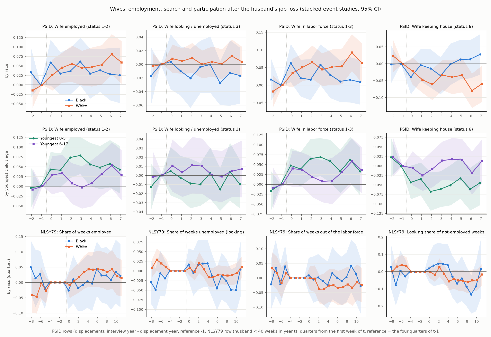

# Do wives search more after the husband's job loss? Constraint or preference

Built by `21.WifeSearch.py` (2026-10-17); variables per wave in its docstring. Unweighted. *** p<0.01, ** p<0.05, * p<0.1; every cell = coefficient (s.e.; p-value). The PSID design is the stacked event study of `19.FatherDisplacement.py` (first displacement = plant closing / move or layoff / firing of a male head with a child 0-17 and positive hours at baseline; clean controls not displaced up to the event year + 6; father x stack and calendar year x stack fixed effects; s.e. clustered by 1968 family). These are comparisons with clean controls, not experiments: they identify the effect of displacement only if displaced and control families would have followed parallel paths, and wives' outcomes are observed only while the marriage lasts (separation rises after displacement, see 19), so post-event samples are selected.

**Reading guide.** Status outcomes (employed / looking / in the labor force / keeping house) come from the employment status at the spring interview: tau = interview year - displacement year, reference tau = -1, tau = 0 is the interview in the displacement year (mostly before the job ended), tau = +1 the first interview after it; 'mean +1..+3' = interviews 1-3 years later. Calendar-year outcomes (weeks unemployed, worked in the year) use tau = calendar year - displacement year, reference -2, as in 19. Because employed + looking = in the labor force in the same sample, the coefficients add up exactly: Delta LF = Delta employed + Delta looking.

## 1. PSID: wives' employment, search and participation after the husband's displacement

### Table 1. Event study, pooled and by race

One regression per column (outcome in the header); rows = displaced x event-time coefficients. The first column is the first stage (the husband's own status at the interview).

| | Husband looking / unemployed (status 3) | Wife employed (status 1-2) | Wife looking / unemployed (status 3) | Wife in labor force (status 1-3) | Wife keeping house (status 6) | Wife's weeks unemployed in year | Wife any unemployment in year | Wife worked in year (hours > 0) |
|---|---|---|---|---|---|---|---|---|
| **All fathers** | | | | | | | | |
| tau=-3 |  |  |  |  |  | -0.22 (0.31; p=0.471) | 0.006 (0.014; p=0.683) | -0.017 (0.013; p=0.193) |
| tau=-2 | -0.016 (0.010; p=0.109) | -0.002 (0.019; p=0.921) | -0.008 (0.010; p=0.413) | -0.010 (0.019; p=0.597) | 0.019 (0.019; p=0.328) | ref | ref | ref |
| tau=-1 | ref | ref | ref | ref | ref | 0.77** (0.33; p=0.021) | 0.036*** (0.014; p=0.009) | 0.005 (0.012; p=0.658) |
| tau=+0 | 0.224*** (0.015; p=<0.001) | 0.036** (0.017; p=0.034) | 0.007 (0.010; p=0.496) | 0.043*** (0.016; p=0.008) | -0.027* (0.016; p=0.089) | 0.88*** (0.34; p=0.009) | 0.046*** (0.013; p=<0.001) | 0.012 (0.013; p=0.361) |
| tau=+1 | 0.165*** (0.013; p=<0.001) | 0.039** (0.016; p=0.019) | -0.000 (0.009; p=0.964) | 0.038** (0.016; p=0.015) | -0.031** (0.015; p=0.044) | 0.56* (0.34; p=0.096) | 0.039*** (0.014; p=0.007) | 0.013 (0.014; p=0.355) |
| tau=+2 | 0.063*** (0.013; p=<0.001) | 0.047** (0.019; p=0.014) | -0.001 (0.011; p=0.924) | 0.046** (0.019; p=0.013) | -0.043** (0.018; p=0.017) | 0.64** (0.32; p=0.044) | 0.035** (0.014; p=0.011) | -0.007 (0.015; p=0.654) |
| tau=+3 | 0.053*** (0.011; p=<0.001) | 0.047** (0.019; p=0.012) | -0.002 (0.010; p=0.846) | 0.045** (0.018; p=0.014) | -0.031* (0.018; p=0.073) | 0.83** (0.39; p=0.034) | 0.028* (0.015; p=0.066) | 0.016 (0.016; p=0.312) |
| tau=+4 | 0.034*** (0.012; p=0.005) | 0.039* (0.021; p=0.059) | 0.001 (0.010; p=0.899) | 0.040** (0.020; p=0.046) | -0.024 (0.020; p=0.224) | 0.89** (0.35; p=0.011) | 0.030** (0.014; p=0.029) | 0.006 (0.016; p=0.701) |
| tau=+5 | 0.033*** (0.011; p=0.003) | 0.045** (0.020; p=0.024) | -0.010 (0.009; p=0.295) | 0.035* (0.020; p=0.075) | -0.015 (0.020; p=0.454) | 0.68* (0.37; p=0.064) | 0.037** (0.016; p=0.021) | 0.012 (0.017; p=0.483) |
| tau=+6 | 0.010 (0.012; p=0.382) | 0.061*** (0.022; p=0.005) | 0.003 (0.011; p=0.770) | 0.065*** (0.021; p=0.002) | -0.047** (0.020; p=0.020) | 0.82** (0.38; p=0.031) | 0.034** (0.016; p=0.033) | 0.019 (0.017; p=0.279) |
| **mean +1..+3** | 0.094*** (0.009; p=<0.001) | 0.044*** (0.015; p=0.004) | -0.001 (0.008; p=0.890) | 0.043*** (0.015; p=0.004) | -0.035** (0.015; p=0.016) | 0.67** (0.27; p=0.012) | 0.034*** (0.012; p=0.004) | 0.008 (0.013; p=0.565) |
| Treated mean at reference | 0.038 | 0.599 | 0.041 | 0.641 | 0.321 | 1.630 | 0.100 | 0.695 |
| N (stacked rows) | 277,287 | 258,252 | 258,252 | 258,252 | 258,252 | 299,207 | 299,207 | 386,254 |
| Displaced fathers / control father-stacks | 1,750 / 48,190 | 1,643 / 46,761 | 1,643 / 46,761 | 1,643 / 46,761 | 1,643 / 46,761 | 1,819 / 51,528 | 1,819 / 51,528 | 2,295 / 61,958 |
| Clusters | 2,071 | 2,059 | 2,059 | 2,059 | 2,059 | 2,197 | 2,197 | 2,696 |
| **Black fathers** | | | | | | | | |
| tau=-3 |  |  |  |  |  | -0.43 (0.66; p=0.513) | 0.023 (0.027; p=0.392) | 0.008 (0.021; p=0.710) |
| tau=-2 | -0.011 (0.021; p=0.600) | 0.033 (0.034; p=0.327) | -0.017 (0.022; p=0.430) | 0.016 (0.031; p=0.598) | -0.002 (0.029; p=0.956) | ref | ref | ref |
| tau=-1 | ref | ref | ref | ref | ref | 1.86*** (0.71; p=0.008) | 0.084*** (0.027; p=0.002) | 0.016 (0.019; p=0.403) |
| tau=+0 | 0.279*** (0.026; p=<0.001) | 0.059* (0.031; p=0.058) | 0.004 (0.021; p=0.850) | 0.063** (0.028; p=0.023) | -0.039 (0.026; p=0.129) | 1.10 (0.67; p=0.101) | 0.061*** (0.023; p=0.009) | 0.033* (0.019; p=0.082) |
| tau=+1 | 0.233*** (0.023; p=<0.001) | 0.030 (0.028; p=0.291) | -0.010 (0.018; p=0.600) | 0.020 (0.027; p=0.443) | -0.004 (0.024; p=0.869) | 0.84 (0.68; p=0.214) | 0.059** (0.025; p=0.018) | 0.030 (0.021; p=0.166) |
| tau=+2 | 0.072*** (0.023; p=0.002) | 0.036 (0.031; p=0.249) | -0.020 (0.022; p=0.356) | 0.016 (0.030; p=0.597) | -0.014 (0.029; p=0.629) | 0.86 (0.60; p=0.157) | 0.064** (0.026; p=0.013) | 0.019 (0.021; p=0.371) |
| tau=+3 | 0.071*** (0.021; p=<0.001) | 0.062* (0.032; p=0.054) | -0.004 (0.020; p=0.848) | 0.058** (0.029; p=0.049) | -0.035 (0.028; p=0.206) | 1.86** (0.87; p=0.033) | 0.065** (0.030; p=0.031) | 0.029 (0.025; p=0.236) |
| tau=+4 | 0.068*** (0.024; p=0.004) | 0.030 (0.034; p=0.379) | -0.000 (0.021; p=0.988) | 0.029 (0.033; p=0.381) | -0.002 (0.031; p=0.960) | 1.49** (0.76; p=0.049) | 0.045* (0.026; p=0.078) | 0.018 (0.026; p=0.490) |
| tau=+5 | 0.051** (0.023; p=0.028) | 0.038 (0.029; p=0.186) | -0.028* (0.016; p=0.094) | 0.011 (0.030; p=0.718) | 0.013 (0.030; p=0.674) | 0.88 (0.78; p=0.258) | 0.039 (0.030; p=0.194) | 0.038 (0.028; p=0.167) |
| tau=+6 | 0.017 (0.024; p=0.481) | 0.028 (0.035; p=0.424) | -0.013 (0.024; p=0.608) | 0.015 (0.033; p=0.637) | 0.013 (0.029; p=0.641) | 1.18 (0.81; p=0.144) | 0.029 (0.029; p=0.317) | 0.038 (0.027; p=0.151) |
| **mean +1..+3** | 0.125*** (0.016; p=<0.001) | 0.043 (0.026; p=0.103) | -0.011 (0.017; p=0.495) | 0.031 (0.024; p=0.198) | -0.018 (0.023; p=0.435) | 1.19** (0.54; p=0.028) | 0.063*** (0.021; p=0.004) | 0.026 (0.019; p=0.168) |
| Treated mean at reference | 0.061 | 0.658 | 0.072 | 0.730 | 0.223 | 2.370 | 0.131 | 0.721 |
| N (stacked rows) | 72,668 | 65,329 | 65,329 | 65,329 | 65,329 | 76,803 | 76,803 | 100,925 |
| Displaced fathers / control father-stacks | 706 / 13,106 | 633 / 12,438 | 633 / 12,438 | 633 / 12,438 | 633 / 12,438 | 715 / 13,883 | 715 / 13,883 | 909 / 16,927 |
| Clusters | 744 | 733 | 733 | 733 | 733 | 797 | 797 | 995 |
| **White fathers** | | | | | | | | |
| tau=-3 |  |  |  |  |  | -0.13 (0.32; p=0.673) | -0.003 (0.016; p=0.856) | -0.030* (0.017; p=0.069) |
| tau=-2 | -0.023** (0.010; p=0.021) | -0.015 (0.023; p=0.525) | -0.003 (0.010; p=0.785) | -0.018 (0.024; p=0.457) | 0.024 (0.025; p=0.342) | ref | ref | ref |
| tau=-1 | ref | ref | ref | ref | ref | 0.15 (0.33; p=0.654) | 0.008 (0.015; p=0.593) | -0.001 (0.015; p=0.966) |
| tau=+0 | 0.188*** (0.018; p=<0.001) | 0.026 (0.021; p=0.213) | 0.008 (0.011; p=0.426) | 0.034* (0.021; p=0.095) | -0.022 (0.021; p=0.283) | 0.81** (0.36; p=0.027) | 0.039** (0.016; p=0.013) | -0.002 (0.017; p=0.923) |
| tau=+1 | 0.121*** (0.014; p=<0.001) | 0.045** (0.020; p=0.025) | 0.005 (0.010; p=0.607) | 0.050** (0.020; p=0.011) | -0.047** (0.020; p=0.016) | 0.43 (0.36; p=0.235) | 0.028 (0.018; p=0.115) | 0.004 (0.019; p=0.845) |
| tau=+2 | 0.057*** (0.014; p=<0.001) | 0.056** (0.025; p=0.024) | 0.009 (0.011; p=0.408) | 0.065*** (0.024; p=0.007) | -0.061*** (0.024; p=0.009) | 0.53 (0.36; p=0.146) | 0.019 (0.016; p=0.250) | -0.019 (0.020; p=0.335) |
| tau=+3 | 0.040*** (0.012; p=<0.001) | 0.044* (0.023; p=0.058) | 0.000 (0.010; p=0.994) | 0.044* (0.024; p=0.060) | -0.034 (0.023; p=0.137) | 0.29 (0.38; p=0.441) | 0.008 (0.017; p=0.626) | 0.011 (0.021; p=0.595) |
| tau=+4 | 0.010 (0.013; p=0.402) | 0.047* (0.026; p=0.073) | 0.004 (0.011; p=0.722) | 0.051** (0.026; p=0.046) | -0.040 (0.025; p=0.117) | 0.57 (0.35; p=0.102) | 0.020 (0.016; p=0.204) | 0.004 (0.021; p=0.845) |
| tau=+5 | 0.020* (0.012; p=0.087) | 0.053** (0.026; p=0.045) | 0.000 (0.011; p=0.972) | 0.053** (0.026; p=0.039) | -0.034 (0.026; p=0.188) | 0.58 (0.39; p=0.138) | 0.035* (0.019; p=0.066) | 0.004 (0.022; p=0.862) |
| tau=+6 | 0.003 (0.013; p=0.807) | 0.080*** (0.027; p=0.003) | 0.012 (0.013; p=0.327) | 0.092*** (0.027; p=<0.001) | -0.080*** (0.026; p=0.002) | 0.63 (0.41; p=0.124) | 0.034* (0.019; p=0.070) | 0.016 (0.023; p=0.493) |
| **mean +1..+3** | 0.072*** (0.010; p=<0.001) | 0.048** (0.019; p=0.013) | 0.005 (0.008; p=0.560) | 0.053*** (0.019; p=0.006) | -0.047** (0.019; p=0.012) | 0.42 (0.30; p=0.159) | 0.018 (0.014; p=0.185) | -0.002 (0.018; p=0.931) |
| Treated mean at reference | 0.025 | 0.568 | 0.025 | 0.593 | 0.373 | 1.215 | 0.083 | 0.681 |
| N (stacked rows) | 204,619 | 192,923 | 192,923 | 192,923 | 192,923 | 222,404 | 222,404 | 285,329 |
| Displaced fathers / control father-stacks | 1,044 / 35,084 | 1,010 / 34,323 | 1,010 / 34,323 | 1,010 / 34,323 | 1,010 / 34,323 | 1,104 / 37,645 | 1,104 / 37,645 | 1,386 / 45,031 |
| Clusters | 1,432 | 1,425 | 1,425 | 1,425 | 1,425 | 1,500 | 1,500 | 1,807 |
| Event time | interview | interview | interview | interview | interview | calendar year | calendar year | calendar year |
| Stacks (displacement years) | >= 1980 | >= 1980 | >= 1980 | >= 1980 | >= 1980 | >= 1976 | >= 1976 | >= 1968 |
| Fixed effects | father x stack, calendar year x stack | father x stack, calendar year x stack | father x stack, calendar year x stack | father x stack, calendar year x stack | father x stack, calendar year x stack | father x stack, calendar year x stack | father x stack, calendar year x stack | father x stack, calendar year x stack |

### Table 2. By the youngest child's age and the wife's status at baseline

Baseline status = the wife's employment status at the interview a year before the displacement year (tau = -1; else -2). For wives not employed at baseline, 'Wife employed' is the cumulative transition into employment (job finding) and 'Wife looking' the transition into search, relative to controls with the same baseline status.

| | Husband looking / unemployed (status 3) | Wife employed (status 1-2) | Wife looking / unemployed (status 3) | Wife in labor force (status 1-3) | Wife keeping house (status 6) | Wife's weeks unemployed in year | Wife any unemployment in year | Wife worked in year (hours > 0) |
|---|---|---|---|---|---|---|---|---|
| **All: youngest child 0-5** | | | | | | | | |
| tau=-2 / -3 (pre) | -0.000 (0.014; p=0.984) | -0.003 (0.027; p=0.899) | -0.013 (0.013; p=0.331) | -0.016 (0.026; p=0.525) | 0.022 (0.026; p=0.392) | -0.66 (0.40; p=0.104) | -0.008 (0.019; p=0.673) | -0.013 (0.020; p=0.507) |
| tau=+1 | 0.168*** (0.017; p=<0.001) | 0.041* (0.022; p=0.064) | -0.002 (0.012; p=0.839) | 0.039* (0.022; p=0.077) | -0.035 (0.022; p=0.116) | 0.44 (0.46; p=0.339) | 0.038** (0.019; p=0.049) | 0.049** (0.020; p=0.015) |
| tau=+2 | 0.060*** (0.016; p=<0.001) | 0.074*** (0.027; p=0.006) | -0.009 (0.014; p=0.527) | 0.065** (0.026; p=0.011) | -0.068*** (0.026; p=0.008) | 0.50 (0.44; p=0.252) | 0.031 (0.019; p=0.101) | 0.029 (0.021; p=0.162) |
| tau=+3 | 0.056*** (0.014; p=<0.001) | 0.079*** (0.024; p=0.001) | -0.010 (0.012; p=0.414) | 0.069*** (0.024; p=0.005) | -0.061** (0.024; p=0.010) | 0.99* (0.56; p=0.078) | 0.031 (0.021; p=0.146) | 0.046** (0.022; p=0.040) |
| mean +1..+3 | 0.095*** (0.011; p=<0.001) | 0.065*** (0.021; p=0.002) | -0.007 (0.010; p=0.492) | 0.058*** (0.020; p=0.005) | -0.054*** (0.020; p=0.007) | 0.64* (0.37; p=0.084) | 0.033** (0.016; p=0.037) | 0.041** (0.018; p=0.025) |
| Treated mean at reference | 0.044 | 0.544 | 0.046 | 0.590 | 0.378 | 1.763 | 0.108 | 0.667 |
| N (stacked rows) | 140,655 | 131,455 | 131,455 | 131,455 | 131,455 | 151,369 | 151,369 | 193,277 |
| Displaced fathers / control father-stacks | 1,054 / 24,156 | 991 / 23,679 | 991 / 23,679 | 991 / 23,679 | 991 / 23,679 | 1,100 / 26,062 | 1,100 / 26,062 | 1,415 / 31,252 |
| Clusters | 1,824 | 1,814 | 1,814 | 1,814 | 1,814 | 1,926 | 1,926 | 2,344 |
| **All: youngest child 6-17** | | | | | | | | |
| tau=-2 / -3 (pre) | -0.036*** (0.014; p=0.009) | -0.008 (0.027; p=0.767) | -0.001 (0.015; p=0.927) | -0.009 (0.027; p=0.729) | 0.024 (0.027; p=0.370) | 0.34 (0.48; p=0.479) | 0.023 (0.021; p=0.259) | -0.033** (0.016; p=0.038) |
| tau=+1 | 0.162*** (0.020; p=<0.001) | 0.034 (0.024; p=0.155) | 0.003 (0.014; p=0.812) | 0.037* (0.022; p=0.099) | -0.025 (0.021; p=0.221) | 0.75 (0.49; p=0.127) | 0.041* (0.021; p=0.057) | -0.032* (0.019; p=0.097) |
| tau=+2 | 0.068*** (0.020; p=<0.001) | 0.007 (0.027; p=0.782) | 0.011 (0.016; p=0.478) | 0.019 (0.026; p=0.470) | -0.008 (0.025; p=0.737) | 0.84* (0.47; p=0.070) | 0.041** (0.020; p=0.037) | -0.055*** (0.021; p=0.008) |
| tau=+3 | 0.049*** (0.018; p=0.006) | -0.003 (0.028; p=0.924) | 0.010 (0.015; p=0.507) | 0.008 (0.027; p=0.776) | 0.014 (0.026; p=0.595) | 0.62 (0.51; p=0.231) | 0.025 (0.022; p=0.248) | -0.026 (0.022; p=0.235) |
| mean +1..+3 | 0.093*** (0.015; p=<0.001) | 0.013 (0.022; p=0.570) | 0.008 (0.012; p=0.494) | 0.021 (0.022; p=0.335) | -0.007 (0.020; p=0.744) | 0.74* (0.39; p=0.062) | 0.036** (0.017; p=0.035) | -0.038** (0.018; p=0.036) |
| Treated mean at reference | 0.031 | 0.676 | 0.034 | 0.711 | 0.241 | 1.446 | 0.089 | 0.736 |
| N (stacked rows) | 136,632 | 126,797 | 126,797 | 126,797 | 126,797 | 147,838 | 147,838 | 192,977 |
| Displaced fathers / control father-stacks | 696 / 24,034 | 652 / 23,082 | 652 / 23,082 | 652 / 23,082 | 652 / 23,082 | 719 / 25,466 | 719 / 25,466 | 880 / 30,706 |
| Clusters | 1,823 | 1,802 | 1,802 | 1,802 | 1,802 | 1,929 | 1,929 | 2,269 |
| **All: wife employed at baseline** | | | | | | | | |
| tau=-2 / -3 (pre) | -0.021 (0.013; p=0.105) | -0.040* (0.021; p=0.061) | 0.002 (0.009; p=0.819) | -0.038** (0.019; p=0.050) | 0.041** (0.019; p=0.027) | -0.41 (0.41; p=0.323) | 0.016 (0.019; p=0.404) | 0.001 (0.015; p=0.954) |
| tau=+1 | 0.174*** (0.017; p=<0.001) | -0.042*** (0.016; p=0.007) | 0.019** (0.008; p=0.016) | -0.023 (0.014; p=0.104) | 0.014 (0.013; p=0.282) | 0.82* (0.48; p=0.087) | 0.061*** (0.021; p=0.003) | -0.002 (0.015; p=0.892) |
| tau=+2 | 0.060*** (0.017; p=<0.001) | -0.030 (0.019; p=0.117) | 0.018* (0.010; p=0.074) | -0.012 (0.018; p=0.499) | 0.012 (0.017; p=0.485) | 0.28 (0.38; p=0.460) | 0.031* (0.018; p=0.083) | -0.016 (0.015; p=0.310) |
| tau=+3 | 0.050*** (0.014; p=<0.001) | -0.020 (0.019; p=0.295) | 0.007 (0.008; p=0.370) | -0.013 (0.017; p=0.450) | 0.012 (0.015; p=0.417) | 0.31 (0.49; p=0.527) | 0.016 (0.020; p=0.407) | -0.002 (0.018; p=0.895) |
| mean +1..+3 | 0.095*** (0.011; p=<0.001) | -0.031** (0.014; p=0.028) | 0.015*** (0.005; p=0.007) | -0.016 (0.013; p=0.209) | 0.013 (0.012; p=0.278) | 0.47 (0.35; p=0.178) | 0.036** (0.015; p=0.017) | -0.007 (0.013; p=0.597) |
| Treated mean at reference | 0.030 | 0.949 | 0.007 | 0.956 | 0.043 | 1.458 | 0.099 | 0.954 |
| N (stacked rows) | 175,593 | 168,722 | 168,722 | 168,722 | 168,722 | 169,367 | 169,367 | 169,366 |
| Displaced fathers / control father-stacks | 935 / 31,228 | 935 / 31,229 | 935 / 31,229 | 935 / 31,229 | 935 / 31,229 | 935 / 31,229 | 935 / 31,229 | 935 / 31,229 |
| Clusters | 1,889 | 1,889 | 1,889 | 1,889 | 1,889 | 1,889 | 1,889 | 1,889 |
| **All: wife not employed at baseline** | | | | | | | | |
| tau=-2 / -3 (pre) | -0.025* (0.014; p=0.080) | 0.021 (0.029; p=0.457) | -0.019 (0.021; p=0.359) | 0.002 (0.031; p=0.944) | 0.014 (0.034; p=0.693) | -0.05 (0.48; p=0.909) | -0.013 (0.024; p=0.590) | -0.061** (0.029; p=0.039) |
| tau=+1 | 0.152*** (0.021; p=<0.001) | 0.092*** (0.026; p=<0.001) | -0.020 (0.019; p=0.283) | 0.072** (0.029; p=0.013) | -0.044 (0.030; p=0.137) | 0.67 (0.59; p=0.250) | 0.020 (0.026; p=0.446) | -0.000 (0.036; p=0.999) |
| tau=+2 | 0.076*** (0.021; p=<0.001) | 0.079*** (0.030; p=0.008) | -0.020 (0.021; p=0.333) | 0.059* (0.032; p=0.065) | -0.049 (0.033; p=0.142) | 1.40** (0.61; p=0.022) | 0.031 (0.024; p=0.211) | -0.022 (0.037; p=0.564) |
| tau=+3 | 0.063*** (0.019; p=<0.001) | 0.069** (0.029; p=0.017) | -0.003 (0.021; p=0.876) | 0.066** (0.032; p=0.038) | -0.037 (0.033; p=0.261) | 1.49** (0.69; p=0.032) | 0.029 (0.028; p=0.309) | 0.016 (0.039; p=0.677) |
| mean +1..+3 | 0.097*** (0.014; p=<0.001) | 0.080*** (0.023; p=<0.001) | -0.014 (0.017; p=0.405) | 0.066** (0.026; p=0.011) | -0.043 (0.027; p=0.109) | 1.19** (0.50; p=0.018) | 0.026 (0.022; p=0.226) | -0.002 (0.033; p=0.957) |
| Treated mean at reference | 0.037 | 0.075 | 0.093 | 0.168 | 0.737 | 1.752 | 0.100 | 0.458 |
| N (stacked rows) | 87,636 | 84,054 | 84,054 | 84,054 | 84,054 | 84,560 | 84,560 | 84,559 |
| Displaced fathers / control father-stacks | 595 / 14,067 | 595 / 14,067 | 595 / 14,067 | 595 / 14,067 | 595 / 14,067 | 595 / 14,067 | 595 / 14,067 | 595 / 14,067 |
| Clusters | 1,643 | 1,643 | 1,643 | 1,643 | 1,643 | 1,643 | 1,643 | 1,643 |
| **Black: youngest child 0-5** | | | | | | | | |
| tau=-2 / -3 (pre) | 0.003 (0.028; p=0.916) | 0.024 (0.046; p=0.597) | -0.023 (0.030; p=0.455) | 0.002 (0.039; p=0.968) | 0.005 (0.039; p=0.900) | -1.12 (0.89; p=0.211) | -0.006 (0.035; p=0.866) | 0.004 (0.032; p=0.890) |
| tau=+1 | 0.234*** (0.029; p=<0.001) | 0.023 (0.037; p=0.537) | -0.022 (0.025; p=0.386) | 0.001 (0.036; p=0.970) | 0.019 (0.033; p=0.564) | 0.82 (0.92; p=0.371) | 0.076** (0.033; p=0.021) | 0.056* (0.031; p=0.074) |
| tau=+2 | 0.047 (0.029; p=0.102) | 0.017 (0.040; p=0.663) | -0.036 (0.029; p=0.212) | -0.019 (0.038; p=0.624) | 0.023 (0.038; p=0.548) | 0.44 (0.83; p=0.591) | 0.057 (0.036; p=0.111) | 0.054* (0.030; p=0.069) |
| tau=+3 | 0.079*** (0.028; p=0.005) | 0.066 (0.040; p=0.101) | -0.021 (0.025; p=0.394) | 0.045 (0.039; p=0.242) | -0.012 (0.038; p=0.749) | 2.03 (1.25; p=0.104) | 0.068 (0.042; p=0.109) | 0.035 (0.036; p=0.328) |
| mean +1..+3 | 0.120*** (0.020; p=<0.001) | 0.036 (0.033; p=0.280) | -0.026 (0.021; p=0.220) | 0.009 (0.031; p=0.764) | 0.010 (0.030; p=0.738) | 1.10 (0.76; p=0.151) | 0.067** (0.030; p=0.026) | 0.048* (0.028; p=0.079) |
| Treated mean at reference | 0.069 | 0.625 | 0.086 | 0.711 | 0.252 | 2.666 | 0.142 | 0.680 |
| N (stacked rows) | 36,237 | 32,281 | 32,281 | 32,281 | 32,281 | 37,976 | 37,976 | 50,304 |
| Displaced fathers / control father-stacks | 449 / 6,368 | 398 / 6,086 | 398 / 6,086 | 398 / 6,086 | 398 / 6,086 | 450 / 6,843 | 450 / 6,843 | 578 / 8,502 |
| Clusters | 640 | 632 | 632 | 632 | 632 | 677 | 677 | 860 |
| **Black: youngest child 6-17** | | | | | | | | |
| tau=-2 / -3 (pre) | -0.032 (0.030; p=0.295) | 0.049 (0.051; p=0.332) | -0.009 (0.030; p=0.776) | 0.041 (0.049; p=0.404) | -0.016 (0.041; p=0.698) | 0.47 (1.01; p=0.639) | 0.060 (0.043; p=0.166) | 0.005 (0.024; p=0.850) |
| tau=+1 | 0.233*** (0.038; p=<0.001) | 0.032 (0.041; p=0.438) | 0.010 (0.028; p=0.710) | 0.042 (0.037; p=0.258) | -0.032 (0.033; p=0.327) | 0.97 (1.03; p=0.346) | 0.035 (0.039; p=0.375) | -0.017 (0.029; p=0.551) |
| tau=+2 | 0.123*** (0.041; p=0.003) | 0.044 (0.048; p=0.361) | 0.009 (0.033; p=0.782) | 0.053 (0.044; p=0.226) | -0.055 (0.042; p=0.191) | 1.49 (0.93; p=0.108) | 0.076** (0.037; p=0.040) | -0.044 (0.030; p=0.139) |
| tau=+3 | 0.062* (0.033; p=0.059) | 0.047 (0.045; p=0.305) | 0.023 (0.032; p=0.469) | 0.070 (0.043; p=0.105) | -0.061 (0.040; p=0.127) | 1.62 (1.19; p=0.175) | 0.060 (0.044; p=0.167) | 0.009 (0.032; p=0.790) |
| mean +1..+3 | 0.139*** (0.028; p=<0.001) | 0.041 (0.038; p=0.290) | 0.014 (0.025; p=0.565) | 0.055 (0.035; p=0.118) | -0.050 (0.032; p=0.124) | 1.36* (0.80; p=0.091) | 0.057* (0.032; p=0.075) | -0.018 (0.025; p=0.490) |
| Treated mean at reference | 0.049 | 0.708 | 0.051 | 0.759 | 0.179 | 1.945 | 0.115 | 0.781 |
| N (stacked rows) | 36,431 | 33,048 | 33,048 | 33,048 | 33,048 | 38,827 | 38,827 | 50,621 |
| Displaced fathers / control father-stacks | 257 / 6,738 | 235 / 6,352 | 235 / 6,352 | 235 / 6,352 | 235 / 6,352 | 265 / 7,040 | 265 / 7,040 | 331 / 8,425 |
| Clusters | 616 | 602 | 602 | 602 | 602 | 666 | 666 | 776 |
| **Black: wife employed at baseline** | | | | | | | | |
| tau=-2 / -3 (pre) | -0.026 (0.024; p=0.279) | 0.015 (0.035; p=0.656) | 0.011 (0.020; p=0.585) | 0.026 (0.026; p=0.312) | -0.021 (0.023; p=0.373) | -1.16 (0.81; p=0.155) | 0.007 (0.035; p=0.833) | 0.033 (0.025; p=0.187) |
| tau=+1 | 0.242*** (0.031; p=<0.001) | -0.043* (0.026; p=0.092) | 0.019 (0.016; p=0.216) | -0.024 (0.023; p=0.286) | 0.014 (0.020; p=0.494) | 1.37 (1.03; p=0.185) | 0.090** (0.036; p=0.012) | 0.004 (0.025; p=0.879) |
| tau=+2 | 0.055** (0.027; p=0.043) | -0.013 (0.033; p=0.687) | 0.001 (0.020; p=0.966) | -0.012 (0.029; p=0.669) | 0.001 (0.027; p=0.970) | -0.14 (0.67; p=0.830) | 0.040 (0.034; p=0.242) | 0.016 (0.020; p=0.424) |
| tau=+3 | 0.061** (0.026; p=0.019) | 0.015 (0.031; p=0.637) | 0.000 (0.015; p=0.989) | 0.015 (0.027; p=0.581) | -0.002 (0.024; p=0.920) | 0.84 (1.20; p=0.483) | 0.016 (0.038; p=0.664) | -0.009 (0.034; p=0.788) |
| mean +1..+3 | 0.119*** (0.020; p=<0.001) | -0.014 (0.023; p=0.544) | 0.007 (0.011; p=0.532) | -0.007 (0.020; p=0.717) | 0.004 (0.017; p=0.812) | 0.69 (0.74; p=0.354) | 0.049* (0.028; p=0.082) | 0.003 (0.020; p=0.860) |
| Treated mean at reference | 0.046 | 0.964 | 0.016 | 0.980 | 0.018 | 1.887 | 0.115 | 0.954 |
| N (stacked rows) | 45,676 | 43,486 | 43,486 | 43,486 | 43,486 | 43,687 | 43,687 | 43,687 |
| Displaced fathers / control father-stacks | 359 / 8,397 | 359 / 8,398 | 359 / 8,398 | 359 / 8,398 | 359 / 8,398 | 359 / 8,398 | 359 / 8,398 | 359 / 8,398 |
| Clusters | 661 | 661 | 661 | 661 | 661 | 661 | 661 | 661 |
| **Black: wife not employed at baseline** | | | | | | | | |
| tau=-2 / -3 (pre) | -0.029 (0.034; p=0.400) | 0.069 (0.059; p=0.238) | -0.083* (0.050; p=0.099) | -0.013 (0.068; p=0.846) | 0.045 (0.067; p=0.507) | -0.57 (1.18; p=0.629) | 0.014 (0.049; p=0.775) | -0.034 (0.052; p=0.516) |
| tau=+1 | 0.240*** (0.039; p=<0.001) | 0.098** (0.047; p=0.038) | -0.037 (0.043; p=0.397) | 0.061 (0.054; p=0.258) | -0.002 (0.054; p=0.974) | 1.49 (1.37; p=0.277) | 0.061 (0.053; p=0.244) | -0.051 (0.061; p=0.404) |
| tau=+2 | 0.136*** (0.046; p=0.003) | 0.041 (0.052; p=0.432) | -0.023 (0.049; p=0.632) | 0.018 (0.059; p=0.764) | 0.023 (0.063; p=0.711) | 3.00** (1.52; p=0.048) | 0.118** (0.051; p=0.021) | -0.047 (0.061; p=0.434) |
| tau=+3 | 0.087** (0.042; p=0.038) | 0.089* (0.051; p=0.080) | 0.011 (0.046; p=0.815) | 0.100* (0.059; p=0.087) | -0.066 (0.060; p=0.275) | 2.78* (1.68; p=0.099) | 0.099 (0.061; p=0.105) | -0.032 (0.070; p=0.646) |
| mean +1..+3 | 0.154*** (0.029; p=<0.001) | 0.076* (0.041; p=0.065) | -0.016 (0.040; p=0.681) | 0.060 (0.049; p=0.224) | -0.015 (0.051; p=0.770) | 2.42* (1.26; p=0.054) | 0.093** (0.046; p=0.042) | -0.043 (0.054; p=0.425) |
| Treated mean at reference | 0.064 | 0.069 | 0.180 | 0.249 | 0.618 | 3.169 | 0.155 | 0.498 |
| N (stacked rows) | 20,883 | 19,668 | 19,668 | 19,668 | 19,668 | 19,801 | 19,801 | 19,800 |
| Displaced fathers / control father-stacks | 213 / 3,453 | 213 / 3,453 | 213 / 3,453 | 213 / 3,453 | 213 / 3,453 | 213 / 3,453 | 213 / 3,453 | 213 / 3,453 |
| Clusters | 551 | 551 | 551 | 551 | 551 | 551 | 551 | 551 |
| **White: youngest child 0-5** | | | | | | | | |
| tau=-2 / -3 (pre) | -0.005 (0.014; p=0.724) | -0.008 (0.033; p=0.816) | -0.007 (0.013; p=0.598) | -0.014 (0.033; p=0.665) | 0.019 (0.035; p=0.585) | -0.41 (0.39; p=0.304) | -0.009 (0.023; p=0.679) | -0.020 (0.024; p=0.414) |
| tau=+1 | 0.123*** (0.019; p=<0.001) | 0.051* (0.028; p=0.068) | 0.009 (0.013; p=0.484) | 0.060** (0.028; p=0.033) | -0.064** (0.029; p=0.026) | 0.31 (0.50; p=0.531) | 0.018 (0.024; p=0.464) | 0.037 (0.026; p=0.156) |
| tau=+2 | 0.071*** (0.019; p=<0.001) | 0.101*** (0.035; p=0.004) | 0.007 (0.015; p=0.612) | 0.108*** (0.033; p=0.001) | -0.114*** (0.034; p=<0.001) | 0.58 (0.50; p=0.245) | 0.018 (0.023; p=0.427) | 0.010 (0.027; p=0.723) |
| tau=+3 | 0.039*** (0.015; p=0.007) | 0.089*** (0.030; p=0.003) | -0.003 (0.013; p=0.840) | 0.087*** (0.031; p=0.006) | -0.090*** (0.031; p=0.003) | 0.47 (0.54; p=0.383) | 0.011 (0.023; p=0.628) | 0.047 (0.029; p=0.101) |
| mean +1..+3 | 0.078*** (0.012; p=<0.001) | 0.080*** (0.026; p=0.002) | 0.005 (0.010; p=0.660) | 0.085*** (0.026; p=0.001) | -0.090*** (0.027; p=<0.001) | 0.45 (0.40; p=0.251) | 0.016 (0.019; p=0.401) | 0.031 (0.024; p=0.194) |
| Treated mean at reference | 0.028 | 0.499 | 0.025 | 0.523 | 0.448 | 1.244 | 0.089 | 0.660 |
| N (stacked rows) | 104,418 | 99,174 | 99,174 | 99,174 | 99,174 | 113,393 | 113,393 | 142,973 |
| Displaced fathers / control father-stacks | 605 / 17,788 | 593 / 17,593 | 593 / 17,593 | 593 / 17,593 | 593 / 17,593 | 650 / 19,219 | 650 / 19,219 | 837 / 22,750 |
| Clusters | 1,253 | 1,247 | 1,247 | 1,247 | 1,247 | 1,314 | 1,314 | 1,553 |
| **White: youngest child 6-17** | | | | | | | | |
| tau=-2 / -3 (pre) | -0.045*** (0.014; p=0.002) | -0.034 (0.033; p=0.303) | 0.002 (0.017; p=0.911) | -0.032 (0.033; p=0.334) | 0.041 (0.033; p=0.218) | 0.20 (0.52; p=0.693) | 0.006 (0.023; p=0.804) | -0.053*** (0.021; p=0.009) |
| tau=+1 | 0.118*** (0.023; p=<0.001) | 0.039 (0.029; p=0.172) | -0.000 (0.015; p=0.979) | 0.039 (0.028; p=0.160) | -0.026 (0.026; p=0.320) | 0.60 (0.53; p=0.254) | 0.043* (0.026; p=0.096) | -0.032 (0.026; p=0.210) |
| tau=+2 | 0.038* (0.022; p=0.088) | -0.005 (0.032; p=0.878) | 0.012 (0.017; p=0.475) | 0.007 (0.032; p=0.817) | 0.009 (0.030; p=0.764) | 0.46 (0.52; p=0.375) | 0.020 (0.023; p=0.377) | -0.052* (0.028; p=0.060) |
| tau=+3 | 0.041* (0.021; p=0.055) | -0.022 (0.035; p=0.532) | 0.004 (0.017; p=0.793) | -0.017 (0.034; p=0.614) | 0.047 (0.033; p=0.150) | 0.09 (0.52; p=0.866) | 0.006 (0.024; p=0.793) | -0.034 (0.029; p=0.240) |
| mean +1..+3 | 0.066*** (0.016; p=<0.001) | 0.004 (0.028; p=0.879) | 0.005 (0.013; p=0.680) | 0.010 (0.028; p=0.727) | 0.010 (0.026; p=0.698) | 0.38 (0.44; p=0.378) | 0.023 (0.020; p=0.242) | -0.039 (0.024; p=0.104) |
| Treated mean at reference | 0.022 | 0.661 | 0.026 | 0.686 | 0.272 | 1.175 | 0.075 | 0.710 |
| N (stacked rows) | 100,201 | 93,749 | 93,749 | 93,749 | 93,749 | 109,011 | 109,011 | 142,356 |
| Displaced fathers / control father-stacks | 439 / 17,296 | 417 / 16,730 | 417 / 16,730 | 417 / 16,730 | 417 / 16,730 | 454 / 18,426 | 454 / 18,426 | 549 / 22,281 |
| Clusters | 1,267 | 1,256 | 1,256 | 1,256 | 1,256 | 1,321 | 1,321 | 1,555 |
| **White: wife employed at baseline** | | | | | | | | |
| tau=-2 / -3 (pre) | -0.020 (0.014; p=0.149) | -0.071*** (0.027; p=0.009) | -0.006 (0.007; p=0.412) | -0.076*** (0.026; p=0.004) | 0.079*** (0.026; p=0.002) | 0.01 (0.46; p=0.989) | 0.022 (0.022; p=0.324) | -0.019 (0.019; p=0.301) |
| tau=+1 | 0.130*** (0.019; p=<0.001) | -0.040** (0.020; p=0.045) | 0.014 (0.009; p=0.108) | -0.026 (0.019; p=0.157) | 0.019 (0.018; p=0.272) | 0.60 (0.49; p=0.226) | 0.048* (0.025; p=0.058) | -0.009 (0.020; p=0.652) |
| tau=+2 | 0.060*** (0.021; p=0.005) | -0.040* (0.024; p=0.094) | 0.023** (0.012; p=0.050) | -0.017 (0.022; p=0.438) | 0.023 (0.021; p=0.270) | 0.51 (0.47; p=0.275) | 0.026 (0.021; p=0.220) | -0.036* (0.022; p=0.094) |
| tau=+3 | 0.041*** (0.016; p=0.009) | -0.037 (0.024; p=0.121) | 0.006 (0.008; p=0.499) | -0.031 (0.022; p=0.156) | 0.026 (0.020; p=0.186) | 0.10 (0.43; p=0.810) | 0.017 (0.023; p=0.451) | -0.005 (0.021; p=0.831) |
| mean +1..+3 | 0.077*** (0.013; p=<0.001) | -0.039** (0.018; p=0.028) | 0.014** (0.006; p=0.017) | -0.025 (0.017; p=0.134) | 0.023 (0.016; p=0.141) | 0.40 (0.36; p=0.264) | 0.030* (0.018; p=0.094) | -0.017 (0.017; p=0.325) |
| Treated mean at reference | 0.020 | 0.939 | 0.001 | 0.941 | 0.058 | 1.192 | 0.089 | 0.954 |
| N (stacked rows) | 129,917 | 125,236 | 125,236 | 125,236 | 125,236 | 125,680 | 125,680 | 125,679 |
| Displaced fathers / control father-stacks | 576 / 22,831 | 576 / 22,831 | 576 / 22,831 | 576 / 22,831 | 576 / 22,831 | 576 / 22,831 | 576 / 22,831 | 576 / 22,831 |
| Clusters | 1,308 | 1,308 | 1,308 | 1,308 | 1,308 | 1,308 | 1,308 | 1,308 |
| **White: wife not employed at baseline** | | | | | | | | |
| tau=-2 / -3 (pre) | -0.031** (0.015; p=0.032) | 0.005 (0.032; p=0.871) | 0.005 (0.022; p=0.828) | 0.010 (0.035; p=0.777) | -0.003 (0.040; p=0.940) | -0.07 (0.49; p=0.886) | -0.029 (0.028; p=0.298) | -0.071** (0.035; p=0.043) |
| tau=+1 | 0.104*** (0.023; p=<0.001) | 0.080*** (0.031; p=0.010) | -0.002 (0.019; p=0.899) | 0.078** (0.034; p=0.022) | -0.065* (0.035; p=0.065) | 0.42 (0.59; p=0.477) | 0.005 (0.030; p=0.855) | 0.022 (0.044; p=0.623) |
| tau=+2 | 0.045** (0.021; p=0.034) | 0.091** (0.036; p=0.013) | -0.010 (0.020; p=0.617) | 0.081** (0.038; p=0.034) | -0.085** (0.039; p=0.030) | 0.79 (0.60; p=0.191) | -0.004 (0.028; p=0.881) | -0.015 (0.047; p=0.751) |
| tau=+3 | 0.047** (0.019; p=0.014) | 0.055 (0.035; p=0.117) | 0.001 (0.022; p=0.949) | 0.056 (0.038; p=0.137) | -0.031 (0.039; p=0.424) | 1.04 (0.71; p=0.144) | -0.000 (0.031; p=1.000) | 0.034 (0.047; p=0.463) |
| mean +1..+3 | 0.066*** (0.015; p=<0.001) | 0.075*** (0.027; p=0.006) | -0.004 (0.017; p=0.831) | 0.072** (0.030; p=0.017) | -0.060* (0.032; p=0.056) | 0.75 (0.49; p=0.129) | 0.000 (0.025; p=0.986) | 0.014 (0.041; p=0.736) |
| Treated mean at reference | 0.025 | 0.078 | 0.056 | 0.134 | 0.788 | 1.149 | 0.077 | 0.441 |
| N (stacked rows) | 66,753 | 64,386 | 64,386 | 64,386 | 64,386 | 64,759 | 64,759 | 64,759 |
| Displaced fathers / control father-stacks | 382 / 10,614 | 382 / 10,614 | 382 / 10,614 | 382 / 10,614 | 382 / 10,614 | 382 / 10,614 | 382 / 10,614 | 382 / 10,614 |
| Clusters | 1,145 | 1,145 | 1,145 | 1,145 | 1,145 | 1,145 | 1,145 | 1,145 |
| Event time | interview | interview | interview | interview | interview | calendar year | calendar year | calendar year |
| Stacks (displacement years) | >= 1980 | >= 1980 | >= 1980 | >= 1980 | >= 1980 | >= 1976 | >= 1976 | >= 1968 |
| Fixed effects | father x stack, calendar year x stack | father x stack, calendar year x stack | father x stack, calendar year x stack | father x stack, calendar year x stack | father x stack, calendar year x stack | father x stack, calendar year x stack | father x stack, calendar year x stack | father x stack, calendar year x stack |

### Table 3. Flows between consecutive interviews

Each outcome is defined only for wives in the origin state at the previous interview (1 year earlier to 1997, 2 years from 1999). Treated x stack and calendar year x stack fixed effects (most wives have few rows in an origin state); reference tau = -1; stacks from 1981.

| | Job finding: employed | not employed at previous interview | Starts looking: looking | out of LF at previous interview | Looking -> employed: employed | looking at previous interview | Job loss: not employed | employed at previous interview |
|---|---|---|---|---|
| **All: all** | | | | |
| tau=-2 / -3 (pre) | -0.026 (0.034; p=0.457) | -0.010 (0.014; p=0.489) | -0.004 (0.130; p=0.974) | -0.019 (0.025; p=0.441) |
| tau=+1 | 0.062** (0.030; p=0.035) | 0.012 (0.015; p=0.429) | 0.113 (0.105; p=0.283) | 0.004 (0.020; p=0.856) |
| tau=+2 | 0.030 (0.034; p=0.377) | 0.011 (0.017; p=0.529) | -0.046 (0.126; p=0.714) | -0.030 (0.023; p=0.183) |
| tau=+3 | 0.037 (0.033; p=0.257) | 0.020 (0.017; p=0.244) | 0.077 (0.115; p=0.504) | -0.014 (0.019; p=0.484) |
| mean +1..+3 | 0.043* (0.025; p=0.086) | 0.014 (0.013; p=0.267) | 0.048 (0.096; p=0.618) | -0.013 (0.017; p=0.432) |
| Treated mean at reference | 0.246 | 0.031 | 0.459 | 0.172 |
| N (stacked rows) | 74,525 | 68,638 | 5,887 | 167,856 |
| Displaced fathers / control father-stacks | 913 / 22,210 | 812 / 20,445 | 272 / 4,567 | 1,308 / 39,321 |
| Clusters | 1,672 | 1,594 | 787 | 1,910 |
| **All: youngest child 0-5** | | | | |
| tau=-2 / -3 (pre) | 0.019 (0.044; p=0.668) | -0.012 (0.019; p=0.511) | -0.044 (0.179; p=0.807) | -0.026 (0.037; p=0.479) |
| tau=+1 | 0.067* (0.035; p=0.056) | 0.008 (0.019; p=0.666) | 0.029 (0.132; p=0.827) | 0.034 (0.030; p=0.251) |
| tau=+2 | 0.037 (0.042; p=0.386) | -0.002 (0.021; p=0.941) | -0.169 (0.157; p=0.280) | -0.038 (0.033; p=0.254) |
| tau=+3 | 0.093** (0.039; p=0.016) | 0.008 (0.019; p=0.694) | 0.036 (0.155; p=0.816) | -0.012 (0.027; p=0.658) |
| mean +1..+3 | 0.065** (0.031; p=0.033) | 0.005 (0.016; p=0.764) | -0.035 (0.126; p=0.782) | -0.005 (0.025; p=0.831) |
| Treated mean at reference | 0.233 | 0.038 | 0.478 | 0.207 |
| N (stacked rows) | 44,426 | 41,251 | 3,175 | 78,177 |
| Displaced fathers / control father-stacks | 606 / 12,799 | 550 / 11,986 | 172 / 2,438 | 756 / 19,370 |
| Clusters | 1,424 | 1,356 | 599 | 1,668 |
| **All: youngest child 6-17** | | | | |
| tau=-2 / -3 (pre) | -0.091 (0.057; p=0.109) | -0.002 (0.020; p=0.915) | 0.151 (0.203; p=0.458) | -0.007 (0.032; p=0.829) |
| tau=+1 | 0.053 (0.055; p=0.334) | 0.010 (0.026; p=0.685) | 0.281 (0.191; p=0.142) | -0.017 (0.025; p=0.493) |
| tau=+2 | 0.028 (0.060; p=0.638) | 0.030 (0.032; p=0.354) | 0.184 (0.207; p=0.374) | -0.011 (0.029; p=0.707) |
| tau=+3 | -0.076 (0.057; p=0.183) | 0.042 (0.033; p=0.195) | 0.340* (0.181; p=0.061) | -0.009 (0.027; p=0.744) |
| mean +1..+3 | 0.002 (0.046; p=0.966) | 0.027 (0.021; p=0.184) | 0.268* (0.145; p=0.064) | -0.012 (0.022; p=0.580) |
| Treated mean at reference | 0.270 | 0.020 | 0.429 | 0.136 |
| N (stacked rows) | 30,099 | 27,387 | 2,712 | 89,679 |
| Displaced fathers / control father-stacks | 307 / 9,411 | 262 / 8,459 | 100 / 2,129 | 552 / 19,951 |
| Clusters | 1,264 | 1,187 | 482 | 1,665 |
| **Black: all** | | | | |
| tau=-2 / -3 (pre) | -0.003 (0.069; p=0.967) | -0.053 (0.041; p=0.188) | -0.200 (0.193; p=0.299) | -0.049 (0.040; p=0.227) |
| tau=+1 | 0.052 (0.053; p=0.321) | -0.046 (0.040; p=0.247) | -0.136 (0.150; p=0.367) | 0.013 (0.032; p=0.672) |
| tau=+2 | -0.015 (0.061; p=0.806) | -0.031 (0.043; p=0.471) | -0.276* (0.148; p=0.062) | -0.048 (0.037; p=0.186) |
| tau=+3 | 0.051 (0.062; p=0.416) | 0.008 (0.046; p=0.861) | -0.146 (0.154; p=0.343) | -0.045 (0.032; p=0.168) |
| mean +1..+3 | 0.029 (0.046; p=0.523) | -0.023 (0.036; p=0.523) | -0.186 (0.122; p=0.128) | -0.027 (0.028; p=0.351) |
| Treated mean at reference | 0.310 | 0.077 | 0.585 | 0.156 |
| N (stacked rows) | 17,484 | 14,519 | 2,965 | 42,878 |
| Displaced fathers / control father-stacks | 329 / 5,685 | 266 / 4,797 | 140 / 2,137 | 483 / 10,351 |
| Clusters | 552 | 504 | 337 | 656 |
| **Black: youngest child 0-5** | | | | |
| tau=-2 / -3 (pre) | 0.029 (0.089; p=0.744) | -0.038 (0.054; p=0.485) | -0.202 (0.270; p=0.454) | -0.051 (0.055; p=0.349) |
| tau=+1 | 0.072 (0.063; p=0.253) | -0.055 (0.049; p=0.253) | -0.028 (0.177; p=0.873) | 0.035 (0.044; p=0.425) |
| tau=+2 | -0.077 (0.074; p=0.299) | -0.017 (0.056; p=0.761) | -0.205 (0.200; p=0.303) | -0.040 (0.048; p=0.405) |
| tau=+3 | 0.114 (0.084; p=0.175) | -0.011 (0.056; p=0.846) | -0.063 (0.226; p=0.781) | -0.045 (0.043; p=0.296) |
| mean +1..+3 | 0.037 (0.058; p=0.526) | -0.028 (0.046; p=0.543) | -0.099 (0.161; p=0.539) | -0.017 (0.038; p=0.665) |
| Treated mean at reference | 0.321 | 0.092 | 0.600 | 0.158 |
| N (stacked rows) | 9,402 | 7,744 | 1,658 | 20,031 |
| Displaced fathers / control father-stacks | 219 / 3,040 | 181 / 2,606 | 89 / 1,164 | 294 / 4,946 |
| Clusters | 461 | 422 | 267 | 560 |
| **Black: youngest child 6-17** | | | | |
| tau=-2 / -3 (pre) | -0.047 (0.109; p=0.664) | -0.059 (0.052; p=0.258) | 0.004 (0.342; p=0.991) | -0.054 (0.057; p=0.345) |
| tau=+1 | 0.008 (0.097; p=0.936) | -0.013 (0.058; p=0.822) | -0.380 (0.273; p=0.165) | 0.007 (0.044; p=0.882) |
| tau=+2 | 0.033 (0.113; p=0.770) | -0.034 (0.069; p=0.617) | -0.145 (0.263; p=0.581) | -0.047 (0.053; p=0.379) |
| tau=+3 | -0.067 (0.089; p=0.451) | 0.038 (0.072; p=0.600) | 0.184 (0.230; p=0.425) | -0.035 (0.046; p=0.446) |
| mean +1..+3 | -0.009 (0.079; p=0.912) | -0.003 (0.048; p=0.946) | -0.114 (0.188; p=0.545) | -0.025 (0.039; p=0.519) |
| Treated mean at reference | 0.286 | 0.043 | 0.562 | 0.155 |
| N (stacked rows) | 8,082 | 6,775 | 1,307 | 22,847 |
| Displaced fathers / control father-stacks | 110 / 2,645 | 85 / 2,191 | 51 / 973 | 189 / 5,405 |
| Clusters | 388 | 342 | 213 | 544 |
| **White: all** | | | | |
| tau=-2 / -3 (pre) | -0.036 (0.038; p=0.344) | 0.000 (0.012; p=0.997) | 0.204 (0.181; p=0.259) | -0.005 (0.031; p=0.862) |
| tau=+1 | 0.073** (0.035; p=0.036) | 0.031** (0.015; p=0.042) | 0.527*** (0.156; p=<0.001) | -0.009 (0.025; p=0.727) |
| tau=+2 | 0.061 (0.041; p=0.138) | 0.028 (0.018; p=0.124) | 0.303 (0.218; p=0.166) | -0.025 (0.029; p=0.379) |
| tau=+3 | 0.038 (0.039; p=0.322) | 0.021 (0.016; p=0.167) | 0.319** (0.153; p=0.037) | -0.002 (0.024; p=0.923) |
| mean +1..+3 | 0.058* (0.030; p=0.053) | 0.027** (0.012; p=0.022) | 0.383*** (0.145; p=0.008) | -0.012 (0.021; p=0.569) |
| Treated mean at reference | 0.219 | 0.014 | 0.303 | 0.182 |
| N (stacked rows) | 57,041 | 54,119 | 2,922 | 124,978 |
| Displaced fathers / control father-stacks | 584 / 16,525 | 546 / 15,648 | 132 / 2,430 | 825 / 28,970 |
| Clusters | 1,171 | 1,133 | 466 | 1,333 |
| **White: youngest child 0-5** | | | | |
| tau=-2 / -3 (pre) | 0.009 (0.048; p=0.858) | -0.011 (0.015; p=0.471) | 0.037 (0.327; p=0.911) | -0.022 (0.047; p=0.646) |
| tau=+1 | 0.079* (0.041; p=0.055) | 0.031* (0.018; p=0.090) | 0.361 (0.249; p=0.147) | 0.026 (0.039; p=0.498) |
| tau=+2 | 0.092* (0.051; p=0.075) | 0.011 (0.019; p=0.578) | 0.109 (0.311; p=0.726) | -0.043 (0.045; p=0.334) |
| tau=+3 | 0.103** (0.044; p=0.019) | 0.014 (0.017; p=0.403) | 0.222 (0.246; p=0.368) | -0.009 (0.034; p=0.802) |
| mean +1..+3 | 0.091** (0.036; p=0.011) | 0.019 (0.014; p=0.169) | 0.231 (0.234; p=0.325) | -0.009 (0.032; p=0.789) |
| Treated mean at reference | 0.191 | 0.015 | 0.333 | 0.235 |
| N (stacked rows) | 35,024 | 33,507 | 1,517 | 58,146 |
| Displaced fathers / control father-stacks | 387 / 9,759 | 369 / 9,380 | 83 / 1,274 | 462 / 14,424 |
| Clusters | 998 | 965 | 339 | 1,158 |
| **White: youngest child 6-17** | | | | |
| tau=-2 / -3 (pre) | -0.095 (0.066; p=0.148) | 0.022 (0.018; p=0.225) | 0.151 (0.344; p=0.660) | 0.017 (0.039; p=0.664) |
| tau=+1 | 0.086 (0.066; p=0.189) | 0.027 (0.026; p=0.298) | 0.799*** (0.201; p=<0.001) | -0.026 (0.029; p=0.369) |
| tau=+2 | 0.007 (0.072; p=0.920) | 0.066* (0.038; p=0.081) | 0.438 (0.420; p=0.298) | 0.013 (0.033; p=0.704) |
| tau=+3 | -0.079 (0.071; p=0.267) | 0.042 (0.033; p=0.209) | 0.915*** (0.246; p=<0.001) | 0.010 (0.033; p=0.766) |
| mean +1..+3 | 0.005 (0.055; p=0.930) | 0.045** (0.020; p=0.028) | 0.717*** (0.218; p=<0.001) | -0.001 (0.026; p=0.965) |
| Treated mean at reference | 0.265 | 0.013 | 0.250 | 0.126 |
| N (stacked rows) | 22,017 | 20,612 | 1,405 | 66,832 |
| Displaced fathers / control father-stacks | 197 / 6,766 | 177 / 6,268 | 49 / 1,156 | 363 / 14,546 |
| Clusters | 899 | 861 | 276 | 1,167 |
| Fixed effects | treated x stack, calendar year x stack | treated x stack, calendar year x stack | treated x stack, calendar year x stack | treated x stack, calendar year x stack |

### Table 4. Decomposition of the participation response (mean of tau = +1..+3, PSID status)

Each cell is the 'mean +1..+3' coefficient of a separate regression (columns 1-3 and 5 on the same wives); column 1 = column 2 + column 3 exactly. The looking share is not meaningful when Delta LF is near zero.

| | Delta in labor force | = Delta employed | + Delta looking | Looking share of Delta LF | Delta keeping house | Husband looking (first stage) |
|---|---|---|---|---|---|---|
| All: all | 0.043*** (0.015; p=0.004) | 0.044*** (0.015; p=0.004) | -0.001 (0.008; p=0.890) | -0.03 | -0.035** (0.015; p=0.016) | 0.094*** (0.009; p=<0.001) |
| All: youngest child 0-5 | 0.058*** (0.020; p=0.005) | 0.065*** (0.021; p=0.002) | -0.007 (0.010; p=0.492) | -0.12 | -0.054*** (0.020; p=0.007) | 0.095*** (0.011; p=<0.001) |
| All: youngest child 6-17 | 0.021 (0.022; p=0.335) | 0.013 (0.022; p=0.570) | 0.008 (0.012; p=0.494) | 0.39 | -0.007 (0.020; p=0.744) | 0.093*** (0.015; p=<0.001) |
| All: wife employed at baseline | -0.016 (0.013; p=0.209) | -0.031** (0.014; p=0.028) | 0.015*** (0.005; p=0.007) | -0.92 | 0.013 (0.012; p=0.278) | 0.095*** (0.011; p=<0.001) |
| All: wife not employed at baseline | 0.066** (0.026; p=0.011) | 0.080*** (0.023; p=<0.001) | -0.014 (0.017; p=0.405) | -0.22 | -0.043 (0.027; p=0.109) | 0.097*** (0.014; p=<0.001) |
| Black: all | 0.031 (0.024; p=0.198) | 0.043 (0.026; p=0.103) | -0.011 (0.017; p=0.495) | -0.36 | -0.018 (0.023; p=0.435) | 0.125*** (0.016; p=<0.001) |
| Black: youngest child 0-5 | 0.009 (0.031; p=0.764) | 0.036 (0.033; p=0.280) | -0.026 (0.021; p=0.220) | -2.82 | 0.010 (0.030; p=0.738) | 0.120*** (0.020; p=<0.001) |
| Black: youngest child 6-17 | 0.055 (0.035; p=0.118) | 0.041 (0.038; p=0.290) | 0.014 (0.025; p=0.565) | 0.26 | -0.050 (0.032; p=0.124) | 0.139*** (0.028; p=<0.001) |
| Black: wife employed at baseline | -0.007 (0.020; p=0.717) | -0.014 (0.023; p=0.544) | 0.007 (0.011; p=0.532) | -0.94 | 0.004 (0.017; p=0.812) | 0.119*** (0.020; p=<0.001) |
| Black: wife not employed at baseline | 0.060 (0.049; p=0.224) | 0.076* (0.041; p=0.065) | -0.016 (0.040; p=0.681) | -0.27 | -0.015 (0.051; p=0.770) | 0.154*** (0.029; p=<0.001) |
| White: all | 0.053*** (0.019; p=0.006) | 0.048** (0.019; p=0.013) | 0.005 (0.008; p=0.560) | 0.09 | -0.047** (0.019; p=0.012) | 0.072*** (0.010; p=<0.001) |
| White: youngest child 0-5 | 0.085*** (0.026; p=0.001) | 0.080*** (0.026; p=0.002) | 0.005 (0.010; p=0.660) | 0.05 | -0.090*** (0.027; p=<0.001) | 0.078*** (0.012; p=<0.001) |
| White: youngest child 6-17 | 0.010 (0.028; p=0.727) | 0.004 (0.028; p=0.879) | 0.005 (0.013; p=0.680) | 0.56 | 0.010 (0.026; p=0.698) | 0.066*** (0.016; p=<0.001) |
| White: wife employed at baseline | -0.025 (0.017; p=0.134) | -0.039** (0.018; p=0.028) | 0.014** (0.006; p=0.017) | -0.57 | 0.023 (0.016; p=0.141) | 0.077*** (0.013; p=<0.001) |
| White: wife not employed at baseline | 0.072** (0.030; p=0.017) | 0.075*** (0.027; p=0.006) | -0.004 (0.017; p=0.831) | -0.05 | -0.060* (0.032; p=0.056) | 0.066*** (0.015; p=<0.001) |

### Table 5. Robustness: plant closures only (19's strict definition)

| | Husband looking / unemployed (status 3) | Wife employed (status 1-2) | Wife looking / unemployed (status 3) | Wife in labor force (status 1-3) | Wife keeping house (status 6) |
|---|---|---|---|---|---|
| **Closures only: All** | | | | | |
| tau=-2 / -3 (pre) | -0.019 (0.014; p=0.177) | -0.025 (0.030; p=0.408) | 0.000 (0.015; p=0.976) | -0.025 (0.031; p=0.424) | 0.054* (0.032; p=0.092) |
| tau=+1 | 0.116*** (0.019; p=<0.001) | 0.043 (0.028; p=0.121) | 0.003 (0.013; p=0.840) | 0.046* (0.027; p=0.092) | -0.026 (0.028; p=0.346) |
| tau=+2 | 0.040** (0.019; p=0.037) | 0.035 (0.031; p=0.259) | 0.007 (0.016; p=0.639) | 0.042 (0.030; p=0.154) | -0.014 (0.030; p=0.639) |
| tau=+3 | 0.041** (0.016; p=0.012) | 0.036 (0.031; p=0.238) | -0.006 (0.013; p=0.674) | 0.031 (0.031; p=0.316) | -0.004 (0.030; p=0.887) |
| mean +1..+3 | 0.065*** (0.013; p=<0.001) | 0.038 (0.026; p=0.136) | 0.002 (0.012; p=0.896) | 0.040 (0.025; p=0.116) | -0.015 (0.025; p=0.556) |
| Treated mean at reference | 0.021 | 0.602 | 0.029 | 0.631 | 0.331 |
| N (stacked rows) | 270,239 | 252,227 | 252,227 | 252,227 | 252,227 |
| Displaced fathers / control father-stacks | 520 / 48,190 | 494 / 46,761 | 494 / 46,761 | 494 / 46,761 | 494 / 46,761 |
| Clusters | 1,992 | 1,984 | 1,984 | 1,984 | 1,984 |
| **Closures only: Black** | | | | | |
| tau=-2 / -3 (pre) | -0.060** (0.026; p=0.019) | -0.003 (0.044; p=0.953) | 0.009 (0.034; p=0.781) | 0.007 (0.043; p=0.876) | 0.034 (0.045; p=0.445) |
| tau=+1 | 0.147*** (0.036; p=<0.001) | 0.018 (0.048; p=0.709) | -0.001 (0.025; p=0.956) | 0.017 (0.046; p=0.715) | 0.004 (0.044; p=0.931) |
| tau=+2 | 0.023 (0.035; p=0.520) | 0.028 (0.044; p=0.527) | 0.015 (0.035; p=0.660) | 0.043 (0.040; p=0.287) | -0.022 (0.041; p=0.586) |
| tau=+3 | 0.003 (0.027; p=0.908) | 0.061 (0.055; p=0.262) | -0.010 (0.026; p=0.688) | 0.051 (0.054; p=0.345) | -0.033 (0.053; p=0.535) |
| mean +1..+3 | 0.058** (0.024; p=0.015) | 0.036 (0.042; p=0.395) | 0.001 (0.024; p=0.959) | 0.037 (0.041; p=0.365) | -0.017 (0.038; p=0.655) |
| Treated mean at reference | 0.026 | 0.680 | 0.044 | 0.724 | 0.222 |
| N (stacked rows) | 69,921 | 63,158 | 63,158 | 63,158 | 63,158 |
| Displaced fathers / control father-stacks | 188 / 13,106 | 167 / 12,438 | 167 / 12,438 | 167 / 12,438 | 167 / 12,438 |
| Clusters | 706 | 698 | 698 | 698 | 698 |
| **Closures only: White** | | | | | |
| tau=-2 / -3 (pre) | -0.003 (0.016; p=0.849) | -0.030 (0.038; p=0.433) | -0.003 (0.016; p=0.848) | -0.033 (0.039; p=0.400) | 0.058 (0.041; p=0.155) |
| tau=+1 | 0.097*** (0.022; p=<0.001) | 0.060* (0.034; p=0.083) | 0.005 (0.016; p=0.760) | 0.064* (0.034; p=0.061) | -0.044 (0.035; p=0.209) |
| tau=+2 | 0.047** (0.023; p=0.038) | 0.041 (0.040; p=0.307) | 0.004 (0.017; p=0.800) | 0.046 (0.039; p=0.243) | -0.014 (0.039; p=0.722) |
| tau=+3 | 0.060*** (0.020; p=0.003) | 0.028 (0.037; p=0.446) | -0.004 (0.015; p=0.813) | 0.025 (0.037; p=0.506) | 0.007 (0.036; p=0.855) |
| mean +1..+3 | 0.068*** (0.015; p=<0.001) | 0.043 (0.032; p=0.179) | 0.002 (0.013; p=0.889) | 0.045 (0.032; p=0.160) | -0.017 (0.032; p=0.594) |
| Treated mean at reference | 0.019 | 0.566 | 0.022 | 0.588 | 0.381 |
| N (stacked rows) | 200,318 | 189,069 | 189,069 | 189,069 | 189,069 |
| Displaced fathers / control father-stacks | 332 / 35,084 | 327 / 34,323 | 327 / 34,323 | 327 / 34,323 | 327 / 34,323 |
| Clusters | 1,375 | 1,372 | 1,372 | 1,372 | 1,372 |
| Fixed effects | father x stack, calendar year x stack | father x stack, calendar year x stack | father x stack, calendar year x stack | father x stack, calendar year x stack | father x stack, calendar year x stack |

## 2. NLSY79: weekly employment, unemployment and participation around the husband's low-weeks year

Event = the husband worked >= 48 weeks in t-1 and < 40 in calendar year t (Q2-15A, asked about the spouse present; t = 1980-1993); controls: >= 48 weeks in t-1, >= 40 in t, not < 40 in t+1 / t+2 where observed, no event of the woman up to t+2. Mothers with a child 0-17 on 1 January t, married to the same husband over the two interviews. Quarter q = 13 weeks from the first week of t; reference = the four quarters of t-1. Woman x stack and quarter x stack fixed effects; s.e. clustered by woman. The event is a year of low weeks (layoffs but also illness, strikes, quits, seasonal work), not a displacement, and the husband's weeks can respond to the household: descriptive complement.

Woman-years: events 569 (569 women), control stacks 12,185; with a child 0-17 (in the panel): events 382 (Black 112, White 270), control stacks 8,142. Husband's mean weeks, events: t-1 51.4, t 23.5, t+1 37.0; controls: 51.5, 51.2, 51.2. Share of events with 0 weeks in t: 0.105.

### Table 6. NLSY79: annual means of the quarterly event-study coefficients

One regression per column per panel; 'year t-2' = mean of quarters -8..-5 (pre-trend check), 'year t' = quarters 0-3 (the husband's low-weeks year), etc.

| | Share of weeks employed | Share of weeks unemployed (looking) | Share of weeks out of the labor force | Share of weeks in the labor force | Looking share of not-employed weeks | Weekly re-employment hazard (x100) |
|---|---|---|---|---|---|---|
| **All: all** | | | | | | |
| year t-2 | -0.019 (0.018; p=0.293) | 0.005 (0.010; p=0.575) | 0.014 (0.019; p=0.462) | -0.014 (0.019; p=0.462) | 0.012 (0.021; p=0.559) | -0.13 (0.34; p=0.712) |
| year t | 0.007 (0.018; p=0.700) | 0.009 (0.009; p=0.342) | -0.016 (0.017; p=0.364) | 0.016 (0.017; p=0.364) | 0.010 (0.018; p=0.571) | 0.11 (0.29; p=0.709) |
| year t+1 | 0.037* (0.022; p=0.099) | -0.014 (0.010; p=0.173) | -0.022 (0.022; p=0.309) | 0.022 (0.022; p=0.309) | -0.045** (0.022; p=0.047) | 0.03 (0.31; p=0.918) |
| year t+2 | 0.028 (0.024; p=0.245) | -0.013 (0.011; p=0.245) | -0.015 (0.024; p=0.521) | 0.015 (0.024; p=0.521) | -0.053** (0.024; p=0.029) | -0.08 (0.33; p=0.805) |
| mean q0..q11 | 0.024 (0.019; p=0.201) | -0.006 (0.009; p=0.488) | -0.018 (0.018; p=0.334) | 0.018 (0.018; p=0.334) | -0.029 (0.018; p=0.105) | 0.02 (0.25; p=0.937) |
| Treated mean at reference | 0.502 | 0.062 | 0.436 | 0.564 | 0.127 | 1.812 |
| N (stacked rows) | 162,392 | 162,392 | 162,392 | 162,392 | 68,228 | 68,282 |
| Event / control woman-stacks | 382 / 8,129 | 382 / 8,129 | 382 / 8,129 | 382 / 8,129 | 331 / 6,547 | 332 / 6,540 |
| Clusters | 1,796 | 1,796 | 1,796 | 1,796 | 1,592 | 1,592 |
| **All: youngest child 0-5** | | | | | | |
| year t-2 | -0.026 (0.020; p=0.195) | 0.010 (0.011; p=0.332) | 0.016 (0.021; p=0.443) | -0.016 (0.021; p=0.443) | 0.014 (0.021; p=0.514) | -0.37 (0.31; p=0.224) |
| year t | 0.012 (0.019; p=0.547) | 0.005 (0.010; p=0.585) | -0.017 (0.019; p=0.377) | 0.017 (0.019; p=0.377) | 0.006 (0.018; p=0.729) | 0.07 (0.31; p=0.825) |
| year t+1 | 0.039 (0.025; p=0.114) | -0.015 (0.011; p=0.182) | -0.024 (0.025; p=0.331) | 0.024 (0.025; p=0.331) | -0.045* (0.024; p=0.059) | -0.05 (0.33; p=0.881) |
| year t+2 | 0.033 (0.026; p=0.215) | -0.012 (0.012; p=0.328) | -0.021 (0.026; p=0.422) | 0.021 (0.026; p=0.422) | -0.053** (0.026; p=0.043) | -0.03 (0.34; p=0.930) |
| mean q0..q11 | 0.028 (0.021; p=0.178) | -0.007 (0.010; p=0.443) | -0.021 (0.021; p=0.314) | 0.021 (0.021; p=0.314) | -0.030 (0.019; p=0.110) | -0.00 (0.26; p=0.990) |
| Treated mean at reference | 0.475 | 0.061 | 0.464 | 0.536 | 0.119 | 1.821 |
| N (stacked rows) | 138,163 | 138,163 | 138,163 | 138,163 | 60,965 | 61,004 |
| Event / control woman-stacks | 327 / 6,899 | 327 / 6,899 | 327 / 6,899 | 327 / 6,899 | 291 / 5,703 | 292 / 5,694 |
| Clusters | 1,720 | 1,720 | 1,720 | 1,720 | 1,534 | 1,534 |
| **All: youngest child 6-17** | | | | | | |
| year t-2 | 0.023 (0.041; p=0.566) | -0.023 (0.022; p=0.294) | -0.000 (0.043; p=1.000) | 0.000 (0.043; p=1.000) | 0.003 (0.082; p=0.972) | 2.37 (1.89; p=0.209) |
| year t | -0.024 (0.038; p=0.532) | 0.025 (0.027; p=0.361) | -0.001 (0.030; p=0.982) | 0.001 (0.030; p=0.982) | 0.029 (0.058; p=0.613) | 0.90 (0.91; p=0.324) |
| year t+1 | 0.015 (0.045; p=0.729) | -0.009 (0.025; p=0.714) | -0.006 (0.043; p=0.883) | 0.006 (0.043; p=0.883) | -0.053 (0.071; p=0.458) | 0.75 (1.04; p=0.467) |
| year t+2 | 0.000 (0.060; p=0.994) | -0.016 (0.026; p=0.529) | 0.016 (0.056; p=0.780) | -0.016 (0.056; p=0.780) | -0.069 (0.067; p=0.300) | -0.43 (1.23; p=0.730) |
| mean q0..q11 | -0.003 (0.040; p=0.947) | -0.000 (0.023; p=0.990) | 0.003 (0.036; p=0.935) | -0.003 (0.036; p=0.935) | -0.031 (0.056; p=0.585) | 0.41 (0.80; p=0.606) |
| Treated mean at reference | 0.674 | 0.068 | 0.258 | 0.742 | 0.213 | 1.720 |
| N (stacked rows) | 24,229 | 24,229 | 24,229 | 24,229 | 7,263 | 7,278 |
| Event / control woman-stacks | 55 / 1,230 | 55 / 1,230 | 55 / 1,230 | 55 / 1,230 | 40 / 844 | 40 / 846 |
| Clusters | 487 | 487 | 487 | 487 | 360 | 359 |
| **All: not employed in the quarter before** | | | | | | |
| year t-2 | -0.032 (0.028; p=0.251) | -0.007 (0.019; p=0.710) | 0.039 (0.031; p=0.213) | -0.039 (0.031; p=0.213) | 0.002 (0.024; p=0.930) | 0.42 (0.36; p=0.251) |
| year t | 0.023 (0.025; p=0.361) | -0.001 (0.018; p=0.976) | -0.023 (0.026; p=0.390) | 0.023 (0.026; p=0.390) | -0.001 (0.020; p=0.952) | 0.30 (0.28; p=0.286) |
| year t+1 | 0.074** (0.035; p=0.033) | -0.036* (0.021; p=0.084) | -0.038 (0.037; p=0.301) | 0.038 (0.037; p=0.301) | -0.045* (0.025; p=0.078) | -0.18 (0.26; p=0.494) |
| year t+2 | 0.037 (0.038; p=0.323) | -0.045** (0.021; p=0.030) | 0.008 (0.039; p=0.833) | -0.008 (0.039; p=0.833) | -0.062** (0.026; p=0.016) | -0.06 (0.31; p=0.848) |
| mean q0..q11 | 0.045 (0.029; p=0.119) | -0.027 (0.018; p=0.127) | -0.017 (0.030; p=0.559) | 0.017 (0.030; p=0.559) | -0.036* (0.020; p=0.069) | 0.02 (0.22; p=0.926) |
| Treated mean at reference | 0.107 | 0.104 | 0.789 | 0.211 | 0.120 | 0.413 |
| N (stacked rows) | 56,965 | 56,965 | 56,965 | 56,965 | 45,396 | 45,455 |
| Event / control woman-stacks | 155 / 2,813 | 155 / 2,813 | 155 / 2,813 | 155 / 2,813 | 155 / 2,813 | 155 / 2,813 |
| Clusters | 1,007 | 1,007 | 1,007 | 1,007 | 1,007 | 1,007 |
| **All: employed in the quarter before** | | | | | | |
| year t-2 | -0.030 (0.021; p=0.151) | 0.016* (0.009; p=0.087) | 0.015 (0.021; p=0.480) | -0.015 (0.021; p=0.480) | 0.041 (0.040; p=0.298) | -1.12* (0.59; p=0.060) |
| year t | -0.017 (0.024; p=0.474) | 0.018** (0.009; p=0.036) | -0.001 (0.023; p=0.965) | 0.001 (0.023; p=0.965) | 0.045 (0.042; p=0.281) | -0.09 (0.86; p=0.917) |
| year t+1 | 0.004 (0.026; p=0.891) | 0.001 (0.010; p=0.909) | -0.005 (0.025; p=0.853) | 0.005 (0.025; p=0.853) | -0.031 (0.047; p=0.509) | 0.79 (0.87; p=0.366) |
| year t+2 | 0.002 (0.029; p=0.938) | 0.011 (0.012; p=0.343) | -0.013 (0.028; p=0.635) | 0.013 (0.028; p=0.635) | -0.021 (0.060; p=0.722) | -0.03 (0.86; p=0.976) |
| mean q0..q11 | -0.004 (0.022; p=0.866) | 0.010 (0.008; p=0.183) | -0.006 (0.022; p=0.770) | 0.006 (0.022; p=0.770) | -0.002 (0.042; p=0.956) | 0.22 (0.69; p=0.746) |
| Treated mean at reference | 0.796 | 0.031 | 0.173 | 0.827 | 0.148 | 5.610 |
| N (stacked rows) | 102,419 | 102,419 | 102,419 | 102,419 | 21,602 | 21,518 |
| Event / control woman-stacks | 207 / 5,078 | 207 / 5,078 | 207 / 5,078 | 207 / 5,078 | 161 / 3,560 | 162 / 3,551 |
| Clusters | 1,380 | 1,380 | 1,380 | 1,380 | 1,184 | 1,184 |
| **Black: all** | | | | | | |
| year t-2 | 0.018 (0.035; p=0.611) | -0.026 (0.022; p=0.236) | 0.008 (0.035; p=0.820) | -0.008 (0.035; p=0.820) | -0.018 (0.045; p=0.680) | 0.01 (0.60; p=0.985) |
| year t | -0.011 (0.032; p=0.738) | 0.012 (0.024; p=0.622) | -0.001 (0.032; p=0.973) | 0.001 (0.032; p=0.973) | 0.036 (0.046; p=0.434) | -0.09 (0.58; p=0.872) |
| year t+1 | 0.017 (0.040; p=0.665) | -0.013 (0.025; p=0.602) | -0.004 (0.038; p=0.915) | 0.004 (0.038; p=0.915) | -0.025 (0.050; p=0.620) | 0.32 (0.61; p=0.595) |
| year t+2 | 0.022 (0.047; p=0.636) | -0.030 (0.027; p=0.259) | 0.008 (0.042; p=0.852) | -0.008 (0.042; p=0.852) | -0.073 (0.055; p=0.186) | -0.38 (0.70; p=0.590) |
| mean q0..q11 | 0.010 (0.034; p=0.781) | -0.010 (0.022; p=0.631) | 0.001 (0.032; p=0.977) | -0.001 (0.032; p=0.977) | -0.020 (0.041; p=0.618) | -0.05 (0.46; p=0.913) |
| Treated mean at reference | 0.526 | 0.111 | 0.363 | 0.637 | 0.231 | 1.810 |
| N (stacked rows) | 38,909 | 38,909 | 38,909 | 38,909 | 14,064 | 14,138 |
| Event / control woman-stacks | 112 / 1,994 | 112 / 1,994 | 112 / 1,994 | 112 / 1,994 | 93 / 1,500 | 93 / 1,502 |
| Clusters | 492 | 492 | 492 | 492 | 411 | 411 |
| **Black: youngest child 0-5** | | | | | | |
| year t-2 | 0.042 (0.040; p=0.292) | -0.016 (0.025; p=0.524) | -0.026 (0.038; p=0.497) | 0.026 (0.038; p=0.497) | 0.015 (0.046; p=0.748) | 0.19 (0.58; p=0.741) |
| year t | -0.003 (0.036; p=0.938) | 0.013 (0.026; p=0.612) | -0.010 (0.036; p=0.773) | 0.010 (0.036; p=0.773) | 0.050 (0.047; p=0.297) | 0.03 (0.65; p=0.963) |
| year t+1 | 0.011 (0.046; p=0.810) | -0.008 (0.028; p=0.786) | -0.004 (0.044; p=0.935) | 0.004 (0.044; p=0.935) | -0.014 (0.051; p=0.787) | 0.46 (0.62; p=0.456) |
| year t+2 | 0.026 (0.052; p=0.616) | -0.026 (0.029; p=0.359) | 0.000 (0.048; p=0.993) | -0.000 (0.048; p=0.993) | -0.065 (0.057; p=0.251) | -0.13 (0.71; p=0.856) |
| mean q0..q11 | 0.011 (0.040; p=0.772) | -0.007 (0.024; p=0.770) | -0.005 (0.037; p=0.902) | 0.005 (0.037; p=0.902) | -0.010 (0.040; p=0.806) | 0.12 (0.48; p=0.798) |
| Treated mean at reference | 0.488 | 0.105 | 0.407 | 0.593 | 0.200 | 1.658 |
| N (stacked rows) | 31,362 | 31,362 | 31,362 | 31,362 | 12,067 | 12,132 |
| Event / control woman-stacks | 93 / 1,603 | 93 / 1,603 | 93 / 1,603 | 93 / 1,603 | 80 / 1,247 | 80 / 1,249 |
| Clusters | 454 | 454 | 454 | 454 | 385 | 385 |
| **Black: youngest child 6-17** | | | | | | |
| year t-2 | -0.105* (0.062; p=0.090) | -0.072* (0.039; p=0.063) | 0.177** (0.072; p=0.014) | -0.177** (0.072; p=0.014) | -0.258* (0.137; p=0.059) | -1.67 (3.65; p=0.648) |
| year t | -0.045 (0.054; p=0.408) | -0.005 (0.054; p=0.928) | 0.050 (0.056; p=0.371) | -0.050 (0.056; p=0.371) | -0.060 (0.150; p=0.689) | -1.22 (1.24; p=0.322) |
| year t+1 | 0.040 (0.061; p=0.517) | -0.035 (0.056; p=0.537) | -0.005 (0.058; p=0.934) | 0.005 (0.058; p=0.934) | -0.103 (0.182; p=0.571) | -1.59 (1.79; p=0.375) |
| year t+2 | 0.007 (0.105; p=0.951) | -0.040 (0.065; p=0.542) | 0.033 (0.085; p=0.697) | -0.033 (0.085; p=0.697) | -0.148 (0.140; p=0.288) | -2.30 (2.86; p=0.421) |
| mean q0..q11 | 0.000 (0.061; p=0.995) | -0.026 (0.054; p=0.622) | 0.026 (0.058; p=0.654) | -0.026 (0.058; p=0.654) | -0.104 (0.149; p=0.487) | -1.71 (1.66; p=0.304) |
| Treated mean at reference | 0.734 | 0.143 | 0.123 | 0.877 | 0.529 | 3.294 |
| N (stacked rows) | 7,547 | 7,547 | 7,547 | 7,547 | 1,997 | 2,006 |
| Event / control woman-stacks | 19 / 391 | 19 / 391 | 19 / 391 | 19 / 391 | 13 / 253 | 13 / 253 |
| Clusters | 161 | 161 | 161 | 161 | 115 | 115 |
| **Black: not employed in the quarter before** | | | | | | |
| year t-2 | -0.026 (0.056; p=0.645) | -0.060 (0.041; p=0.143) | 0.086 (0.064; p=0.179) | -0.086 (0.064; p=0.179) | -0.066 (0.046; p=0.153) | -0.03 (0.58; p=0.959) |
| year t | -0.008 (0.054; p=0.886) | 0.029 (0.051; p=0.571) | -0.021 (0.053; p=0.690) | 0.021 (0.053; p=0.690) | 0.043 (0.051; p=0.395) | -0.11 (0.57; p=0.845) |
| year t+1 | 0.028 (0.072; p=0.694) | -0.028 (0.057; p=0.622) | -0.000 (0.070; p=0.996) | 0.000 (0.070; p=0.996) | -0.009 (0.062; p=0.883) | -0.91* (0.51; p=0.078) |
| year t+2 | 0.030 (0.076; p=0.697) | -0.084 (0.055; p=0.123) | 0.055 (0.073; p=0.452) | -0.055 (0.073; p=0.452) | -0.095 (0.064; p=0.137) | -0.45 (0.69; p=0.518) |
| mean q0..q11 | 0.017 (0.060; p=0.779) | -0.028 (0.048; p=0.558) | 0.011 (0.056; p=0.843) | -0.011 (0.056; p=0.843) | -0.020 (0.046; p=0.657) | -0.49 (0.44; p=0.267) |
| Treated mean at reference | 0.108 | 0.206 | 0.686 | 0.314 | 0.233 | 0.627 |
| N (stacked rows) | 11,152 | 11,152 | 11,152 | 11,152 | 8,443 | 8,494 |
| Event / control woman-stacks | 43 / 555 | 43 / 555 | 43 / 555 | 43 / 555 | 43 / 555 | 43 / 555 |
| Clusters | 250 | 250 | 250 | 250 | 250 | 250 |
| **Black: employed in the quarter before** | | | | | | |
| year t-2 | -0.002 (0.041; p=0.952) | 0.009 (0.019; p=0.654) | -0.006 (0.038; p=0.871) | 0.006 (0.038; p=0.871) | 0.140 (0.109; p=0.202) | -1.17 (1.30; p=0.369) |
| year t | -0.044 (0.037; p=0.234) | -0.002 (0.015; p=0.902) | 0.045 (0.038; p=0.234) | -0.045 (0.038; p=0.234) | -0.005 (0.100; p=0.963) | -0.57 (1.89; p=0.761) |
| year t+1 | -0.015 (0.038; p=0.696) | 0.001 (0.014; p=0.939) | 0.014 (0.036; p=0.701) | -0.014 (0.036; p=0.701) | -0.015 (0.079; p=0.847) | 3.09 (2.05; p=0.132) |
| year t+2 | -0.020 (0.051; p=0.691) | 0.005 (0.020; p=0.803) | 0.016 (0.048; p=0.746) | -0.016 (0.048; p=0.746) | -0.104 (0.127; p=0.414) | -0.84 (1.98; p=0.670) |
| mean q0..q11 | -0.026 (0.034; p=0.439) | 0.001 (0.013; p=0.913) | 0.025 (0.034; p=0.465) | -0.025 (0.034; p=0.465) | -0.041 (0.084; p=0.622) | 0.56 (1.53; p=0.716) |
| Treated mean at reference | 0.827 | 0.042 | 0.131 | 0.869 | 0.223 | 5.615 |
| N (stacked rows) | 26,414 | 26,414 | 26,414 | 26,414 | 5,102 | 5,096 |
| Event / control woman-stacks | 59 / 1,327 | 59 / 1,327 | 59 / 1,327 | 59 / 1,327 | 42 / 868 | 42 / 869 |
| Clusters | 374 | 374 | 374 | 374 | 297 | 297 |
| **White: all** | | | | | | |
| year t-2 | -0.029 (0.021; p=0.175) | 0.016 (0.010; p=0.116) | 0.013 (0.022; p=0.564) | -0.013 (0.022; p=0.564) | 0.025 (0.023; p=0.266) | -0.14 (0.41; p=0.729) |
| year t | 0.012 (0.021; p=0.566) | 0.008 (0.009; p=0.380) | -0.020 (0.020; p=0.325) | 0.020 (0.020; p=0.325) | -0.002 (0.017; p=0.918) | 0.16 (0.34; p=0.641) |
| year t+1 | 0.043 (0.027; p=0.108) | -0.014 (0.011; p=0.211) | -0.029 (0.027; p=0.275) | 0.029 (0.027; p=0.275) | -0.051** (0.025; p=0.038) | -0.09 (0.36; p=0.808) |
| year t+2 | 0.028 (0.028; p=0.322) | -0.005 (0.012; p=0.688) | -0.023 (0.028; p=0.411) | 0.023 (0.028; p=0.411) | -0.045 (0.027; p=0.101) | 0.02 (0.38; p=0.960) |
| mean q0..q11 | 0.028 (0.022; p=0.211) | -0.003 (0.009; p=0.701) | -0.024 (0.022; p=0.273) | 0.024 (0.022; p=0.273) | -0.033 (0.020; p=0.102) | 0.03 (0.30; p=0.920) |
| Treated mean at reference | 0.493 | 0.044 | 0.463 | 0.537 | 0.091 | 1.812 |
| N (stacked rows) | 123,483 | 123,483 | 123,483 | 123,483 | 54,164 | 54,144 |
| Event / control woman-stacks | 270 / 6,135 | 270 / 6,135 | 270 / 6,135 | 270 / 6,135 | 238 / 5,047 | 239 / 5,038 |
| Clusters | 1,304 | 1,304 | 1,304 | 1,304 | 1,181 | 1,181 |
| **White: youngest child 0-5** | | | | | | |
| year t-2 | -0.045* (0.023; p=0.050) | 0.019* (0.011; p=0.088) | 0.026 (0.024; p=0.278) | -0.026 (0.024; p=0.278) | 0.016 (0.023; p=0.479) | -0.52 (0.36; p=0.145) |
| year t | 0.015 (0.023; p=0.513) | 0.003 (0.009; p=0.757) | -0.018 (0.023; p=0.432) | 0.018 (0.023; p=0.432) | -0.011 (0.018; p=0.544) | 0.06 (0.36; p=0.859) |
| year t+1 | 0.048 (0.029; p=0.105) | -0.017 (0.012; p=0.157) | -0.031 (0.030; p=0.299) | 0.031 (0.030; p=0.299) | -0.055** (0.026; p=0.039) | -0.24 (0.38; p=0.525) |
| year t+2 | 0.033 (0.031; p=0.289) | -0.005 (0.013; p=0.712) | -0.028 (0.031; p=0.367) | 0.028 (0.031; p=0.367) | -0.047 (0.030; p=0.115) | 0.02 (0.40; p=0.958) |
| mean q0..q11 | 0.032 (0.024; p=0.191) | -0.006 (0.010; p=0.521) | -0.026 (0.025; p=0.298) | 0.026 (0.025; p=0.298) | -0.037* (0.022; p=0.084) | -0.05 (0.32; p=0.870) |
| Treated mean at reference | 0.470 | 0.045 | 0.485 | 0.515 | 0.091 | 1.878 |
| N (stacked rows) | 106,801 | 106,801 | 106,801 | 106,801 | 48,898 | 48,872 |
| Event / control woman-stacks | 234 / 5,296 | 234 / 5,296 | 234 / 5,296 | 234 / 5,296 | 211 / 4,456 | 212 / 4,445 |
| Clusters | 1,266 | 1,266 | 1,266 | 1,266 | 1,149 | 1,149 |
| **White: youngest child 6-17** | | | | | | |
| year t-2 | 0.083 (0.052; p=0.110) | -0.003 (0.027; p=0.898) | -0.079 (0.049; p=0.106) | 0.079 (0.049; p=0.106) | 0.121 (0.088; p=0.171) | 3.47 (2.31; p=0.134) |
| year t | -0.003 (0.050; p=0.951) | 0.035 (0.031; p=0.250) | -0.032 (0.035; p=0.359) | 0.032 (0.035; p=0.359) | 0.074 (0.060; p=0.212) | 1.45 (1.23; p=0.238) |
| year t+1 | 0.006 (0.059; p=0.919) | 0.008 (0.024; p=0.746) | -0.014 (0.057; p=0.807) | 0.014 (0.057; p=0.807) | -0.016 (0.070; p=0.822) | 1.16 (1.35; p=0.391) |
| year t+2 | -0.002 (0.075; p=0.983) | -0.004 (0.021; p=0.839) | 0.006 (0.074; p=0.938) | -0.006 (0.074; p=0.938) | -0.036 (0.073; p=0.620) | -0.10 (1.34; p=0.940) |
| mean q0..q11 | 0.000 (0.052; p=0.993) | 0.013 (0.022; p=0.549) | -0.013 (0.046; p=0.771) | 0.013 (0.046; p=0.771) | 0.007 (0.052; p=0.885) | 0.84 (0.98; p=0.392) |
| Treated mean at reference | 0.647 | 0.034 | 0.319 | 0.681 | 0.100 | 1.129 |
| N (stacked rows) | 16,682 | 16,682 | 16,682 | 16,682 | 5,266 | 5,272 |
| Event / control woman-stacks | 36 / 839 | 36 / 839 | 36 / 839 | 36 / 839 | 27 / 591 | 27 / 593 |
| Clusters | 326 | 326 | 326 | 326 | 245 | 244 |
| **White: not employed in the quarter before** | | | | | | |
| year t-2 | -0.028 (0.032; p=0.373) | 0.015 (0.021; p=0.467) | 0.013 (0.035; p=0.701) | -0.013 (0.035; p=0.701) | 0.030 (0.028; p=0.283) | 0.62 (0.44; p=0.158) |
| year t | 0.034 (0.028; p=0.220) | -0.013 (0.015; p=0.392) | -0.021 (0.030; p=0.480) | 0.021 (0.030; p=0.480) | -0.019 (0.018; p=0.282) | 0.46 (0.33; p=0.166) |
| year t+1 | 0.090** (0.039; p=0.021) | -0.037* (0.019; p=0.059) | -0.053 (0.043; p=0.216) | 0.053 (0.043; p=0.216) | -0.057** (0.027; p=0.031) | 0.06 (0.31; p=0.843) |
| year t+2 | 0.033 (0.043; p=0.446) | -0.025 (0.019; p=0.192) | -0.007 (0.046; p=0.875) | 0.007 (0.046; p=0.875) | -0.048* (0.028; p=0.085) | 0.06 (0.35; p=0.857) |
| mean q0..q11 | 0.052 (0.032; p=0.104) | -0.025 (0.017; p=0.135) | -0.027 (0.035; p=0.442) | 0.027 (0.035; p=0.442) | -0.041* (0.022; p=0.055) | 0.19 (0.26; p=0.458) |
| Treated mean at reference | 0.106 | 0.066 | 0.828 | 0.172 | 0.078 | 0.332 |
| N (stacked rows) | 45,813 | 45,813 | 45,813 | 45,813 | 36,953 | 36,961 |
| Event / control woman-stacks | 112 / 2,258 | 112 / 2,258 | 112 / 2,258 | 112 / 2,258 | 112 / 2,258 | 112 / 2,258 |
| Clusters | 757 | 757 | 757 | 757 | 757 | 757 |
| **White: employed in the quarter before** | | | | | | |
| year t-2 | -0.041* (0.024; p=0.095) | 0.019* (0.010; p=0.063) | 0.021 (0.024; p=0.378) | -0.021 (0.024; p=0.378) | 0.034 (0.042; p=0.419) | -1.16* (0.68; p=0.088) |
| year t | -0.010 (0.030; p=0.731) | 0.026** (0.011; p=0.014) | -0.016 (0.027; p=0.562) | 0.016 (0.027; p=0.562) | 0.060 (0.045; p=0.178) | -0.27 (0.99; p=0.784) |
| year t+1 | 0.005 (0.033; p=0.874) | 0.003 (0.012; p=0.805) | -0.008 (0.032; p=0.796) | 0.008 (0.032; p=0.796) | -0.032 (0.056; p=0.568) | -0.18 (0.95; p=0.851) |
| year t+2 | 0.006 (0.035; p=0.853) | 0.014 (0.014; p=0.344) | -0.020 (0.034; p=0.556) | 0.020 (0.034; p=0.556) | -0.016 (0.069; p=0.820) | -0.10 (0.99; p=0.922) |
| mean q0..q11 | 0.000 (0.028; p=0.986) | 0.014 (0.009; p=0.130) | -0.015 (0.027; p=0.582) | 0.015 (0.027; p=0.582) | 0.004 (0.048; p=0.931) | -0.18 (0.82; p=0.824) |
| Treated mean at reference | 0.783 | 0.027 | 0.190 | 0.810 | 0.126 | 5.609 |
| N (stacked rows) | 76,005 | 76,005 | 76,005 | 76,005 | 16,500 | 16,422 |
| Event / control woman-stacks | 148 / 3,751 | 148 / 3,751 | 148 / 3,751 | 148 / 3,751 | 119 / 2,692 | 120 / 2,682 |
| Clusters | 1,006 | 1,006 | 1,006 | 1,006 | 887 | 887 |
| Fixed effects | woman x stack, quarter x stack | woman x stack, quarter x stack | woman x stack, quarter x stack | woman x stack, quarter x stack | woman x stack, quarter x stack | woman x stack, quarter x stack |

### Table 7. NLSY79: quarterly coefficients (reference = quarters -4..-1)

| | Share of weeks employed | Share of weeks unemployed (looking) | Share of weeks out of the labor force | Share of weeks in the labor force | Looking share of not-employed weeks | Weekly re-employment hazard (x100) |
|---|---|---|---|---|---|---|
| **All** | | | | | | |
| q=-8 | -0.021 (0.025; p=0.404) | -0.002 (0.012; p=0.855) | 0.023 (0.024; p=0.339) | -0.023 (0.024; p=0.339) | -0.001 (0.025; p=0.964) | -0.67 (0.46; p=0.145) |
| q=-7 | -0.033 (0.024; p=0.169) | 0.009 (0.013; p=0.490) | 0.024 (0.025; p=0.334) | -0.024 (0.025; p=0.334) | 0.003 (0.026; p=0.908) | 0.29 (0.77; p=0.702) |
| q=-6 | 0.003 (0.022; p=0.885) | 0.013 (0.013; p=0.337) | -0.016 (0.022; p=0.475) | 0.016 (0.022; p=0.475) | 0.029 (0.027; p=0.289) | -0.18 (0.51; p=0.726) |
| q=-5 | -0.026 (0.018; p=0.149) | 0.002 (0.011; p=0.864) | 0.024 (0.019; p=0.195) | -0.024 (0.019; p=0.195) | 0.017 (0.023; p=0.457) | 0.04 (0.43; p=0.918) |
| q=+0 | -0.011 (0.018; p=0.545) | 0.009 (0.010; p=0.336) | 0.002 (0.017; p=0.925) | -0.002 (0.017; p=0.925) | 0.006 (0.018; p=0.760) | -0.31 (0.46; p=0.491) |
| q=+1 | 0.008 (0.020; p=0.711) | -0.004 (0.011; p=0.734) | -0.004 (0.020; p=0.855) | 0.004 (0.020; p=0.855) | -0.004 (0.022; p=0.856) | 0.39 (0.45; p=0.392) |
| q=+2 | 0.008 (0.021; p=0.714) | 0.021 (0.014; p=0.134) | -0.028 (0.021; p=0.178) | 0.028 (0.021; p=0.178) | 0.033 (0.026; p=0.212) | -0.01 (0.43; p=0.984) |
| q=+3 | 0.023 (0.023; p=0.327) | 0.009 (0.012; p=0.449) | -0.032 (0.023; p=0.163) | 0.032 (0.023; p=0.163) | 0.006 (0.025; p=0.809) | 0.37 (0.51; p=0.466) |
| q=+4 | 0.033 (0.024; p=0.168) | -0.007 (0.012; p=0.580) | -0.026 (0.024; p=0.264) | 0.026 (0.024; p=0.264) | -0.031 (0.026; p=0.231) | -0.47 (0.46; p=0.302) |
| q=+5 | 0.030 (0.025; p=0.222) | -0.017 (0.012; p=0.167) | -0.013 (0.024; p=0.586) | 0.013 (0.024; p=0.586) | -0.041 (0.026; p=0.118) | 0.51 (0.47; p=0.277) |
| q=+6 | 0.046* (0.025; p=0.069) | -0.021* (0.012; p=0.082) | -0.025 (0.025; p=0.322) | 0.025 (0.025; p=0.322) | -0.059** (0.027; p=0.028) | 0.00 (0.45; p=0.998) |
| q=+7 | 0.037 (0.025; p=0.138) | -0.012 (0.012; p=0.327) | -0.025 (0.025; p=0.320) | 0.025 (0.025; p=0.320) | -0.047* (0.028; p=0.098) | 0.08 (0.58; p=0.885) |
| q=+8 | 0.032 (0.026; p=0.214) | -0.017 (0.012; p=0.162) | -0.015 (0.025; p=0.552) | 0.015 (0.025; p=0.552) | -0.069** (0.028; p=0.013) | 0.36 (0.60; p=0.550) |
| q=+9 | 0.036 (0.027; p=0.180) | -0.023* (0.012; p=0.062) | -0.013 (0.026; p=0.623) | 0.013 (0.026; p=0.623) | -0.077*** (0.028; p=0.007) | 0.31 (0.50; p=0.529) |
| q=+10 | 0.027 (0.027; p=0.317) | -0.019 (0.013; p=0.150) | -0.008 (0.027; p=0.768) | 0.008 (0.027; p=0.768) | -0.059** (0.029; p=0.045) | -0.41 (0.47; p=0.376) |
| q=+11 | 0.018 (0.026; p=0.502) | 0.007 (0.014; p=0.616) | -0.025 (0.025; p=0.325) | 0.025 (0.025; p=0.325) | -0.009 (0.032; p=0.776) | -0.58 (0.55; p=0.290) |
| **Black** | | | | | | |
| q=-8 | 0.050 (0.045; p=0.261) | -0.028 (0.029; p=0.332) | -0.022 (0.044; p=0.614) | 0.022 (0.044; p=0.614) | 0.028 (0.065; p=0.664) | 0.04 (1.13; p=0.969) |
| q=-7 | 0.014 (0.048; p=0.768) | -0.049* (0.028; p=0.084) | 0.035 (0.049; p=0.472) | -0.035 (0.049; p=0.472) | -0.079 (0.060; p=0.192) | -0.22 (0.77; p=0.775) |
| q=-6 | 0.027 (0.039; p=0.481) | -0.006 (0.030; p=0.839) | -0.021 (0.037; p=0.564) | 0.021 (0.037; p=0.564) | 0.005 (0.059; p=0.927) | -0.14 (1.00; p=0.887) |
| q=-5 | -0.020 (0.034; p=0.547) | -0.020 (0.024; p=0.408) | 0.040 (0.037; p=0.279) | -0.040 (0.037; p=0.279) | -0.028 (0.052; p=0.585) | 0.36 (0.89; p=0.683) |
| q=+0 | -0.026 (0.031; p=0.411) | 0.017 (0.022; p=0.443) | 0.009 (0.031; p=0.762) | -0.009 (0.031; p=0.762) | 0.019 (0.040; p=0.643) | -1.14 (0.83; p=0.168) |
| q=+1 | 0.010 (0.040; p=0.795) | -0.005 (0.030; p=0.859) | -0.005 (0.040; p=0.899) | 0.005 (0.040; p=0.899) | 0.035 (0.061; p=0.568) | 0.74 (1.15; p=0.524) |
| q=+2 | -0.018 (0.038; p=0.632) | 0.016 (0.033; p=0.626) | 0.002 (0.041; p=0.955) | -0.002 (0.041; p=0.955) | 0.046 (0.063; p=0.464) | 0.27 (0.92; p=0.766) |
| q=+3 | -0.009 (0.043; p=0.841) | 0.019 (0.032; p=0.543) | -0.011 (0.040; p=0.791) | 0.011 (0.040; p=0.791) | 0.045 (0.059; p=0.446) | -0.24 (0.88; p=0.785) |
| q=+4 | 0.004 (0.044; p=0.928) | 0.020 (0.031; p=0.520) | -0.024 (0.041; p=0.561) | 0.024 (0.041; p=0.561) | 0.038 (0.063; p=0.545) | -1.46** (0.69; p=0.034) |
| q=+5 | -0.003 (0.045; p=0.939) | -0.013 (0.029; p=0.642) | 0.017 (0.046; p=0.715) | -0.017 (0.046; p=0.715) | -0.029 (0.062; p=0.640) | 0.99 (0.89; p=0.267) |
| q=+6 | 0.044 (0.045; p=0.327) | -0.046 (0.028; p=0.108) | 0.001 (0.043; p=0.979) | -0.001 (0.043; p=0.979) | -0.069 (0.060; p=0.250) | 0.41 (0.97; p=0.672) |
| q=+7 | 0.023 (0.045; p=0.604) | -0.013 (0.031; p=0.666) | -0.010 (0.042; p=0.814) | 0.010 (0.042; p=0.814) | -0.040 (0.066; p=0.547) | 1.34 (1.31; p=0.306) |
| q=+8 | 0.023 (0.047; p=0.624) | -0.026 (0.029; p=0.378) | 0.003 (0.043; p=0.953) | -0.003 (0.043; p=0.953) | -0.087 (0.059; p=0.137) | 0.18 (1.21; p=0.882) |
| q=+9 | 0.008 (0.049; p=0.876) | -0.049* (0.027; p=0.070) | 0.041 (0.046; p=0.363) | -0.041 (0.046; p=0.363) | -0.133** (0.056; p=0.018) | 0.07 (0.92; p=0.943) |
| q=+10 | 0.035 (0.053; p=0.510) | -0.050 (0.031; p=0.106) | 0.015 (0.051; p=0.773) | -0.015 (0.051; p=0.773) | -0.086 (0.073; p=0.240) | -0.73 (1.10; p=0.509) |
| q=+11 | 0.022 (0.052; p=0.671) | 0.005 (0.036; p=0.890) | -0.027 (0.048; p=0.570) | 0.027 (0.048; p=0.570) | 0.016 (0.087; p=0.857) | -1.03 (1.42; p=0.465) |
| **White** | | | | | | |
| q=-8 | -0.040 (0.030; p=0.176) | 0.007 (0.012; p=0.543) | 0.033 (0.028; p=0.243) | -0.033 (0.028; p=0.243) | 0.000 (0.026; p=0.988) | -0.81* (0.49; p=0.099) |
| q=-7 | -0.046* (0.028; p=0.096) | 0.029** (0.015; p=0.047) | 0.017 (0.028; p=0.549) | -0.017 (0.028; p=0.549) | 0.029 (0.028; p=0.292) | 0.52 (0.96; p=0.584) |
| q=-6 | -0.003 (0.026; p=0.915) | 0.019 (0.014; p=0.176) | -0.016 (0.027; p=0.541) | 0.016 (0.027; p=0.541) | 0.037 (0.030; p=0.222) | -0.20 (0.61; p=0.737) |
| q=-5 | -0.027 (0.021; p=0.213) | 0.009 (0.012; p=0.422) | 0.017 (0.022; p=0.426) | -0.017 (0.022; p=0.426) | 0.034 (0.026; p=0.188) | -0.07 (0.49; p=0.888) |
| q=+0 | -0.007 (0.022; p=0.741) | 0.008 (0.011; p=0.446) | -0.001 (0.021; p=0.971) | 0.001 (0.021; p=0.971) | -0.001 (0.020; p=0.949) | -0.04 (0.56; p=0.937) |
| q=+1 | 0.005 (0.024; p=0.825) | -0.003 (0.011; p=0.784) | -0.002 (0.023; p=0.922) | 0.002 (0.023; p=0.922) | -0.018 (0.021; p=0.386) | 0.26 (0.47; p=0.583) |
| q=+2 | 0.017 (0.025; p=0.498) | 0.021 (0.014; p=0.125) | -0.039 (0.025; p=0.116) | 0.039 (0.025; p=0.116) | 0.024 (0.027; p=0.367) | -0.11 (0.48; p=0.815) |
| q=+3 | 0.033 (0.027; p=0.226) | 0.005 (0.012; p=0.667) | -0.038 (0.027; p=0.165) | 0.038 (0.027; p=0.165) | -0.012 (0.025; p=0.629) | 0.54 (0.62; p=0.385) |
| q=+4 | 0.043 (0.029; p=0.133) | -0.017 (0.012; p=0.164) | -0.026 (0.029; p=0.358) | 0.026 (0.029; p=0.358) | -0.057** (0.027; p=0.030) | -0.05 (0.57; p=0.926) |
| q=+5 | 0.042 (0.029; p=0.149) | -0.017 (0.013; p=0.189) | -0.025 (0.029; p=0.378) | 0.025 (0.029; p=0.378) | -0.044 (0.028; p=0.119) | 0.28 (0.56; p=0.612) |
| q=+6 | 0.045 (0.030; p=0.141) | -0.010 (0.013; p=0.433) | -0.034 (0.030; p=0.253) | 0.034 (0.030; p=0.253) | -0.052* (0.030; p=0.082) | -0.22 (0.51; p=0.662) |
| q=+7 | 0.041 (0.030; p=0.170) | -0.011 (0.012; p=0.381) | -0.031 (0.031; p=0.322) | 0.031 (0.031; p=0.322) | -0.053* (0.031; p=0.089) | -0.36 (0.62; p=0.557) |
| q=+8 | 0.034 (0.030; p=0.258) | -0.012 (0.012; p=0.316) | -0.022 (0.031; p=0.473) | 0.022 (0.031; p=0.473) | -0.062** (0.032; p=0.050) | 0.43 (0.69; p=0.537) |
| q=+9 | 0.043 (0.032; p=0.177) | -0.010 (0.013; p=0.433) | -0.033 (0.032; p=0.304) | 0.033 (0.032; p=0.304) | -0.051 (0.033; p=0.116) | 0.42 (0.60; p=0.483) |
| q=+10 | 0.020 (0.031; p=0.524) | -0.005 (0.014; p=0.708) | -0.015 (0.031; p=0.638) | 0.015 (0.031; p=0.638) | -0.048 (0.031; p=0.120) | -0.34 (0.52; p=0.513) |
| q=+11 | 0.015 (0.030; p=0.631) | 0.010 (0.014; p=0.504) | -0.024 (0.030; p=0.422) | 0.024 (0.030; p=0.422) | -0.018 (0.032; p=0.582) | -0.43 (0.57; p=0.449) |

## 3. Constraint or preference? Classification by group

PSID: mean of tau = +1..+3 of the status outcomes (Table 1-2); NLSY79: mean of quarters 0-11 of the weekly shares (Table 6). 'up' / 'down' = p < 0.10. Rule: employment up -> insurance; else looking up -> constraint (search friction binds); else participation up -> participation up; else no response (neither looking nor employment moves: consistent with choice / norms / childcare, or with too little power - see the upper 95% bound of the looking effect).

| | Participation rose? | Looking rose? | Employment rose? | Upper 95% bound, looking | Classification |
|---|---|---|---|---|---|
| PSID All: all | up: 0.043*** (p=0.004) | no: -0.001 (p=0.890) | up: 0.044*** (p=0.004) | 0.014 | insurance (employment up) |
| PSID All: youngest child 0-5 | up: 0.058*** (p=0.005) | no: -0.007 (p=0.492) | up: 0.065*** (p=0.002) | 0.013 | insurance (employment up) |
| PSID All: youngest child 6-17 | no: 0.021 (p=0.335) | no: 0.008 (p=0.494) | no: 0.013 (p=0.570) | 0.032 | no response (neither) |
| PSID All: wife employed at baseline | no: -0.016 (p=0.209) | up: 0.015*** (p=0.007) | down: -0.031** (p=0.028) | 0.025 | constraint (looking up, employment not) |
| PSID All: wife not employed at baseline | up: 0.066** (p=0.011) | no: -0.014 (p=0.405) | up: 0.080*** (p=0.000) | 0.020 | insurance (employment up) |
| PSID Black: all | no: 0.031 (p=0.198) | no: -0.011 (p=0.495) | no: 0.043 (p=0.103) | 0.021 | no response (neither) |
| PSID Black: youngest child 0-5 | no: 0.009 (p=0.764) | no: -0.026 (p=0.220) | no: 0.036 (p=0.280) | 0.016 | no response (neither) |
| PSID Black: youngest child 6-17 | no: 0.055 (p=0.118) | no: 0.014 (p=0.565) | no: 0.041 (p=0.290) | 0.063 | no response (neither) |
| PSID Black: wife employed at baseline | no: -0.007 (p=0.717) | no: 0.007 (p=0.532) | no: -0.014 (p=0.544) | 0.028 | no response (neither) |
| PSID Black: wife not employed at baseline | no: 0.060 (p=0.224) | no: -0.016 (p=0.681) | up: 0.076* (p=0.065) | 0.062 | insurance (employment up) |
| PSID White: all | up: 0.053*** (p=0.006) | no: 0.005 (p=0.560) | up: 0.048** (p=0.013) | 0.021 | insurance (employment up) |
| PSID White: youngest child 0-5 | up: 0.085*** (p=0.001) | no: 0.005 (p=0.660) | up: 0.080*** (p=0.002) | 0.025 | insurance (employment up) |
| PSID White: youngest child 6-17 | no: 0.010 (p=0.727) | no: 0.005 (p=0.680) | no: 0.004 (p=0.879) | 0.031 | no response (neither) |
| PSID White: wife employed at baseline | no: -0.025 (p=0.134) | up: 0.014** (p=0.017) | down: -0.039** (p=0.028) | 0.026 | constraint (looking up, employment not) |
| PSID White: wife not employed at baseline | up: 0.072** (p=0.017) | no: -0.004 (p=0.831) | up: 0.075*** (p=0.006) | 0.030 | insurance (employment up) |
| NLSY79 All: all | no: 0.018 (p=0.334) | no: -0.006 (p=0.488) | no: 0.024 (p=0.201) | 0.011 | no response (neither) |
| NLSY79 All: youngest child 0-5 | no: 0.021 (p=0.314) | no: -0.007 (p=0.443) | no: 0.028 (p=0.178) | 0.011 | no response (neither) |
| NLSY79 All: youngest child 6-17 | no: -0.003 (p=0.935) | no: -0.000 (p=0.990) | no: -0.003 (p=0.947) | 0.045 | no response (neither) |
| NLSY79 All: not employed in the quarter before | no: 0.017 (p=0.559) | no: -0.027 (p=0.127) | no: 0.045 (p=0.119) | 0.008 | no response (neither) |
| NLSY79 All: employed in the quarter before | no: 0.006 (p=0.770) | no: 0.010 (p=0.183) | no: -0.004 (p=0.866) | 0.025 | no response (neither) |
| NLSY79 Black: all | no: -0.001 (p=0.977) | no: -0.010 (p=0.631) | no: 0.010 (p=0.781) | 0.032 | no response (neither) |
| NLSY79 Black: youngest child 0-5 | no: 0.005 (p=0.902) | no: -0.007 (p=0.770) | no: 0.011 (p=0.772) | 0.039 | no response (neither) |
| NLSY79 Black: youngest child 6-17 | no: -0.026 (p=0.654) | no: -0.026 (p=0.622) | no: 0.000 (p=0.995) | 0.079 | no response (neither) |
| NLSY79 Black: not employed in the quarter before | no: -0.011 (p=0.843) | no: -0.028 (p=0.558) | no: 0.017 (p=0.779) | 0.065 | no response (neither) |
| NLSY79 Black: employed in the quarter before | no: -0.025 (p=0.465) | no: 0.001 (p=0.913) | no: -0.026 (p=0.439) | 0.026 | no response (neither) |
| NLSY79 White: all | no: 0.024 (p=0.273) | no: -0.003 (p=0.701) | no: 0.028 (p=0.211) | 0.014 | no response (neither) |
| NLSY79 White: youngest child 0-5 | no: 0.026 (p=0.298) | no: -0.006 (p=0.521) | no: 0.032 (p=0.191) | 0.013 | no response (neither) |
| NLSY79 White: youngest child 6-17 | no: 0.013 (p=0.771) | no: 0.013 (p=0.549) | no: 0.000 (p=0.993) | 0.055 | no response (neither) |
| NLSY79 White: not employed in the quarter before | no: 0.027 (p=0.442) | no: -0.025 (p=0.135) | no: 0.052 (p=0.104) | 0.008 | no response (neither) |
| NLSY79 White: employed in the quarter before | no: 0.015 (p=0.582) | no: 0.014 (p=0.130) | no: 0.000 (p=0.986) | 0.033 | no response (neither) |

Caveats to the mechanical rule. (i) 'Wife employed at baseline' is labelled 'constraint' because looking rises while employment falls: these wives lose jobs (or revert towards the mean: the split conditions on status at the reference interview, and the pre-period coefficient on employment is -0.04*), so this is not an added-worker search that fails; the job-loss flow in Table 3 is not significant. (ii) The PSID status measure ('working now' at the interview) rises while 19's 'any hours in the year' does not (also on stacks from 1980: 0.008, p=0.61): the response is wives already attached working more continuously (part-year -> working at the interview; hours +46, p=0.13), not new entrants. (iii) The wife's weeks / any unemployment in the calendar year rise for Black wives already in the year before the displacement year (tau = -1: +0.084***), so that rise looks like shocks common to both spouses (or dating error), not search caused by the displacement.
